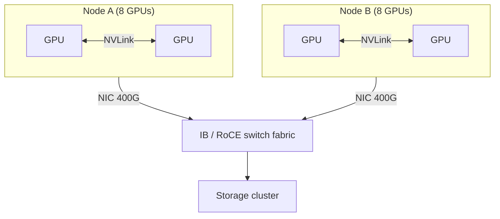
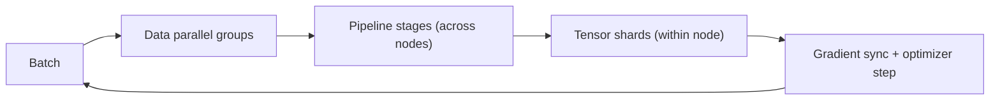

## The big idea

Training a large neural network means repeating one loop billions of times: run a batch through the model (forward pass), compute how wrong it was and how to adjust every parameter (backward pass), then update the parameters (optimizer step). A model with 70 billion parameters, plus the state needed to update it, doesn't fit on one GPU. The compute needed would take decades on one GPU anyway. So the work is cut up and spread across many GPUs, which must constantly exchange results.

Think of a distributed database that is too big and too busy for one node. You can replicate it and split the read traffic (data parallelism). You can partition it by key range (sharding, much like tensor and pipeline parallelism). Either way, nodes must agree on state, so network bandwidth and node failures become first-order design constraints. A training job has the same shape. The difference is that it is a tightly synchronized batch computation: every step ends with a barrier where all GPUs must agree on the new weights. One slow link or one dead GPU stalls everyone.

So the whole discipline comes down to three questions. What do we split? What must we communicate because of that split? And what do we do when a part of the cluster dies?

## Why it matters

Frontier-scale models cannot be trained any other way. Even for smaller models, a 7B-parameter fine-tune can exceed one GPU's memory once you count gradients and optimizer state. Engineers meet this in three places:

- **Capacity planning:** how many GPUs, with how much memory, on what network.
- **Debugging throughput:** a job at 30% of expected speed is usually bottlenecked by communication, data loading or stragglers, not by the math.
- **Operations:** jobs run for weeks, and storage teams are asked to absorb checkpoint bursts of hundreds of gigabytes to terabytes.

Without this understanding, you get clusters whose expensive GPUs sit idle waiting on a congested network, jobs that run out of memory at scale, and week-long runs that lose days of progress to one bad node. GPUs are the most expensive resource in the building, and every idle second costs real money.

## How it works

### GPU basics: memory and compute

A GPU has two resources that matter here.

- **Compute:** thousands of arithmetic units, plus specialized matrix-multiply units (Tensor Cores) that do most of the work. Training mostly uses low-precision formats such as bf16 (16-bit "brain float") or FP8, because they are faster and smaller.
- **Memory:** high-bandwidth memory (HBM), stacked DRAM on the GPU package. An H100 has 80 GB of HBM3 with roughly 3.35 TB/s of bandwidth. Newer parts have more capacity, but the principle holds: it is small compared with the model.

HBM capacity is usually the first wall you hit. Training with the Adam optimizer in mixed precision stores roughly this per parameter:

| Item | Bytes per parameter |
|---|---|
| bf16 weights | 2 |
| bf16 gradients | 2 |
| fp32 master copy of weights | 4 |
| Adam momentum (fp32) | 4 |
| Adam variance (fp32) | 4 |
| **Total (before activations)** | **~16** |

*Activations* are the intermediate values saved during the forward pass for use in the backward pass. They come on top of the 16 bytes and scale with batch size and sequence length. A common trick, *activation checkpointing* (recomputing them instead of storing them), trades extra compute for memory. Don't confuse it with the fault-tolerance checkpoints discussed later.

So 16 bytes × 70B parameters = 1.12 TB of training state, which is about 14 H100s' worth of memory before any activations.

### Cluster topology and interconnects

A typical building block is a node with 8 GPUs. Inside the node, GPUs talk over **NVLink**, a high-bandwidth GPU-to-GPU interconnect (hundreds of GB/s per GPU, about 900 GB/s on H100, higher on newer generations), usually through NVSwitch chips so any GPU can reach any other. Between nodes, traffic goes through network cards (NICs) onto a fabric:

- **InfiniBand (IB):** a purpose-built, lossless fabric with RDMA (remote direct memory access, where a NIC reads or writes another machine's memory without involving its CPU). A 400 Gb/s NDR port is about 50 GB/s.
- **RoCE (RDMA over Converged Ethernet):** RDMA over Ethernet. It is cheaper and familiar, but it needs careful congestion control and tuning to behave like a lossless fabric.

The gap matters: intra-node bandwidth is roughly an order of magnitude higher than per-GPU inter-node bandwidth. Clusters are typically wired as a multi-tier fat-tree or similar topology, and big ones are often "rail-optimized" so that GPU *k* on every node connects to the same leaf switch.

The same fabric, or a separate one, also carries checkpoint and dataset traffic to storage, so training traffic and storage traffic can compete.

### Collective communication

GPUs rarely send point-to-point messages. They use **collectives**, operations that involve a whole group:

- **All-reduce:** every GPU contributes a tensor and every GPU receives the sum. This is used to average gradients.
- **All-gather:** every GPU holds a shard, and every GPU ends up with the full tensor.
- **Reduce-scatter:** the data is summed and each GPU receives one shard of the result.

An all-reduce is equivalent to a reduce-scatter followed by an all-gather. In a ring all-reduce over N GPUs, each GPU sends and receives about 2(N−1)/N times the tensor size, which is close to 2× regardless of N. That's why bandwidth, not GPU count, sets the cost. Libraries such as NCCL implement these over NVLink and IB/RoCE.

### Data parallelism (DP)

Every GPU holds a **full copy** of the model and processes a different slice of the batch. After the backward pass, an all-reduce averages the gradients, so all replicas apply the same update and stay identical. It's the simplest strategy and scales well, but each GPU must hold the whole model and its state. The analogy is full replication with synchronous writes: simple, but each replica pays the full storage cost.

### Tensor parallelism (TP)

A single layer's weight matrix is split across GPUs. Each GPU multiplies its piece, and partial results are combined with collectives *inside every layer*, on both the forward and backward pass. That's a lot of frequent, latency-sensitive communication, so TP is normally kept **within a node** over NVLink, typically degree 2 to 8.

### Pipeline parallelism (PP)

Consecutive layers are grouped into **stages**, each on a different GPU or group. A batch is split into **microbatches** that flow through the stages like an assembly line. The communication is modest, because it only passes activations between neighboring stages, so PP tolerates slower inter-node links. The cost is the **pipeline bubble**: idle time while the pipeline fills and drains. More microbatches and interleaved schedules shrink the bubble.

### Sharded optimizers: ZeRO and FSDP

Plain DP wastes memory because every replica stores identical weights, gradients and optimizer state. **ZeRO** (Zero Redundancy Optimizer) removes that redundancy by sharding across the data-parallel group:

| Stage | What is sharded | Rough effect |
|---|---|---|
| ZeRO-1 | Optimizer state | Saves the largest chunk (12 of 16 bytes/param) |
| ZeRO-2 | + gradients | Gradients become reduce-scatter instead of all-reduce |
| ZeRO-3 | + parameters | Per-GPU state falls roughly as 1/N |

With ZeRO-3, a GPU doesn't hold the full weights. Right before a layer runs, an all-gather reassembles that layer's weights, and they are freed again right after. That adds communication in exchange for large memory savings. PyTorch's **FSDP** (Fully Sharded Data Parallel) implements essentially the same idea natively. Intuitively, it is like sharding a database that was previously fully replicated: each node keeps one slice and fetches the others on demand.

### Combining them: "3D parallelism"

Large runs combine all of these. A common layout puts TP inside a node, PP across nodes in a group, and DP (often with sharding) across groups. Total GPUs = TP × PP × DP. The Megatron-LM paper reported training a 1-trillion-parameter model on 3,072 GPUs at about 52% of theoretical peak by combining the three. That figure is a useful reminder that even excellent runs leave much of the peak unused.

### Failures and checkpointing

At scale, the mean time between failures (MTBF) of the *whole job* is roughly the per-component MTBF divided by the number of components. Meta's Llama 3 report describes a 54-day stretch of 405B pre-training on 16,384 H100s with 466 job interruptions, 419 of them unexpected. Most unexpected ones were hardware, led by GPU and HBM3 faults, with network switches and cables also contributing. That's one unexpected interruption roughly every three hours. Meta reported over 90% effective training time because automation handled most recoveries.

A **checkpoint** is a saved snapshot of everything needed to resume: weights, optimizer state, step counter, learning-rate schedule, random-number and data-loader positions. After a failure, the job restarts from the latest checkpoint and loses only the work since then. Practical points:

- With sharded training, each rank writes its own shard in parallel (for example PyTorch's Distributed Checkpoint). This is a write burst from thousands of clients at once.
- **Asynchronous checkpointing** copies state to host memory quickly and writes to storage in the background, so GPUs resume sooner.
- A checkpoint must be consistent and atomic: either all shards of step *N* are complete, or the previous checkpoint is still the one used. This is the same discipline as any snapshot or commit protocol.
- **Resharding on load** lets you restart on a different number of GPUs, which matters when a node is gone.

## A worked example

Take a 70B-parameter model trained on 1,024 GPUs (128 nodes × 8) with FSDP-style sharding.

**Memory.** Training state is 70B × 16 bytes = 1.12 TB. Sharded evenly over 1,024 GPUs, that's 1.12 TB / 1,024 ≈ 1.1 GB per GPU, which leaves most of the 80 GB for activations and temporary all-gathered layer weights. Unsharded DP would need 1.12 TB per GPU, which is impossible. In practice you'd use a smaller sharding group plus TP or PP to reduce communication, but the arithmetic shows why sharding is essential.

**Communication.** Take a smaller case to see the scale: gradients for a 7B model in bf16 are 14 GB. A ring all-reduce moves about 2 × 14 = 28 GB per GPU per step. At an effective 50 GB/s per GPU (one 400 Gb/s NIC), that is 28 / 50 ≈ 0.56 s. If compute for a step is about 2 s and communication overlaps with the backward pass, you hide most of it. If the network delivers only a quarter of that, 0.56 s becomes 2.24 s, communication now exceeds compute, and your GPUs idle. This is why the network matters.

**Checkpoint size.** Saving weights (bf16 plus fp32 master) and Adam state is about 2 + 4 + 8 = 14 bytes per parameter, or 70B × 14 = 980 GB. Say about 1 TB. At 20 GB/s aggregate write bandwidth that takes 1,000 / 20 = 50 s. At 200 GB/s it takes 5 s. With 1,024 ranks writing, each rank writes about 1 GB.

**Checkpoint interval.** Suppose the job's MTBF is 3 hours (10,800 s), like the Llama 3 figure, and a checkpoint stalls training for C = 60 s. The Young/Daly rule of thumb for the optimal interval is √(2 × C × MTBF) = √(2 × 60 × 10,800) = √1,296,000 ≈ 1,138 s, about 19 minutes. Overhead is then about 60 / 1,138 ≈ 5% for checkpoint stalls, plus on average about half an interval (~9.5 minutes) of lost work per failure, which is about 5% of the 3-hour MTBF. Making checkpoints faster (say C = 10 s) moves the optimum to about 465 s and cuts both costs. This is why async checkpointing and fast storage pay off directly in GPU-hours.

## Common pitfalls and misconceptions

- **"More GPUs means proportionally faster."** Communication and pipeline bubbles grow with scale. Measure scaling efficiency (such as MFU, model FLOPs utilization) instead of assuming it. Good large runs sit well below 100%, with roughly 40–55% commonly reported.
- **"Compute is the bottleneck."** Often it's memory capacity, memory bandwidth or the network. Profile before buying.
- **Putting tensor parallelism across slow links.** Keep TP within NVLink domains, and put the least chatty traffic (DP, PP) across the slower fabric.
- **Ignoring stragglers.** Synchronous steps run at the speed of the slowest GPU or link. One degraded NIC or a thermally throttled GPU can slow thousands.
- **Confusing activation checkpointing with fault-tolerance checkpoints.** One recomputes within a step to save memory. The other saves state to durable storage to survive failures.
- **Treating checkpoints as an afterthought.** An unverified, non-atomic or too-infrequent checkpoint turns a node failure into days of lost work. Test restores, including onto a different GPU count.
- **Assuming one recipe is final.** Parallelism libraries are changing fast. For example, PyTorch's original FSDP is now being superseded by FSDP2, so check current docs.

## How it connects

This lesson is the compute-and-network half of the picture. Training jobs are fed by datasets, which need high-throughput, shuffled, parallel reads, and they produce large checkpoints in synchronized bursts. Both are the focus of [Storage for AI: datasets, checkpoints and data pipelines](../storage-for-ai/). Later lessons cover moving, replicating and protecting those artifacts, then serving the trained model, where many of the same ideas (tensor and pipeline parallelism, memory limits, interconnect bandwidth) reappear under latency constraints.

For storage engineers, the analogies hold well. Sharded state is partitioning, DP replicas are synchronous replication, a checkpoint is a consistent snapshot, and a restart is crash recovery. What's new is the scale of the write bursts and the cost of every idle GPU-second.

## Check your understanding

**1. Why does a 7B-parameter model often not fit for training on a single 80 GB GPU, even though its bf16 weights are only 14 GB?**

Show answer

Training also needs gradients, an fp32 master copy of the weights, and two Adam optimizer states, about 16 bytes per parameter in total. For 7B parameters that is roughly 112 GB, before counting activations. Weights alone are a small part of the footprint.

**2. You have 8-GPU nodes connected by a 400 Gb/s fabric. Where would you place tensor-parallel groups, and why?**

Show answer

Within a single node, over NVLink. Tensor parallelism requires collectives in every layer on both forward and backward passes, so it is very sensitive to latency and bandwidth. NVLink offers much higher bandwidth than a single inter-node NIC. Data and pipeline parallelism communicate less often, so they can go across nodes.

**3. How does ZeRO-3/FSDP reduce memory, and what does it cost?**

Show answer

It shards parameters, gradients and optimizer state across the data-parallel group, so each GPU stores roughly 1/N of the state. The cost is extra communication: each layer's weights must be all-gathered just before use and freed after, and gradients are reduce-scattered. You trade network bandwidth for memory, which pays off only if the network can keep up or the communication overlaps with compute.

**4. A job on a large cluster sees an unexpected interruption about every 3 hours, and a checkpoint stalls training for 60 s. Roughly how often should you checkpoint, and what would you change to checkpoint more often?**

Show answer

The Young/Daly estimate is √(2 × 60 s × 10,800 s) ≈ 1,140 s, about every 19 minutes. To checkpoint more often at the same overhead, reduce the stall time with asynchronous checkpointing, parallel per-rank writes and faster storage. Since the optimum scales with the square root of the stall time, a shorter stall makes both overhead and lost work smaller.

**5. Your 1,024-GPU job runs at far lower throughput than a 128-GPU run of the same model. List what you'd check first.**

Show answer

Check whether communication is now exposed instead of overlapped, by looking at all-reduce, all-gather and reduce-scatter times in a profiler. Check the network for congestion, a degraded link or a misconfigured RoCE or IB setup. Check for stragglers, such as one slow GPU or node, and for pipeline bubbles from too few microbatches. Also check whether the data pipeline or storage reads can keep up at the larger scale.

## Further reading

- [ZeRO: Memory Optimizations Toward Training Trillion Parameter Models (Rajbhandari et al.)](https://arxiv.org/abs/1910.02054): the original paper on sharding optimizer state, gradients and parameters.
- [Efficient Large-Scale Language Model Training on GPU Clusters Using Megatron-LM (Narayanan et al.)](https://arxiv.org/abs/2104.04473): how tensor, pipeline and data parallelism combine to scale to thousands of GPUs.
- [The Llama 3 Herd of Models (Meta)](https://arxiv.org/abs/2407.21783): includes the infrastructure section with cluster details and the failure and interruption statistics for a 16K-GPU run.
- [Getting Started with FSDP (PyTorch tutorial)](https://docs.pytorch.org/tutorials/intermediate/FSDP1_tutorial.html): official walkthrough of FSDP. The page notes FSDP1 is deprecated in favor of FSDP2, so check for the newer tutorial.
- [Introducing PyTorch Fully Sharded Data Parallel](https://pytorch.org/blog/introducing-pytorch-fully-sharded-data-parallel/): the PyTorch team's explanation of the design and motivation.
- [PyTorch Distributed Checkpoint (torch.distributed.checkpoint)](https://docs.pytorch.org/docs/2.9/distributed.checkpoint.html): official documentation on parallel, resharding-capable checkpoint save and load. API names change between releases, so match the docs to your version.
