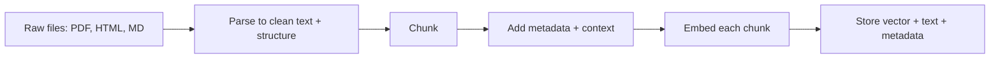
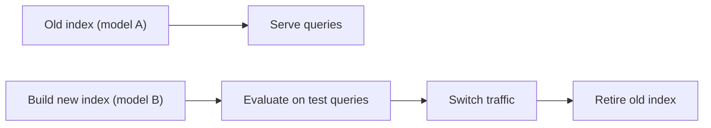

## The big idea

RAG (see [What RAG is, and when to use it](../what-is-rag/)) works by finding the few pieces of your data that are relevant to a question and handing them to a language model. Before you can search, you have to prepare the data in two steps. First, cut documents into pieces called **chunks**. Second, convert each chunk into an **embedding**, a list of numbers (a vector) that encodes its meaning.

An analogy from storage: think of chunking as choosing your **block size**, and embedding as computing a **content-derived index key**. Block size is a trade-off you know well. Blocks that are too large waste I/O on irrelevant bytes. Blocks that are too small blow up metadata and lose locality. Chunks work the same way. Large chunks dilute a specific fact among unrelated text, so the vector becomes a blurry average. Tiny chunks lose the context that makes a fact interpretable. Unlike a hash, though, the embedding key is *semantic*: similar meanings produce nearby keys, which is what makes "find text about this idea" a lookup problem.

Most RAG failures that look like "the model hallucinated" are really "the right text was never retrieved," and the cause often lies here. A table split in half, a PDF whose columns were read in the wrong order, or a chunk saying "revenue grew 3%" without naming the company will each fail silently.

## Why it matters

Language models can't read your whole corpus on every request. It's too large, too slow, and too expensive. Retrieval narrows it to a handful of passages, and the quality of that narrowing depends almost entirely on how the data was prepared.

You'll meet this in practice whenever you build a support bot over docs, a code assistant, or search over contracts and tickets. Typical failures without care:

- **Answers missing from the retrieved set** because the relevant sentence was separated from the sentence that gave it meaning.
- **Irrelevant context crowding the prompt** because chunks are huge and mostly noise. Models also use long contexts unevenly: information in the middle is used less reliably ([Liu et al., "Lost in the Middle"](https://arxiv.org/abs/2307.03172)).
- **Garbled source text** from PDF extraction, which no embedding model can repair.
- **Surprise bills and downtime** when you must re-embed millions of chunks because you switched models.

## How it works

The whole preparation pipeline (often called **ingestion** or indexing) looks like this:



Retrieval, the next stage, is covered in lesson 3. Here we make sure what goes into the store is good.

### What an embedding model does

An **embedding model** is a neural network trained so that text with similar meaning maps to nearby points in a high-dimensional space. Models such as Sentence-BERT ([Reimers & Gurevych, 2019](https://arxiv.org/abs/1908.10084)) popularized this: encode each text once, independently, then compare vectors cheaply. The output is a vector of fixed length (the **dimension**), commonly somewhere from 384 to a few thousand numbers, regardless of input length.

Key properties:

- **Fixed input limit.** Each model accepts a maximum number of tokens. Text beyond that is truncated, or the call fails, depending on the provider.
- **Encoded once.** Chunks are embedded at ingestion. Only the query is embedded at request time.
- **Model-specific space.** Dimension 1024 from model A and dimension 1024 from model B are unrelated coordinate systems.
- **Some models use query and document prefixes or modes.** Check the model's documentation, because skipping a required prefix quietly degrades results.

### Cosine similarity

To compare a query vector **q** and a chunk vector **d**, the usual measure is **cosine similarity**: the cosine of the angle between them.

```
cos(q, d) = (q · d) / (‖q‖ · ‖d‖)
```

It ranges from -1 to 1. Higher means more similar in direction, and vector length is ignored. Many embedding models output unit-length vectors (‖v‖ = 1), in which case cosine similarity equals the plain dot product, which is faster. Note that scores are **relative, not absolute**: 0.78 means little by itself, and what matters is how it ranks against other chunks. Score distributions differ per model, so don't copy thresholds between models.

### Chunking: size and overlap

**Chunk size** is how much text each piece holds, measured in tokens or characters. **Overlap** is how much text consecutive chunks share, so a sentence cut at a boundary appears whole in at least one chunk.

| Choice | Benefit | Cost |
|---|---|---|
| Smaller chunks (100-300 tokens) | Precise matches, less noise per chunk | Lost context, more vectors to store and search |
| Larger chunks (800-1500 tokens) | Keeps context together, fewer vectors | Diluted embeddings, more prompt tokens per hit |
| More overlap (10-20%) | Fewer facts cut in half | More storage, duplicate hits in results |
| No overlap | Smallest index | Boundary losses |

There is no universally best size. A range of 200-800 tokens with 10-15% overlap is a common starting point, but the right value depends on your documents, your questions, and your embedding model. Treat it as a hyperparameter and measure it (lesson 4 covers evaluation). A common refinement is to retrieve on small chunks but pass the surrounding section to the LLM, which gives precise matching and ample context.

Naive fixed-size splitting looks like this:

```python
def split(tokens, size=500, overlap=60):
    step = size - overlap
    return [tokens[i:i+size] for i in range(0, len(tokens), step)]
```

It's simple, but it will happily cut through a sentence, a table, or a function.

### Structure-aware chunking

Documents have structure, and respecting it usually beats character counting.

- **Headings and sections.** Split on headings first, then subdivide only sections that exceed the size limit. Keep the heading path (for example, "Billing > Refunds > Time limits") with each chunk.
- **Paragraph and sentence boundaries.** If you must subdivide, split at paragraph breaks, then sentences. "Recursive" splitters in popular libraries do this by trying a list of separators in order.
- **Tables.** Keep a table whole when it fits. If it doesn't, split by rows and repeat the header row in each chunk. A row like `| 42 | 3.1% |` is meaningless without its column names.
- **Code.** Split on function or class boundaries, ideally using a parser, and keep the signature, docstring, and file path with the body.
- **Lists and procedures.** Keep numbered steps together. Step 4 alone is rarely useful.

### Metadata

**Metadata** is structured data stored next to each chunk: source URL or file, title, section path, author, date, document type, access-control group, language, version. It does three jobs:

1. **Filtering.** "Only docs for product v3, updated after 2025" narrows the search before similarity ranking. This is far more reliable than hoping the embedding captures it.
2. **Security.** Store permission groups and filter on them at query time, so users never retrieve text they can't read.
3. **Citations and debugging.** You can show where an answer came from and trace bad retrievals to their source.

### Contextual chunk enrichment

A chunk like "Revenue grew 3% over the previous quarter" is ambiguous in isolation. **Contextual enrichment** fixes this by prepending a short, chunk-specific description (for example, "From ACME Corp's Q2 2023 SEC filing, discussing revenue") before embedding. Anthropic's [Contextual Retrieval](https://www.anthropic.com/news/contextual-retrieval) technique has an LLM read the whole document plus each chunk and write that context, typically 50-100 tokens. They report that it reduces failed retrievals substantially when combined with keyword search and reranking. Those are vendor-reported figures on their own test sets, so measure on your data. Cheaper alternatives include prepending the document title and heading path, which needs no LLM calls.

### Re-embedding when models change

Because each model defines its own vector space, you **cannot mix** vectors from two models in one index, and you can't embed the query with a new model against old document vectors. Changing the model, or sometimes just its dimension, means re-embedding everything. Some models are trained with Matryoshka Representation Learning ([Kusupati et al., 2022](https://arxiv.org/abs/2205.13147)), so their leading dimensions can be truncated to a smaller usable vector. That helps with storage cost, but it doesn't make different models compatible.

A safe migration is like a zero-downtime schema change:



Store the model name and version as metadata on the index, keep the original text so you never need to re-parse, and run old and new indexes side by side until evaluation says the new one is better.

### Document parsing pitfalls

Parsing happens before chunking, and errors here propagate silently.

- **PDFs are a layout format, not a text format.** They store glyph positions, not paragraphs. Extraction may interleave multi-column text, scramble reading order, or include headers, footers, and page numbers in the middle of sentences.
- **Scanned PDFs** contain only images and need OCR (optical character recognition), which introduces its own errors, especially on poor scans.
- **Tables** often flatten into a stream of numbers with no row/column structure. Use a layout-aware parser or a vision-capable model, and output tables as Markdown, HTML, or CSV-like text.
- **Boilerplate**, such as navigation menus in HTML, cookie banners, and repeated legal footers, pollutes embeddings and matches many queries equally.
- **Images and charts** carry information that plain text extraction drops entirely.

Parsing tools differ a lot in quality and change quickly. Always inspect extracted text from a sample of your real documents before building anything on top.

## A worked example

Scenario: a 20,000-page internal knowledge base, averaging 500 tokens per page, which is 10M tokens total.

**Chunking.** With 500-token chunks and 60-token overlap, the step is 440 tokens. Chunks ≈ 10,000,000 / 440 ≈ 22,700. Without overlap, it would be 20,000. So overlap costs about 13.6% more chunks.

**Embedding tokens.** Each chunk is 500 tokens, so 22,700 × 500 ≈ 11.4M tokens to embed. At an illustrative price of $0.10 per million tokens (check your provider's real price), that's about $1.14. Embedding is cheap.

**Storage.** With 1024-dimension float32 vectors: 1024 × 4 bytes = 4,096 bytes per vector. 22,700 × 4,096 ≈ 93 MB of raw vectors, before index overhead. Using 256 truncated dimensions on a model that supports it would cut this to about 23 MB.

**Contextual enrichment.** Adding 100 tokens of context per chunk grows each embedded chunk to about 600 tokens, so embedding costs rise about 20%. The larger cost is the LLM call to *generate* the context: each call reads the document plus the chunk. Anthropic's article estimates about $1.02 per million document tokens with prompt caching, under their assumptions (800-token chunks, 8k-token documents). That would be roughly $10 for our 10M tokens, though your numbers will differ with different chunk sizes and models.

**Model change.** Re-embedding means paying roughly the same $1.14 again, plus rebuilding the index and re-running evaluation. For a 10M-token corpus that's trivial. At 10B tokens (1000× more), it's about $1,140 in embedding fees, but also hours of throughput time, rate limits, and a parallel index that doubles storage during the cutover. That's why you plan the migration rather than discovering it.

**What goes wrong without structure.** Suppose a pricing table has 40 rows and 6 columns, about 1,200 tokens. A fixed 500-token split cuts it into three pieces, and only the first contains the header. The query "price of the Pro plan in EU" retrieves a middle piece full of numbers with no column labels, and the LLM guesses. Splitting by rows and repeating the header in each chunk fixes it.

## Common pitfalls and misconceptions

- **"Embeddings understand everything."** They capture topical similarity well but can miss exact identifiers, error codes, negation, and numbers. Keyword search often complements them (lesson 3).
- **"Pick the chunk size once and forget it."** Test several sizes against real questions. Optimal size varies by corpus.
- **"More overlap is always safer."** Heavy overlap inflates the index and fills results with near-duplicates. Keep it modest.
- **Skipping parsing inspection.** Print the extracted text for a dozen real files. Garbled reading order is much cheaper to catch now than after launch.
- **Dropping metadata.** Without it you can't filter by version, enforce permissions, or cite sources.
- **Mixing embedding models** in one index, or using a different model for queries than for documents. Record the model version with the index.
- **Treating similarity scores as probabilities.** A score of 0.8 doesn't mean "80% relevant." Compare ranks, not absolute numbers.
- **Exceeding the model's token limit.** Silent truncation means the end of a long chunk is never embedded.
- **Not keeping raw text.** If you store only vectors, every model change forces a re-parse of the source files.

## How it connects

- **Lesson 1, [What RAG is, and when to use it](../what-is-rag/):** This lesson is the "indexing" half of the pipeline introduced there.
- **Lesson 3 (vector search and retrieval):** Once chunks are embedded, approximate nearest neighbor (ANN) indexes, hybrid keyword-plus-vector search, and reranking turn the vectors into ranked results. Contextual enrichment pairs naturally with those techniques.
- **Lesson 4 (evaluating and debugging):** Chunk size, overlap, and parsing choices are tested there with retrieval metrics. Most "bad answer" investigations end up back at these choices.
- **Lesson 5 (advanced RAG):** GraphRAG and agentic retrieval build on well-prepared chunks and metadata.
- **Systems parallel:** Treat the ingestion pipeline like an ETL job with versioned outputs. It needs idempotent re-runs, incremental updates when source documents change, deletion handling (stale chunks must go), and migration plans, just like any derived index or replica.

## Check your understanding

**1. Your retrieval returns chunks that are topically right but the LLM answers with the wrong product's pricing. What chunk-level fixes would you try?**
<details><summary>Show answer</summary>

Chunks probably lack identifying context. Prepend the product name and heading path (or generated contextual text) to each chunk before embedding, and store product and version as metadata so you can filter at query time. For tables, repeat headers in each chunk.

</details>

**2. Why can't you embed new documents with a newer model and keep searching the old vectors?**
<details><summary>Show answer</summary>

Each model defines its own vector space, so coordinates from different models have no shared meaning, and similarity scores between them are meaningless. Queries must use the same model as the documents. Upgrading means re-embedding the corpus, ideally into a parallel index that you validate before switching traffic.

</details>

**3. A teammate sets chunk size to 2,000 tokens "so nothing gets cut." What problems might this cause?**
<details><summary>Show answer</summary>

Each vector summarizes a lot of mixed content, so specific queries match less sharply. Each retrieved hit also consumes much more of the prompt, leaving room for fewer distinct sources. The chunk may also exceed the embedding model's token limit and get truncated. Test smaller chunks or retrieve small and expand to the parent section.

</details>

**4. Why is cosine similarity often equivalent to a dot product, and why does that matter?**
<details><summary>Show answer</summary>

If vectors are normalized to unit length, the denominator in the cosine formula is 1, leaving only the dot product. Dot products are cheaper to compute, which matters when comparing a query against millions of vectors. Check whether your model normalizes its output, and normalize yourself if it doesn't.

</details>

**5. A scanned PDF yields retrieval results that look like random numbers. Where do you investigate first?**
<details><summary>Show answer</summary>

Start at parsing, not embedding. Inspect the extracted text for OCR errors, scrambled column order, or flattened tables. If the text is bad, no chunking or embedding strategy will fix it. Use a better OCR or layout-aware parser, then re-chunk.

</details>

## Further reading

- [Sentence-BERT: Sentence Embeddings using Siamese BERT-Networks (Reimers & Gurevych, 2019)](https://arxiv.org/abs/1908.10084): the paper that made encoding text once and comparing by cosine similarity practical.
- [Introducing Contextual Retrieval (Anthropic)](https://www.anthropic.com/news/contextual-retrieval): the contextual chunk enrichment technique, with cost estimates and results.
- [Matryoshka Representation Learning (Kusupati et al., 2022)](https://arxiv.org/abs/2205.13147): how embeddings can be trained so truncated versions remain usable, reducing storage and search cost.
- [Lost in the Middle: How Language Models Use Long Contexts (Liu et al., 2023)](https://arxiv.org/abs/2307.03172): evidence for why stuffing the prompt with large or many chunks hurts.
