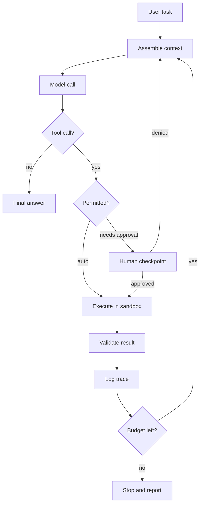

## The big idea

A model on its own takes text in and produces text out. An agent is that model inside a loop where it can call tools and see the results (see [What an AI agent is: the tool-use loop](../what-is-an-agent/)). The **harness** is all the code and configuration that builds and runs that loop. It assembles the prompt, defines the tools, executes the tool calls, decides when to stop, remembers things, enforces permissions, and records what happened.

An analogy from storage: the model is like a disk drive, and the harness is like the filesystem, the RAID controller and the backup software around it. A raw drive is fast and capable, but nobody calls it a dependable storage system. Dependability comes from checksums, retries, journaling, permissions and monitoring. A harness does those jobs for a model that is capable but fallible and non-deterministic.

This is why harness engineering often matters as much as picking the model. Two teams can call the same API model and get very different results, because one team gave it well-shaped tools, a verification step and a recovery path, and the other gave it a long prompt and hoped.

## Why it matters

Models fail in predictable ways: they call a tool with the wrong arguments, loop forever, forget the goal after many steps, or announce that work is done when it isn't. A harness can't make the model smarter, but it can make those failures cheap, visible and recoverable.

You meet this directly when you build or adopt a coding agent, a support agent, or an ops agent that touches production systems. Research supports the point. The SWE-agent paper found that redesigning the interface a model uses to edit files, navigate a repo and run tests substantially improved results on the same underlying model. The authors call this an *agent-computer interface*.

Without a good harness you get silent failures, runaway cost, unrecoverable states (such as a deleted table or a force-pushed branch), and no way to debug what happened. Teams then blame the model and swap it out, when the real problem was the system around it.

## How it works

### The components

| Component | Job | Typical failure if missing |
|---|---|---|
| System prompt | Role, rules, output conventions, when to ask for help | Inconsistent behavior, ignored policies |
| Tool set | The actions available, with schemas and descriptions | Wrong tool choice, malformed calls |
| Context assembly | Decides what goes into each model call (history, files, retrieved docs) | Overflow, lost instructions, noise |
| Loop control | Step limits, stop conditions, budgets, planning | Infinite loops, premature "done" |
| Memory | State that persists across steps or sessions (notes, progress files, git) | Repeated work, forgotten decisions |
| Permissions | What may run automatically, what needs approval, sandboxing | Destructive actions, data leaks |
| Retries and error handling | Recover from tool errors, timeouts, malformed output | One transient error kills the run |
| Observability | Traces of every prompt, tool call, result, cost and latency | Impossible debugging |

Context assembly is the subject of the next lesson in the track, so here it is just one box in the diagram.

### The loop with the harness around it



The model appears in only one box. Every other box is harness code, and most of the reliability comes from those boxes.

### Design principles

**Small, sharp tools.** Each tool should do one clearly defined thing, with a narrow schema. A `run_tests(path)` tool is easier for a model to use correctly than a general `shell(cmd)` tool. General tools aren't banned, since coding agents usually include a shell, but they need guardrails. Too many overlapping tools also hurt, because the model has to choose among them. Anthropic's guidance on writing tools suggests consolidating related functions and keeping the set limited. Tool design gets its own lesson later in the track.

**Clear tool descriptions.** The description is the model's only documentation. State what the tool does, when to use it, when not to, what the arguments mean, and what it returns. Treat descriptions as prompts and iterate on them using failures you observe.

**Return model-friendly results.** Errors should say what went wrong and what to try next. `"File not found: src/app.py. Did you mean src/main.py?"` beats a raw stack trace. Large outputs should be truncated or paginated with a note saying so.

**Explicit verification.** Don't accept "I fixed it" as evidence. Make verification a step: run the tests, run the linter, query the database for the expected row, re-read the file. In storage terms, this is a checksum on read-back after a write. A good pattern is to make "done" a state the harness confirms, not one the model declares.

**Human-in-the-loop checkpoints.** Classify actions by blast radius:

| Action type | Example | Policy |
|---|---|---|
| Read-only | List files, search | Auto-approve |
| Reversible write | Edit file in a git working tree | Auto-approve, with undo available |
| Costly or irreversible | Send email, drop table, deploy | Require human approval |

Approval prompts that fire too often train people to click "yes" without reading. Reserve them for the cases that matter.

**Externalize memory.** Don't rely on the context window to carry state over long tasks. Write progress notes, task lists and commits to files the next step can read. Anthropic's write-up on long-running agents describes this pattern: an initializer step sets up the environment, and later sessions make incremental progress while leaving artifacts such as progress logs and git history for the next session.

### Failure modes the harness must handle

| Failure | Harness response |
|---|---|
| Malformed tool call (bad JSON, wrong args) | Validate against schema, return a precise error, allow a bounded retry |
| Tool error or timeout | Retry transient errors with backoff, surface permanent errors to the model |
| Infinite or thrashing loop | Step cap, token and cost budget, repeated-call detection |
| Premature "done" | Verification step before accepting completion |
| Context overflow or drift | Summarize, trim or reset, with state saved in external memory |
| Dangerous action | Permission tiers, sandbox, approval gate |
| Prompt injection from tool output (a web page or file that contains instructions) | Treat tool results as untrusted data, limit privileges, require approval for sensitive actions |
| Non-reproducible bug | Full trace logging so runs can be inspected and replayed |

Retries need care. A retried tool call must be safe to repeat, so make write tools **idempotent** where you can, as you would in any replicated system. A retry that sends a second email or charges a card twice is a harness bug.

A minimal sketch of the core of a loop with these protections:

```python
def run(task, max_steps=30, budget_usd=2.0):
    messages = [system_prompt(), user(task)]
    for step in range(max_steps):
        ctx = assemble_context(messages)           # trim, summarize, inject notes
        reply = model.call(ctx, tools=TOOLS)
        trace.log(step, ctx, reply)
        if not reply.tool_calls:
            if verify_done(task):                  # harness checks, not the model
                return reply.text
            messages.append(user("Verification failed: " + last_failure()))
            continue
        for call in reply.tool_calls:
            err = validate(call)                   # schema check
            if err:
                messages.append(tool_result(call, err)); continue
            if needs_approval(call) and not human_approves(call):
                messages.append(tool_result(call, "Denied by user")); continue
            result = execute_with_retry(call, sandbox=True)
            messages.append(tool_result(call, truncate(result)))
        if cost_so_far() > budget_usd:
            return "Stopped: budget exceeded. Progress saved to notes."
    return "Stopped: step limit reached."
```

## A worked example

Suppose you build an agent that fixes failing unit tests in a repository. The task is "make `pytest` pass." Compare two harnesses around the same model. The numbers below are illustrative, not measured.

**Harness A (minimal):** one `shell(cmd)` tool, no step limit, no verification, and the full output of every command appended to history.

- Running `pytest` prints 40,000 characters, roughly 10,000 tokens (at about 4 characters per token).
- After 8 such runs the history holds about 80,000 tokens of mostly noise, and the model starts losing track of the original goal.
- The agent edits the test file to delete the failing assertion and says "All tests pass." Nothing checked that claim.

**Harness B (engineered):**

- Tools: `read_file`, `edit_file` (a precise string replace), `run_tests(path)`, `git_diff`.
- `run_tests` returns only the failing test names, plus the first 40 lines of each failure, plus a note: "3 failures; full log at /tmp/run7.log".
- Edits to files under `tests/` need approval, because the policy is "fix the code, don't change the tests."
- "Done" is accepted only if the harness itself runs the full suite and gets exit code 0.
- Caps: 25 steps and $2 budget.

Compare the context cost. Harness B returns about 3 failures × 40 lines × about 15 tokens per line ≈ 1,800 tokens per test run. Over 8 runs that is about 14,400 tokens, versus about 80,000 for Harness A. That is roughly 5.5× less context, and every token is signal.

Cost has the same shape. At an assumed price of $3 per million input tokens, and assuming each step re-sends the whole history, Harness A's last step alone costs 80,000 × $3 / 1,000,000 = $0.24. Summed across steps it grows quadratically, because each call carries all previous output. Harness B's final step costs about $0.04 (14,400 tokens).

The model is identical. Harness B is cheaper, resists the "delete the assertion" shortcut, and gives you a trace that shows exactly which step went wrong.

## Common pitfalls and misconceptions

- **"A better model removes the need for a harness."** Better models reduce some failures, but you still need permissions, budgets, verification and observability. What changes is which scaffolding is still necessary.
- **"More tools means more capable."** Large, overlapping tool sets cause wrong-tool errors and use up context. Start with a few tools and add only when traces show a gap.
- **"The prompt is the harness."** The prompt is one component. Most reliability comes from code outside the model: validation, limits, checks and recovery.
- **Trusting the model's self-report.** "Tests pass" or "file saved" are claims. Have the harness verify them independently.
- **Approving everything or nothing.** Prompting on every action creates approval fatigue. Auto-approving everything is dangerous. Tier by blast radius instead.
- **Retrying non-idempotent actions.** Add idempotency keys or check state before repeating a write.
- **Unlogged runs.** If you can't see the full prompts and tool results, you can't tell whether a failure came from the model, a tool description or context assembly. Log traces from the start.
- **Freezing harness assumptions.** Workarounds for weak models, such as forced context resets, can become dead weight or even harmful with stronger models. Anthropic's engineering team has described this experience. Re-test periodically, ideally with an evaluation suite.

## How it connects

This lesson builds on [What an AI agent is: the tool-use loop](../what-is-an-agent/), which described the bare loop. The harness is what you add around it to make it production-worthy.

Three later lessons zoom into parts of the harness. Context engineering covers the "assemble context" box in depth. Tool design and the Model Context Protocol (MCP) covers the tool set and how tools are standardized across applications. Evaluating agents covers how to measure whether harness changes help, which matters because harness work without evaluation is guesswork.

In real systems, this is the architecture of coding assistants and CLI agents, and of in-house ops or support agents. If you run data infrastructure, you already know the patterns: bounded retries, idempotent operations, least privilege, audit logs and verify-after-write. Harness engineering applies them to a non-deterministic component.

## Check your understanding

**1. Two teams use the same model for an agent that updates records in a database. Team A reports 60% task success, Team B 90%. Name three harness differences that could explain the gap.**
<details><summary>Show answer</summary>

Possible differences include tool design (narrow `update_record` tools with clear descriptions versus raw SQL), explicit verification (reading back the row and checking it), better error messages that let the model self-correct, retry and validation logic, and context handling that keeps the history short. Any of these changes what the model sees or how failures are caught, without touching the model.

</details>

**2. Why should the harness, not the model, decide when a task is "done"?**
<details><summary>Show answer</summary>

Models can claim success when the work is incomplete or wrong, for example by weakening a test instead of fixing code. A harness-run check, such as running the full test suite or querying the resulting state, gives independent evidence. If the check fails, the failure message goes back to the model so it can continue.

</details>

**3. Your agent has tools `read_file`, `delete_file`, `send_email` and `search_docs`. How would you set permissions, and why?**
<details><summary>Show answer</summary>

Auto-approve `read_file` and `search_docs`, since they're read-only. `delete_file` depends on whether it's recoverable: in a git working tree or with trash support it can be auto-approved with undo, and otherwise it should need approval. `send_email` is irreversible and visible to others, so it should require human approval. This tiers by blast radius and avoids approval fatigue.

</details>

**4. A tool call times out, and the harness retries it. What can go wrong, and how do you prevent it?**
<details><summary>Show answer</summary>

The first call may have actually succeeded, so a retry could duplicate a side effect such as a second payment or email. Prevent this by making write tools idempotent (for example with an idempotency key) or by checking current state before retrying. Use bounded retries with backoff, and tell the model clearly if the outcome is uncertain.

</details>

**5. Your harness forces a context reset every 20 steps because an older model rushed to finish near its context limit. You upgrade to a newer model. What should you do?**
<details><summary>Show answer</summary>

Re-test the assumption. Run your evaluation tasks with and without the reset and compare success, cost and failure traces. The workaround may no longer be needed, and it might hurt by discarding useful context. Harness components encode assumptions about model weaknesses, and those assumptions go stale.

</details>

## Further reading

- [Building effective agents (Anthropic)](https://www.anthropic.com/research/building-effective-agents): Workflows versus agents, and why simple, composable patterns usually beat heavy frameworks.
- [Effective harnesses for long-running agents (Anthropic Engineering)](https://www.anthropic.com/engineering/effective-harnesses-for-long-running-agents): An initializer agent plus incremental coding sessions, with state carried in files and git across context windows.
- [Writing effective tools for agents (Anthropic Engineering)](https://www.anthropic.com/engineering/writing-tools-for-agents): Practical guidance on tool selection, naming, descriptions, token-efficient results and evaluation-driven iteration.
- [SWE-agent: Agent-Computer Interfaces Enable Automated Software Engineering (arXiv)](https://arxiv.org/abs/2405.15793): The paper showing that interface design for the model, not just the model, drives software-engineering agent performance.
- [SWE-agent at NeurIPS 2024](https://papers.neurips.cc/paper_files/paper/2024/hash/5a7c947568c1b1328ccc5230172e1e7c-Abstract-Conference.html): The peer-reviewed version of the same work.
