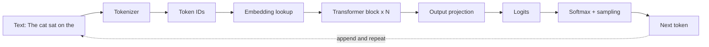
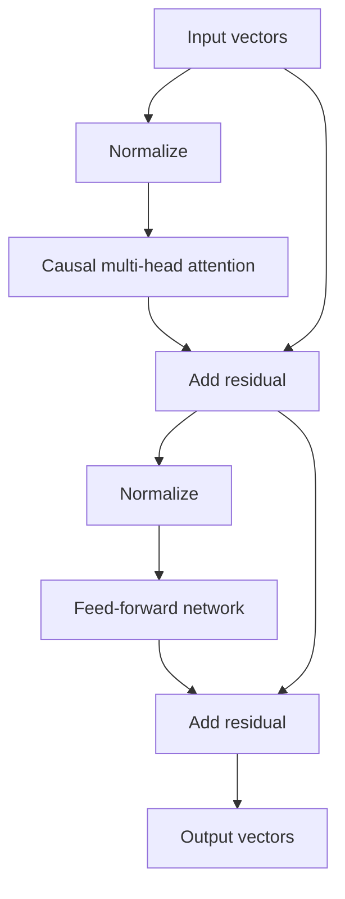

## The big idea

A large language model is a function that takes a sequence of tokens and returns a probability distribution over the next token. Everything else is machinery for computing that distribution well. If the input is "The cat sat on the" the model outputs something like "mat" 30%, "floor" 12%, "couch" 8%, and so on across its whole vocabulary. Pick one token, append it, and repeat. That loop produces essays, code and answers.

Think of a very well-read colleague finishing your sentence. They don't look up a stored answer. Over years of reading they built up a compressed sense of what tends to follow what, and they use it on your context. The weights of the model are that compressed sense.

An analogy from storage: tokenization is like chunking in a deduplicating backup system. You split a byte stream into reusable pieces, and common pieces get short IDs. Embeddings are like the metadata record for each chunk, but learned and dense, so that similar chunks sit near each other. Attention is like a read path where each position issues a query against an index of everything written so far and gets back a weighted blend of the matches.

Throughout this lesson we follow one prompt: **"The cat sat on the"**. The aim is a working mental model, not the full mathematics. Where the details are an active research area, I say so.

## Why it matters

If you build on LLMs, these mechanics show up in your bills and your bug reports:

- **Cost and latency are per token.** APIs charge for input and output tokens, and generation time grows with each output token. A prompt that looks short in characters can be long in tokens, especially with code, non-English text or unusual formats like long IDs and base64.
- **Limits are in tokens.** Context windows, output caps and rate limits are all counted in tokens, not characters or words.
- **Many "weird" behaviors trace back to tokenization.** Examples are trouble counting letters in a word, inconsistent arithmetic on long numbers, and sensitivity to whitespace and capitalization. The model sees chunks, not letters.
- **Output is probabilistic.** Without understanding logits and temperature, you can't reason about why the same prompt gives different answers, or why setting temperature to 0 helps reproducibility but doesn't guarantee it.

Without this model in your head, you end up treating the LLM as a black box. You can't estimate cost, can't explain failures, and can't tell which knobs are meaningful.

## How it works

Here is the whole pipeline for one forward pass.



### 1. Tokenization (byte-pair encoding)

A **token** is the unit of text the model reads and writes. It is usually a word, part of a word, or punctuation with its leading space. A **vocabulary** is the fixed list of all tokens, typically tens of thousands to a few hundred thousand entries.

Most modern LLMs build the vocabulary with **byte-pair encoding (BPE)**, or a close variant. The training procedure for the tokenizer is:

1. Start with a base vocabulary of single bytes (256 values) or characters.
2. Count how often each adjacent pair of tokens occurs in a large text corpus.
3. Merge the most frequent pair into a new token and record that merge rule.
4. Repeat until the vocabulary reaches the target size.

To tokenize new text, you apply the learned merges in order. Frequent strings like " the" become a single token. Rare strings fall back to smaller pieces, and in the worst case to raw bytes, so any input can be encoded.

Our prompt might tokenize like this (exact splits and IDs differ between models, so treat these as illustrative):

| Token | `The` | ` cat` | ` sat` | ` on` | ` the` |
|---|---|---|---|---|---|
| ID (made up) | 464 | 3797 | 3332 | 319 | 262 |

Note that the leading space is part of the token. `" the"` and `"the"` are different tokens with different IDs.

A rough rule for English prose is about 0.75 words per token, or about 4 characters per token. Code, non-Latin scripts and numbers often tokenize less efficiently. Always measure with the tokenizer of the model you actually use, because different model families use different vocabularies and the same text gives different counts.

### 2. Embeddings

An **embedding** is a vector (a list of floating-point numbers) that represents a token. The model has an **embedding matrix** of shape `vocab_size × d_model`. Token ID 3797 selects row 3797. Here `d_model` is the model's working width, such as 4096 in many mid-sized models.

These rows are learned during training. Tokens used in similar ways end up with similar vectors. Nothing hand-codes "cat is an animal". That structure emerges because it helps predict the next token.

Attention by itself has no sense of order, so the model also injects **position information**. Many current models use rotary position embeddings (RoPE), which rotate query and key vectors by position. Others add or learn position vectors. Details vary by model family.

After this step, our 5-token prompt is a matrix of shape `5 × d_model`.

### 3. Self-attention: query, key, value

**Self-attention** is the mechanism that lets each position gather information from other positions in the same sequence. For the final token " the", the model needs to know what came before: a cat, sitting, on something. Attention is how that information moves.

Each token's vector is projected by three learned matrices into three roles:

- **Query (Q):** "what am I looking for?"
- **Key (K):** "what do I contain, for matching purposes?"
- **Value (V):** "what information do I hand over if selected?"

For each position, the model does this:

1. Compare its query with the keys of all visible positions using a dot product. A higher score means a better match.
2. Scale the scores and apply **softmax** (explained below) to get weights that sum to 1.
3. Return the weighted sum of the value vectors.

In compact form: `Attention(Q,K,V) = softmax(QKᵀ / √d_k) · V`, where `d_k` is the key dimension.

This is the retrieval analogy made concrete: a soft, differentiable key-value lookup. Instead of returning exactly one record, it returns a blend weighted by match quality.

**Causal masking.** In a generative model, position *i* may only attend to positions ≤ *i*. Future tokens are masked out by setting their scores to negative infinity before softmax. Without this, the model could cheat during training by reading the answer. It is the same reason a write-ahead log reader must not see records that haven't been written yet.

**Multi-head attention.** Instead of one attention operation, the model runs several in parallel, called **heads**. Each head has its own Q, K and V projections of smaller dimension, and the outputs are concatenated and mixed by another matrix. Different heads can specialize, for example one tracking nearby syntax and another linking pronouns to nouns. Researchers have found interpretable patterns in some heads, but not all heads are cleanly interpretable, and this is still an active area of study.

### 4. The decoder-only transformer stack

A **transformer block** has two main sublayers, each wrapped with a residual connection and normalization:



- **Attention** moves information *between* positions.
- The **feed-forward network (FFN)**, a small per-position neural network, transforms each position's vector *independently*. A large share of a model's parameters live here.
- **Residual connections** add each sublayer's input back to its output. Think of the vector as a running "workspace" that each layer reads and edits, rather than replaces. This makes very deep stacks trainable.
- **Normalization** (commonly LayerNorm or RMSNorm) keeps the numbers in a stable range.

A **decoder-only** model, the design behind GPT-style and most current chat LLMs, stacks N of these blocks, typically from a couple dozen to over a hundred layers depending on size. The original 2017 transformer had both an encoder and a decoder for translation. Most modern general-purpose LLMs dropped the encoder.

Many production models use variants, such as grouped-query attention, mixture-of-experts FFNs, or different activation functions. The skeleton above stays recognizable, but check the specific model's documentation for details.

### 5. Logits, softmax and temperature

After the last block, we take the vector at the **last position** (the one for " the"). The other positions' outputs matter for training, but at generation time only the last one predicts the next token. An output projection multiplies it by a `d_model × vocab_size` matrix (often tied to the embedding matrix) to produce one score per vocabulary entry. These raw scores are the **logits**.

**Softmax** turns logits into probabilities: `p_i = exp(z_i) / Σ_j exp(z_j)`. Every probability is positive and they sum to 1.

**Temperature** `T` divides the logits first: `softmax(z / T)`.

- `T < 1` sharpens the distribution, so the top choices dominate.
- `T = 1` leaves it unchanged.
- `T > 1` flattens it, so unlikely tokens get more chance.
- `T → 0` approaches always picking the top token (greedy decoding).

Strategies like top-k and top-p (nucleus) sampling further restrict which tokens can be picked. They are covered in the serving lesson.

### 6. The autoregressive loop

**Autoregressive** means each output becomes part of the next input:

```python
ids = tokenizer.encode("The cat sat on the")
while len(ids) < max_len:
    logits = model(ids)[-1]            # scores for the next token
    probs = softmax(logits / temperature)
    next_id = sample(probs)            # or argmax for greedy
    if next_id == EOS: break           # end-of-sequence token
    ids.append(next_id)
text = tokenizer.decode(ids)
```

This pseudocode recomputes everything each step, which is wasteful. Real systems cache the keys and values of earlier tokens so each step only processes the new one. That is the KV cache, covered in the inference and serving lesson of this track.

## A worked example

Let's cost out a small scenario: a support-bot request with a 1,200-word system prompt plus user question, and a 300-word answer.

**Token estimates** (using about 0.75 words per token):
- Input: 1,200 / 0.75 = 1,600 tokens
- Output: 300 / 0.75 = 400 tokens

**Price** (hypothetical: $3 per million input tokens, $15 per million output tokens; output is commonly priced several times higher than input):
- Input: 1,600 × $3 / 1,000,000 = $0.0048
- Output: 400 × $15 / 1,000,000 = $0.0060
- Total: about $0.0108 per request, or about $10,800 per million requests

**Latency** (hypothetical: 0.4 s to process the prompt, then 40 tokens/s generation):
- Generation: 400 / 40 = 10 s
- Total: about 10.4 s

Output tokens dominate both cost (56% here) and latency (about 96%). Why? Because the prompt is processed in one parallel pass, while each output token needs its own sequential forward pass.

**Now the tokenization effect.** Suppose the user pastes 1,000 characters of JSON with many UUIDs. Prose would be about 250 tokens at 4 characters per token. UUIDs and punctuation tokenize poorly, so maybe 1 token per 2 characters, giving about 500 tokens. That's twice the estimate, and why measuring beats guessing.

**Tracing "The cat sat on the":**
1. Tokenize into 5 IDs.
2. Embed into a `5 × d_model` matrix. With `d_model = 4096`, that's 20,480 numbers.
3. Pass through, say, 32 blocks. In each, " the" attends over the 5 positions and picks up that a cat sat, so something it can sit on is expected.
4. Take the last position's vector and project to the vocabulary. With a 100,000-token vocabulary, that's 100,000 logits.
5. Softmax gives, for example, " mat" 0.30, " floor" 0.12, " couch" 0.08, and the remainder spread thinly.
6. At `T = 0.2` " mat" would dominate. At `T = 1.5` the choice spreads more widely. Sample, append, and run again.

## Common pitfalls and misconceptions

- **"Tokens are words."** They aren't. Use the actual tokenizer for counts and don't assume equal counts across providers or model versions.
- **"The model sees letters."** It sees token chunks, which is why character-level tasks like counting letters or reversing strings are error-prone. Spell out characters or use code tools when exactness matters.
- **"The model looks up facts in a database."** Knowledge is stored implicitly in the weights. This is why it can state wrong things fluently. Use retrieval or tools for facts that must be correct.
- **"Attention means it understands what's important."** Attention weights are a mechanism, not a reliable explanation. Interpreting them as explanations is debated in the research literature.
- **"Temperature 0 is fully deterministic."** It selects the top token, but floating-point nondeterminism, batching effects and provider-side changes can still cause variation.
- **"Temperature adds creativity."** It only reshapes the probabilities of the model's own distribution. It can't add knowledge.
- **"Longer prompts only cost more money."** Attention compares every token against every earlier token, so compute and memory grow with context length. The context window lesson covers this.

## How it connects

This lesson covers a single forward pass with fixed weights. The rest of the track fills in the surrounding questions:

- **Where do the weights come from?** See [Training an LLM: pretraining, fine-tuning and preference tuning](../training-llms/). Training is next-token prediction on huge corpora, followed by tuning for instructions and preferences.
- **How do you run the loop cheaply?** The inference and serving lesson covers sampling strategies, the KV cache and batching.
- **How much can the model look at?** The context windows lesson covers what fits, the cost of attention at length, and how well models actually use long inputs.
- **Can the model think longer?** The reasoning models lesson covers spending more generated tokens to improve answers.

For systems engineers, the useful framing is that an LLM service is a stateful, sequential, memory-bound pipeline. The model weights are a huge read-only dataset, the KV cache is per-request state, and token counts are the unit of capacity planning.

## Check your understanding

**1. Why does a short-looking string of UUIDs or base64 cost more than the same number of characters of English prose?**
<details><summary>Show answer</summary>

BPE merges are learned from frequent patterns in the training corpus. English words appear constantly and become single tokens, while random-looking strings have no frequent patterns and split into many short tokens or bytes. More tokens means higher cost, more context used and more generation steps.

</details>

**2. In self-attention, what do queries, keys and values each do, and why is causal masking needed in a generative model?**
<details><summary>Show answer</summary>

A query is compared with every key to produce match scores. Softmax turns the scores into weights, and those weights blend the value vectors into the output. Causal masking stops a position from attending to later tokens. Without it, training would let the model read the very token it's supposed to predict, and it would learn nothing useful for generation.

</details>

**3. Output tokens are generated one at a time, but the prompt is processed in parallel. What does this imply for latency?**
<details><summary>Show answer</summary>

Prompt tokens are known up front, so their attention can be computed in one parallel pass. Output tokens depend on the previous output token, so each needs its own sequential forward pass. Latency therefore scales mostly with the number of generated tokens, and shortening outputs usually speeds up a response more than shortening the prompt.

</details>

**4. You lower temperature from 1.0 to 0.3. What happens to the logits and to the probabilities, and what doesn't change?**
<details><summary>Show answer</summary>

The logits are divided by 0.3 before softmax, which stretches the gaps between them. The top token gets a larger share of the probability, and the distribution is sharper. The model's ranking of tokens does not change, and neither does what it knows. You've only changed how greedily you pick from the same ranking.

</details>

**5. Why does a decoder-only model use only the last position's output vector when generating?**
<details><summary>Show answer</summary>

Each position's output predicts the token that follows it, and earlier positions already have known next tokens (the rest of the prompt). Only the last position predicts something unknown. Thanks to causal masking, the last position has already gathered information from all earlier positions through attention, so its vector summarizes what's needed.

</details>

## Further reading

- [Attention Is All You Need (Vaswani et al., 2017)](https://arxiv.org/abs/1706.03762): the original transformer paper, which introduced scaled dot-product and multi-head attention.
- [Neural Machine Translation of Rare Words with Subword Units (Sennrich et al., 2016)](https://arxiv.org/abs/1508.07909): the paper that brought byte-pair encoding to neural language tasks.
- [The Illustrated Transformer (Jay Alammar)](https://jalammar.github.io/illustrated-transformer/): a widely used visual walkthrough of the architecture.
- [Hugging Face LLM Course: Byte-Pair Encoding tokenization](https://huggingface.co/learn/llm-course/chapter6/5): a step-by-step BPE training example with code.
- [Let's Build the GPT Tokenizer, written version (fast.ai)](https://www.fast.ai/posts/2025-10-16-karpathy-tokenizers): a text version of Andrej Karpathy's lecture, including the tokenization quirks that explain odd model behavior.
