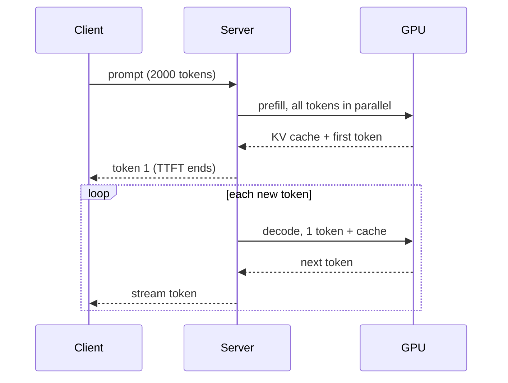
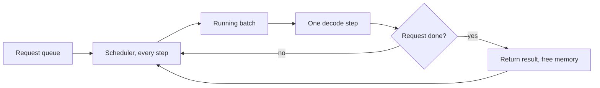

## The big idea

A language model produces text one token at a time. Each new token depends on all the tokens before it, so you can't compute them in parallel. To produce 500 tokens, the model runs 500 sequential forward passes. (If tokens and the transformer are new to you, start with [How LLMs work: tokens, embeddings and the transformer](../how-llms-work/).)

Every one of those passes needs the full set of model weights, often 16 GB or more. The GPU streams all of them out of memory to produce a single token. The arithmetic per byte is tiny, so the chip's compute units sit mostly idle, waiting on memory.

Think of a database doing a full table scan to answer one single-row lookup. The scan is the expensive part, not the answer. The fix is the same as in storage systems: amortize the scan. Serve many queries per pass (batching), keep hot data in a structure that avoids rescanning (the KV cache), and shrink the data (quantization). Most of LLM serving is a set of variations on those three moves.

## Why it matters

Training is a one-off cost. Serving is the bill you pay on every request, forever. For most products, inference dominates total spend, and it determines whether a feature feels instant or sluggish.

Engineers meet this in several ways:

- **Out-of-memory errors** when context length or concurrency rises, even though the model "fits".
- **Throughput that falls** when a few long requests share a GPU with many short ones.
- **Latency numbers that look fine on average** but have bad tails.
- **Per-token prices** that differ widely between providers and between input and output tokens.

Without these techniques, a naive server would run one request at a time, recompute the whole history for each token, and waste most of the GPU. Utilization and cost per token would be many times worse.

## How it works

### Two phases: prefill and decode

A request goes through two distinct phases.

- **Prefill** processes the entire prompt at once. All prompt tokens go through the model in parallel, and the model builds the KV cache for them. It ends by producing the first output token.
- **Decode** generates the remaining tokens one by one. Each step feeds in only the newest token, reads the cache for everything before it, and produces the next token.



The phases behave differently:

| | Prefill | Decode |
|---|---|---|
| Tokens per pass | Thousands (the prompt) | One per request |
| Bottleneck | Compute (FLOPs) | Memory bandwidth |
| Determines | TTFT | Per-token speed |
| GPU utilization | High | Low unless batched |

### Why decode is memory-bandwidth bound

A **FLOP** is one floating-point operation. A forward pass costs roughly 2 FLOPs per model parameter per token. In 16-bit precision, each parameter is 2 bytes, so a batch-1 decode step does about 1 FLOP per byte read from memory.

Modern GPUs can do hundreds of FLOPs for every byte they can fetch. An H100, for example, has roughly 1,000 TFLOPS of dense 16-bit compute and about 3.35 TB/s of memory bandwidth. That ratio is about 300 FLOPs per byte, which is the point where a workload switches from memory-bound to compute-bound. Batch-1 decode sits at about 1, far below it.

The consequence is a simple speed ceiling:

> tokens/sec per request ≈ memory bandwidth ÷ bytes read per token

Prefill reuses each weight across thousands of prompt tokens, so it lands on the compute-bound side of that threshold.

### The KV cache

Attention lets each token look at all earlier tokens. For each token at each layer, the model computes a **key** and a **value** vector. A new token's **query** is compared against all earlier keys to decide how much of each earlier value to mix in.

Past tokens' keys and values never change, because the model is causal and tokens only look backwards. So we save them. This saved state is the **KV cache**. Without it, every decode step would reprocess the whole history. With it, each step computes keys and values for one new token and reads the rest.

The cost is memory. Per token, the cache holds:

> 2 (K and V) × layers × KV heads × head dim × bytes per value

Models using **grouped-query attention (GQA)** share each KV head across several query heads. That cuts the cache several-fold compared with full multi-head attention. It is now standard in most open models.

### Sampling strategies

The final layer outputs a score (a **logit**) for every vocabulary token. A softmax turns these into probabilities, and the server then picks one token. The main options:

| Strategy | What it does | Trade-off |
|---|---|---|
| Greedy | Always take the top token | Deterministic but can loop or be dull |
| Temperature | Divide logits by T before softmax; T<1 sharpens, T>1 flattens | Controls randomness |
| Top-k | Sample only among the k most likely tokens | Fixed cutoff ignores how peaked the distribution is |
| Top-p (nucleus) | Sample from the smallest set whose probability sums to p | Adapts to the distribution's shape |
| Min-p | Drop tokens below a fraction of the top token's probability | Newer, popular in open-source stacks |
| Beam search | Track several candidate sequences | Good for translation, usually worse for open-ended chat |

```python
import numpy as np

def sample(logits, temperature=0.8, top_p=0.9):
    z = logits / temperature
    p = np.exp(z - z.max()); p /= p.sum()
    order = np.argsort(-p)
    cum = np.cumsum(p[order])
    keep = order[: np.searchsorted(cum, top_p) + 1]  # nucleus
    q = p[keep] / p[keep].sum()
    return np.random.choice(keep, p=q)
```

Sampling is cheap compared with the model pass. Even at temperature 0, outputs can differ between runs. Batch composition changes the order of floating-point operations, and floating-point addition isn't associative.

### Batching: static, then continuous

Batching is the main lever on decode cost. With a batch of B requests, the server reads the weights once and produces B tokens. Throughput grows almost linearly with B until the GPU becomes compute-bound or the KV cache fills memory.

**Static batching** groups requests and runs them until the slowest one finishes. Finished requests leave idle slots, and new arrivals wait for the whole batch. It's like a bus that won't let anyone on or off until the final stop.

**Continuous batching** (also called iteration-level scheduling, introduced in the Orca paper) re-forms the batch at every decode step. Finished requests leave immediately and waiting ones join. The GPU stays full and queueing time drops.



### PagedAttention

Each request's KV cache grows unpredictably, because nobody knows the output length in advance. Early servers reserved a contiguous block sized for the maximum length, which caused heavy internal and external fragmentation. The vLLM paper reports that existing systems wasted a large share of KV memory this way.

**PagedAttention** borrows from OS virtual memory. The cache is split into fixed-size blocks (say 16 tokens). A per-request block table maps logical positions to physical blocks anywhere in GPU memory. Blocks are allocated on demand and freed when the request finishes. A side benefit is sharing: requests with the same prompt prefix, such as a system prompt, can point at the same physical blocks. This is like copy-on-write pages.

More usable memory means a bigger batch, which means higher throughput. The paper reports 2–4× over prior systems at similar latency, though results depend on workload.

### Quantization

**Quantization** stores numbers in fewer bits. Weights go from 16-bit to 8-bit or 4-bit integers or low-precision floats. Fewer bytes per weight means less to read per token, which directly lifts the bandwidth-bound ceiling. It also lets bigger models fit on a GPU.

- **Weight-only** methods (GPTQ, AWQ) shrink weights and dequantize on the fly. They help decode most.
- **Weight and activation** quantization (for example FP8 on recent GPUs) also speeds up compute-bound work such as prefill.
- **KV cache quantization** stores the cache in 8 bits or fewer, so more concurrent sequences fit.

Quantization is lossy. 8-bit is usually near-lossless, while 4-bit typically costs a small quality drop that varies by model and task. Test on your own workload.

### Speculative decoding

If decode is memory-bound, verifying several tokens in one pass costs almost the same as generating one. So:

1. A small, fast **draft model** proposes, say, 4 tokens.
2. The large **target model** scores all 4 positions in a single parallel pass.
3. A rejection-sampling rule accepts the longest prefix consistent with the target's distribution, and the target supplies one corrected token at the first rejection.

The output distribution matches what the target would have produced alone, so quality is unchanged. The speedup depends on the acceptance rate. Typical reports are 2–3×, and gains shrink at large batch sizes, where the GPU is no longer idle. Variants avoid a separate draft model, using extra prediction heads or n-gram lookups from the prompt.

### Latency metrics and cost

| Metric | Meaning | Mostly driven by |
|---|---|---|
| TTFT | Time from request to first token | Queueing + prefill |
| TPOT / ITL | Time per output token (inter-token latency) | Decode step time |
| Tokens/sec (per user) | 1 ÷ TPOT | Bandwidth, batch size |
| Throughput (per GPU) | Total tokens/sec across all requests | Batch size, memory |
| Cost per token | GPU $/sec ÷ throughput | Utilization |

There is a fundamental tension. Bigger batches raise throughput and lower cost, but each step takes longer, so per-user speed drops. Serving teams pick a point on this curve to match their service-level objectives. Prefill also stalls decode when it shares a GPU. That's why many systems use **chunked prefill** or split prefill and decode onto separate machines (**disaggregated serving**).

## A worked example

Take an 8B-parameter model with GQA, similar to Llama 3 8B. It has 32 layers, 8 KV heads, head dim 128, and 16-bit values. It runs on one 80 GB GPU with 3.35 TB/s bandwidth. The numbers below are idealized ceilings. Real systems reach a fraction of them.

**Weights:** 8×10⁹ × 2 bytes = 16 GB.

**KV cache per token:**
2 × 32 layers × 8 heads × 128 dim × 2 bytes = 131,072 bytes = 128 KiB.

**Per sequence:**
- 8,192 tokens × 128 KiB = 1 GiB.
- Without GQA (32 KV heads), it would be 4 GiB.

**Capacity:** Reserve about 4 GB for activations and overhead. That leaves 80 − 16 − 4 = 60 GB of cache, or roughly 55 sequences at 8k context. At 32k context each sequence takes 4 GiB, so only about 14 fit. Memory limits concurrency before compute does.

**Batch-1 decode ceiling:**
3.35×10¹² ÷ 16×10⁹ ≈ 209 tokens/sec.

**Batch-32 decode** (each at 8k context):
- Bytes per step: 16 GB weights + 32 × 1.07 GB cache ≈ 50 GB.
- Step time: 50 GB ÷ 3.35 TB/s ≈ 15 ms.
- Throughput: 32 tokens ÷ 0.015 s ≈ 2,100 tokens/sec. That is about 10× the batch-1 figure. Each user sees about 67 tokens/sec instead of 209.

**Cost**, assuming $3 per GPU-hour ($0.000833/sec):
- Batch 1: 0.000833 ÷ 209 ≈ $4.0 per million tokens.
- Batch 32: 0.000833 ÷ 2,100 ≈ $0.40 per million tokens.

Batching cuts cost 10× while per-user speed drops by about two-thirds.

**Prefill for a 2,000-token prompt:**
- FLOPs: 2 × 8×10⁹ × 2,000 = 3.2×10¹³.
- At about 500 TFLOPS achieved: 3.2×10¹³ ÷ 5×10¹⁴ ≈ 64 ms of compute.

So TTFT is on the order of 100 ms with queueing and overhead. Notice that the KV cache read dominates at batch 32 (34 of the 50 GB). Quantizing the cache to 8 bits would cut that part in half. In this example, the step would drop from 15 ms to about 11 ms.

## Common pitfalls and misconceptions

- **"More FLOPs means faster generation."** Decode is bandwidth-bound. Compare memory bandwidth first, and FLOPs second.
- **"If the weights fit, the model fits."** The KV cache grows with context length times concurrency. Budget for it explicitly.
- **"Temperature 0 is fully deterministic."** Batching and kernel nondeterminism can still change outputs. Don't build tests that assume bit-exact text.
- **Looking only at average throughput.** Track TTFT and inter-token latency at p95/p99. A system that's cheap per token can still feel slow.
- **Assuming quantization is free.** Evaluate on your tasks, especially for 4-bit and for long-context or code workloads.
- **Expecting speculative decoding to always help.** Gains shrink at high batch sizes or when the draft model is a poor match.
- **Ignoring prefix reuse.** Long shared system prompts are a big win with prefix caching. Put stable content first in prompts to benefit.
- **Treating input and output tokens as equivalent.** Input tokens go through parallel prefill, while output tokens are sequential decode steps. This is why providers often price them differently.

## How it connects

This lesson builds on the architecture in [How LLMs work: tokens, embeddings and the transformer](../how-llms-work/). The KV cache exists because of how attention works, and the memory formula depends on layer count, head layout and dimensions. Training happens once and is compute-bound. [Training an LLM: pretraining, fine-tuning and preference tuning](../training-llms/) covers that side, where the cost profile is very different.

The next lesson, on context windows, builds directly on the cache math here. Long context is expensive mostly because cache size and attention reads scale with sequence length. The lesson after that, on reasoning models, depends on decode economics. Models that "think" for thousands of tokens spend their budget in the memory-bound loop described above.

Storage engineers will see familiar patterns. PagedAttention is paging and copy-on-write. Continuous batching is request scheduling. Prefix caching is content-addressed deduplication. Disaggregated serving is the same separation of workloads you see between OLTP and analytics.

## Check your understanding

**1. Why does a batch-1 decode step use only a small fraction of a GPU's compute capability?**
<details><summary>Show answer</summary>

Each step must read all the weights (and the KV cache) from memory but performs only about 1 FLOP per byte read. The GPU's compute-to-bandwidth ratio is around 300 FLOPs per byte, so the compute units wait on memory. Batching raises the FLOPs done per byte of weights read.

</details>

**2. A model's weights take 40 GB on an 80 GB GPU, and the KV cache is 160 KiB per token. Roughly how many 4k-token sequences can run concurrently, ignoring other overhead?**
<details><summary>Show answer</summary>

There are about 40 GB of free memory. One sequence needs 4,096 × 160 KiB = 640 MiB, which is about 0.67 GB. That gives roughly 60 sequences. In practice, activations and fragmentation reduce this, which is why PagedAttention matters.

</details>

**3. Why does continuous batching improve throughput compared with static batching when requests have varied output lengths?**
<details><summary>Show answer</summary>

In static batching, short requests finish early and their slots sit idle until the longest one ends. New requests also wait for the whole batch. Continuous batching re-forms the batch at each step, so freed slots are refilled right away and the GPU keeps a full batch.

</details>

**4. Speculative decoding verifies several draft tokens in one target-model pass. Why doesn't that change the output distribution, and when does it stop helping?**
<details><summary>Show answer</summary>

Accepted tokens are chosen with a rejection-sampling rule that provably matches the target model's distribution, and the target corrects the first rejected token. It stops helping when the acceptance rate is low, or when batches are large enough that the GPU is compute-bound. Then the extra verification work is no longer free.

</details>

**5. You halve the weight precision from 16-bit to 8-bit. What do you expect for batch-1 decode speed, and why might long-context batch decode improve less?**
<details><summary>Show answer</summary>

Batch-1 decode is dominated by weight reads, so it should speed up by up to about 2×. At long context and large batches, KV cache reads make up a large share of the bytes moved. Unless the cache is also quantized, the total bytes drop by much less than half.

</details>

## Further reading

- [Efficient Memory Management for Large Language Model Serving with PagedAttention](https://arxiv.org/abs/2309.06180): the vLLM paper (SOSP 2023), covering paged KV cache management and its throughput results.
- [Orca: A Distributed Serving System for Transformer-Based Generative Models](https://www.usenix.org/conference/osdi22/presentation/yu): the OSDI 2022 paper that introduced iteration-level scheduling, now called continuous batching.
- [Fast Inference from Transformers via Speculative Decoding](https://arxiv.org/abs/2211.17192): Leviathan, Kalman and Matias on draft-and-verify decoding that preserves the output distribution.
- [The Curious Case of Neural Text Degeneration](https://arxiv.org/abs/1904.09751): the paper that introduced nucleus (top-p) sampling and explains why greedy and beam search degrade open-ended text.
- [AWQ: Activation-aware Weight Quantization for LLM Compression and Acceleration](https://arxiv.org/abs/2306.00978): a widely used 4-bit weight-only quantization method.
