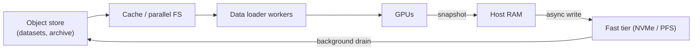
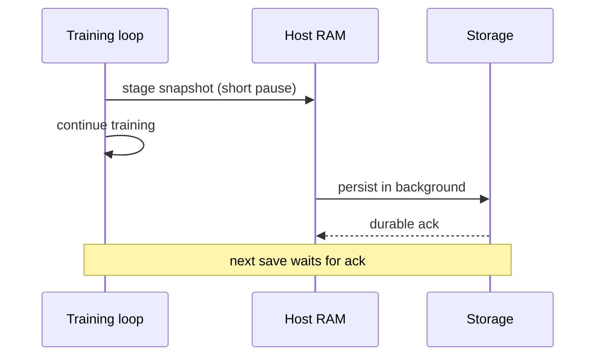

## The big idea

Training reads a huge dataset over and over, and every so often it saves its whole brain to disk. Storage sees two opposite workloads from one job. Between checkpoints it serves a steady, read-heavy, shuffled stream of samples to thousands of data-loader workers. At checkpoint time, every GPU wants to write its slice of the model state at once.

Think of a database with a heavy random-read workload that gets a full-cluster snapshot dumped on it every 30 minutes, with the compute fleet idle until the snapshot is durable. A synchronous snapshot means a stall. The engineering is mostly about turning that stall into a background job.

The money is in the GPUs. If a 1,024-GPU cluster costs about $2,000/hour, 10 idle seconds per step is a real cost. Storage rarely makes training faster, but it can easily make it slower. Its job is to never be the bottleneck and to be durable enough that a failure costs minutes, not days.

## Why it matters

**Starvation.** If the data pipeline can't deliver the next batch before the GPU finishes the current one, the GPU waits. This is *GPU starvation*, and it shows up as low utilization with no obvious error. Image, video and multimodal training are especially exposed.

**Failure is routine.** At thousands of GPUs, hardware faults, link flaps and preemptions happen often (see [AI training infrastructure: GPUs, networking and parallelism](../ai-training-infrastructure/)). Checkpoints bound how much work a failure destroys. Checkpoint too rarely and you lose hours of cluster time per fault. Checkpoint synchronously and too often, and the checkpoints themselves eat your throughput.

**Without these patterns:**
- Thousands of workers hit a metadata server with millions of tiny `open()` calls.
- Object-store request limits throttle you.
- A 1 TB checkpoint written through one node takes ages.
- Nobody can say which data version produced a model that regressed.

## How it works

### The two I/O patterns

| | Dataset reads | Checkpoint writes |
|---|---|---|
| Direction | Read-heavy | Write-heavy, then read on restart |
| Size per op | KBs to a few MBs | 100s of MB to GBs per rank |
| Access | Random (shuffled) | Sequential per file |
| Timing | Continuous, every step | Periodic, synchronized across all ranks |
| Bottleneck | IOPS, metadata, latency | Aggregate write bandwidth, durability |
| Failure cost | Slower training | Lost progress, or a corrupt restore |

Shuffling matters statistically (training wants i.i.d.-ish samples), so a naive loader turns a sequential dataset into random reads. Sharding formats (below) recover sequential access.

### Storage tiers

| Option | Strengths | Weaknesses | Typical role |
|---|---|---|---|
| **Parallel file system** (Lustre, IBM Storage Scale/GPFS, BeeGFS, WEKA, VAST, DDN and similar) | POSIX, high aggregate bandwidth, striping across many servers, good with many clients | Cost per TB, operational complexity, metadata scaling varies by product | Hot working set, checkpoints |
| **Object storage** (S3, GCS, Azure Blob, S3-compatible on-prem) | Cheap, durable, effectively unlimited capacity, easy to replicate | Higher per-request latency, request-rate limits, no in-place update, not POSIX | Source of truth for datasets, long-term checkpoints |
| **Local NVMe** | Lowest latency, no network | Lost with the node, small | Staging, cache, fast checkpoint tier |
| **Tiered cache** (a cache layer over object storage, such as Alluxio or vendor caches) | Object-store economics with file-system-like hot reads | Cache misses are slow, so warm-up and coherence matter | Dataset serving |

A common architecture has object storage as the durable source of truth and a fast tier in front of it for the working set. Checkpoints go to the fast tier first, then drain to object storage.



### Data loaders and starvation

A *data loader* is the CPU-side pipeline that reads raw samples, decodes them (JPEG, tokenization, augmentation), batches them and hands them to the GPU. Typically N worker processes per GPU prefetch batches into a queue.

Starvation happens when `read + decode + batch time > GPU step time`. The levers are:
- more workers and deeper prefetch
- cheaper decode (pre-tokenize, pre-resize)
- larger sequential reads
- a cache closer to the GPUs

*Sharded formats* such as WebDataset tar files or MosaicML's MDS pack thousands of samples into shards of roughly 100 MB to 1 GB. Workers read a whole shard sequentially. Shuffling happens at shard level plus an in-memory buffer, trading a bit of randomness for large sequential reads. Mosaic's `StreamingDataset` also supports deterministic shuffling and mid-epoch resumption.

### Checkpoint size math

A *checkpoint* is a snapshot of everything needed to resume training. With mixed-precision training and the Adam optimizer, per parameter you store:

- bf16 weights: 2 bytes
- fp32 master weights: 4 bytes
- Adam first moment: 4 bytes
- Adam second moment: 4 bytes

That totals **about 14 bytes per parameter**. Some setups also save extra state, so 12–16 is a reasonable planning range. The deployed model is only the 2-byte weights.

| Model | Parameters | Full checkpoint (~14 B/param) |
|---|---|---|
| 7B | 7 × 10⁹ | ~98 GB |
| 70B | 70 × 10⁹ | ~980 GB |
| 405B | 405 × 10⁹ | ~5.7 TB |

Checkpoints are *sharded*. Each rank writes only its own slice, so the write is parallel across nodes. PyTorch's Distributed Checkpoint (DCP) works this way, and it can reshard on load when the parallelism layout changes.

### Async and incremental checkpointing

**Synchronous** checkpointing blocks training until data is durable. **Asynchronous** checkpointing splits the work in two:

1. **Stage:** copy state from GPU memory to host RAM. This is fast (seconds or less) and training pauses briefly.
2. **Persist:** a background thread or process writes the host copy to storage while training continues.

This is the idea behind CheckFreq (a two-phase snapshot and persist, plus iteration-level frequency tuning) and PyTorch DCP's `async_save`, which returns futures for staging completion and upload completion. One caveat: a new checkpoint can't start staging until the previous persist finishes, or you will either block or drop it. So write time must stay below the checkpoint interval.



**Incremental** checkpointing writes only what changed since a baseline. Meta's Check-N-Run applies this to recommendation models, where only a fraction of huge embedding tables change per interval. It combines this with quantization and reports 6–17x lower write bandwidth. For dense LLMs, nearly all weights and optimizer state change every step, so incremental savings are much smaller. Dense models rely more on async, sharding and fast tiers.

A rough sketch of a restart-safe commit protocol:

```python
# Each rank writes its shard, then rank 0 commits atomically.
write(f"ckpt/step_{n}/rank_{r}.shard.tmp")   # data
fsync_and_rename(...)                         # per-rank durability
barrier()                                     # all ranks done
if rank == 0:
    write_atomic(f"ckpt/step_{n}/COMMIT", manifest_with_checksums)
# Loader only trusts directories that contain COMMIT.
```

If you have built replication or backup systems, this should look familiar. It is two-phase commit with a manifest. Never treat a partially written checkpoint as valid.

### Dataset versioning

Models are only reproducible if the data is. Practical approaches:

- **Immutable, content-addressed shards** with a manifest that lists shard IDs and checksums. A "dataset version" is a manifest.
- **Table-format snapshots** (Iceberg, Delta or Lance-style versions) for tabular and curated data, giving time travel and cheap diffs.
- **Recording the data-loader state** (shard order, seed, position) in the checkpoint, so resume doesn't repeat or skip samples. CheckFreq does this explicitly.
- **Lineage:** log dataset manifest hash, filter and dedup code versions and tokenizer version alongside each run.

The commonly used tools here are still evolving, and there is no single standard. The principle (immutable data plus a versioned manifest) is stable.

### How vendors position

Claims vary and are mostly marketing, so test with your own access pattern.

- **Parallel file system vendors** pitch very high aggregate throughput and metadata performance, GPU-direct data paths, and checkpoints at line rate.
- **Object store vendors** pitch cost, scale and durability. Newer low-latency tiers (for example S3 Express One Zone, which SageMaker supports for checkpoints) and client-side caching or connectors target the small-read and checkpoint gap.
- **Cache and tiering products** pitch object-store economics with hot-tier speed.
- Independent benchmarks exist (for example MLCommons' storage benchmark), but they model specific workloads, so check that they resemble yours.

## A worked example

**Setup:** 70B-parameter model, 1,024 GPUs across 128 nodes (8 GPUs each), checkpoint every 30 minutes.

**Checkpoint size:** 70 × 10⁹ × 14 B = 980 GB. Per node: 980 / 128 ≈ 7.7 GB.

**Option A: synchronous to object storage, ~5 GB/s aggregate.**
- Write time: 980 / 5 = 196 s.
- Overhead: 196 / 1,800 ≈ **10.9%** of wall-clock, wasted GPU time.
- At ~$2/GPU-hour, one checkpoint costs 1,024 × (196/3,600) × $2 ≈ **$111** of idle GPUs. Over 48 checkpoints a day, that's ~$5.3k/day.

**Option B: synchronous to a parallel FS, ~40 GB/s aggregate.**
- Write time: 980 / 40 = 24.5 s, overhead ≈ 1.4%.

**Option C: async, staging to host RAM, persisting to object storage.**
- Stage: 7.7 GB per node at ~20 GB/s effective GPU-to-host ≈ 0.4 s. Say about 1 s pause with overhead.
- Persist: 196 s in the background, well under the 1,800 s interval, so it never blocks the next save.
- Overhead: ~1 / 1,800 ≈ 0.06%.
- Cost: needs ≥ 7.7 GB spare host RAM per node, which is trivial on typical nodes.

**Failure cost:** on average you lose half the interval, 15 min. That's 1,024 × 0.25 h × $2 ≈ **$512** per failure, plus restart time. Halving the interval halves that loss but doubles the checkpoint traffic. Async makes the shorter interval affordable.

**Dataset side, for contrast:** a text run at 4M tokens/step and 10 s/step reads 400k tokens/s × 4 B = 1.6 MB/s, which is negligible. An image run at 1,000 images/s/GPU × 110 KB × 256 GPUs ≈ 28 GB/s, roughly 256k random reads/s if unsharded. Same cluster size, completely different storage problem. This is why text pretraining mostly stresses checkpoints, while vision and multimodal stress the read path.

## Common pitfalls and misconceptions

- **"Checkpoint size equals model size."** Optimizer and master weights make it about 6–7x the bf16 weights. Size your tiers for the full state.
- **"Async means free."** It costs host RAM and can still stall if persist is slower than the interval. Monitor persist time versus interval.
- **"Object storage is too slow for AI."** It works well with large sharded sequential reads, parallel requests and a cache. It fails with millions of tiny objects and per-sample GETs.
- **"One big file per checkpoint."** A single writer bottlenecks. Shard per rank, then manifest-commit.
- **Trusting incomplete checkpoints.** A crash mid-write can leave a partial directory. Use commit markers and checksums, and test restores regularly. An untested checkpoint is an unverified backup.
- **Ignoring loader state.** Resuming from the start of the epoch repeats data and skews training. Save and restore the position.
- **Saving the checkpoint only to local disk.** A node loss then loses it. Drain it to durable, off-node storage.
- **Assuming benchmarks transfer.** Vendor throughput figures often use large sequential I/O. Measure with your own sample sizes and client counts.
- **Mutable datasets.** Silently editing shards makes runs irreproducible. Write new versions.

## How it connects

- The previous lesson, [AI training infrastructure: GPUs, networking and parallelism](../ai-training-infrastructure/), explains why sharded state exists (data, tensor and pipeline parallelism). It also explains why failures are frequent at scale, which sets the checkpoint cadence discussed here.
- The next lesson in the track covers **data mobility**: replicating datasets and checkpoints across regions, tiering them and protecting them. The drain from fast tier to object store here is the first step of that.
- The serving lesson reads the same weights, but only the 2-byte copy. Load time and cold start are storage problems too.
- Vector database operations reuse the same durability concerns: snapshots, commit protocols and restore testing.
- If you build storage systems, many of these ideas are familiar: write-ahead commit markers, snapshots, tiering, cache warm-up and erasure-coded object stores. The AI-specific parts are the synchronized burst, the GPU cost of waiting and the data-order requirements.

## Check your understanding

**1. A team's 13B-parameter run writes a 26 GB checkpoint each save, but their storage team is surprised by a ~180 GB write. What most likely explains the gap?**
<details><summary>Show answer</summary>

The 26 GB figure is just bf16 weights (13B × 2 B). The training checkpoint also holds fp32 master weights and two Adam moments, about 14 B/parameter, or ~182 GB. The 180 GB write is expected. The 26 GB figure applies to the exported inference model.

</details>

**2. You switch from synchronous to async checkpointing and training pauses drop from 3 minutes to 2 seconds, but you later see occasional long stalls. What should you check?**
<details><summary>Show answer</summary>

Check whether the background persist takes longer than the checkpoint interval, or whether it overlaps the next save. Async saves typically need the prior persist to finish before staging the next, so slow storage or a throttled object store causes blocking. Compare persist duration to the interval, and either lengthen the interval, add bandwidth or use a faster intermediate tier.

</details>

**3. Why does sharding a dataset into 500 MB tar files typically improve throughput from object storage compared to one object per image, even though the same bytes are read?**
<details><summary>Show answer</summary>

Per-request overhead (latency, request-rate limits, metadata) dominates when objects are about 100 KB, while 500 MB objects allow large sequential streaming reads at high bandwidth. Shuffling is approximated with shard-level randomization plus a sample buffer, so you keep most of the statistical benefit and avoid millions of tiny GETs.

</details>

**4. Incremental checkpointing cut write volume by 10x for a recommendation model. Why might it give far smaller savings for a dense LLM?**
<details><summary>Show answer</summary>

Recommendation models have huge embedding tables where only the rows touched in an interval change. A dense LLM updates essentially all weights and optimizer state at every step, so almost everything is "dirty" and the delta is nearly the full checkpoint. Dense LLMs get more value from sharding, async persistence and fast storage tiers.

</details>

**5. After a crash, rank 0 had written its manifest, but three other ranks hadn't finished their shards. How should the design prevent restoring from this checkpoint?**
<details><summary>Show answer</summary>

The commit marker or manifest should be written only after all ranks report durable shards, for example after a barrier. The loader should accept only directories with a valid commit marker and verified checksums, and otherwise fall back to the previous complete checkpoint. This is the same atomic-commit reasoning as in replication and backup systems.

</details>

## Further reading

- [CheckFreq: Frequent, Fine-Grained DNN Checkpointing (USENIX FAST '21)](https://usenix.org/conference/fast21/presentation/mohan): the two-phase snapshot/persist design, adaptive frequency and data-loader state recovery.
- [Check-N-Run: A Checkpointing System for Training Deep Learning Recommendation Models](https://arxiv.org/abs/2010.08679): Meta's incremental and quantized checkpointing, with reported bandwidth and capacity reductions.
- [PyTorch Distributed Checkpoint documentation](https://docs.pytorch.org/docs/main/distributed.checkpoint.html): sharded save and load, resharding and the `async_save` API.
- [Asynchronous Saving with Distributed Checkpoint (PyTorch recipe)](https://docs.pytorch.org/tutorials/recipes/distributed_async_checkpoint_recipe.html): a hands-on example of staging and persist futures.
- [MosaicML StreamingDataset documentation](https://streaming.docs.mosaicml.com/en/latest/api_reference/generated/streaming.StreamingDataset.html): sharded streaming with deterministic shuffling and mid-epoch resumption.
- [Checkpoints in Amazon SageMaker AI](https://docs.aws.amazon.com/sagemaker/latest/dg/model-checkpoints.html): a vendor example of local-then-sync checkpointing, including S3 Express One Zone directory buckets.
