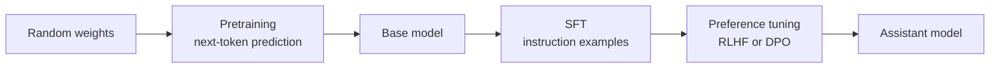
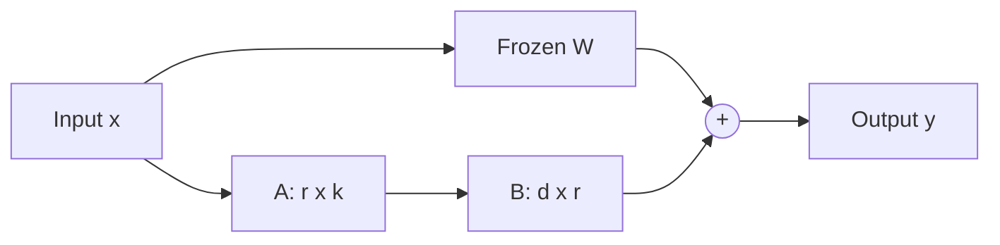

## The big idea

A language model starts as a huge pile of random numbers (weights). Training adjusts them so the model assigns high probability to the real next token in real text. Do that over a large slice of the internet, books and code, and the model has to learn grammar, facts, code patterns and some reasoning, because all of those help it predict what comes next. The result is the **base model**. It is a powerful text continuer, but it isn't an assistant. Ask it a question and it may continue with more questions, as if the text were a quiz page.

The later stages shape this raw capability into behavior. Supervised fine-tuning shows it examples of good conversations. Preference tuning then teaches it which answers humans (or other models) prefer when several are plausible. These stages use far less data and compute than pretraining, but they change how the model presents what it already knows.

An analogy from storage: pretraining is like bulk-loading a huge database. It is slow, expensive, and it determines what data you hold. Fine-tuning is like adding schema, indexes and access policies on top. It changes how the data is served, not how much of it there is. If you need new data, you usually re-ingest or attach an external store (that's RAG, covered below). Fiddling with the query layer won't create data that was never loaded.

## Why it matters

Training explains most of the behavior you see in production: why a model knows some things and not others, why it has a knowledge cutoff, why it follows instructions, why it refuses certain requests, and why it can sound confident while being wrong.

Engineers meet this in practical decisions:

- Choosing between a base model and an instruction-tuned ("chat" or "instruct") variant.
- Deciding whether to fine-tune an open-weight model or use a hosted one with better prompts.
- Estimating the cost and hardware needed to customize a model.
- Debugging odd behavior, such as sycophancy, verbosity or over-refusal, which often traces to preference tuning.

Without this mental model, teams make expensive mistakes. They fine-tune to inject facts that RAG would handle more cheaply and accurately. They expect a prompt to override deep behaviors that only training changes. Or they fine-tune on a small, noisy dataset and degrade a model that was working well.

## How it works

### The pipeline at a glance



Real pipelines vary and are often proprietary. Labs may mix in several rounds of SFT and preference tuning, synthetic data, and extra stages for reasoning or safety. The three-stage picture is the common skeleton, not a universal recipe.

### Pretraining: the objective and the data

The **objective** is next-token prediction. Text is split into **tokens** (sub-word chunks; see [How LLMs work: tokens, embeddings and the transformer](../how-llms-work/)). Given the tokens so far, the model outputs a probability distribution over the vocabulary for the next one. The training signal comes from the text itself, so no human labeling is needed. That is why it scales to enormous datasets.

For the text "The cat sat on the", the model might assign 0.40 to " mat", 0.10 to " floor", and tiny probabilities to everything else. If the real next token is " mat", the model gets a low penalty. If it is " quantum", it gets a high one.

**Data scale** is large. Frontier-era models are trained on the order of trillions to tens of trillions of tokens. Exact figures are often undisclosed. The DeepMind "Chinchilla" study found that, for a fixed compute budget, model size and training tokens should grow roughly in proportion. It put the compute-optimal ratio at roughly 20 tokens per parameter, a figure that is widely quoted but approximate. Many recent models are deliberately trained on far more tokens than that, because a smaller model trained longer is cheaper to serve. How much to overtrain is a live design choice, not a settled rule.

Data quality matters as much as quantity. Pipelines filter web crawls, remove duplicates, mix in code, math and books, and try to exclude low-quality or unsafe content. These choices strongly affect the final model, and labs rarely publish their details.

### Loss and gradient descent

The **loss** is a single number measuring how wrong the model's predictions were. For language models it is **cross-entropy**: the average of −log(probability assigned to the correct token). If the model gave the right token probability 1.0, the loss is 0. If it gave 0.01, the loss is about 4.6 (natural log).

A **gradient** tells you, for each weight, which direction to move it to reduce the loss and how sensitive the loss is to it. **Backpropagation** computes all gradients efficiently by applying the chain rule backward through the network. **Gradient descent** then updates each weight a small step against its gradient. The step size is the **learning rate**.

```python
# Conceptual training loop (PyTorch-style pseudocode)
for batch in data:                      # batch of token sequences
    logits = model(batch.inputs)        # predict next-token distributions
    loss = cross_entropy(logits, batch.targets)
    loss.backward()                     # compute gradients for every weight
    optimizer.step()                    # update weights (e.g. AdamW)
    optimizer.zero_grad()
```

In practice, training uses **mini-batches** (the gradient is estimated from a sample, called stochastic gradient descent), the **AdamW** optimizer, learning-rate schedules, and thousands of GPUs. The work is split across them with data, tensor and pipeline parallelism. Training a large model is a distributed-systems problem: checkpointing, handling node failures and keeping GPUs fed with data all matter.

### Supervised fine-tuning (instruction tuning)

SFT uses the same next-token loss, but on a small curated dataset of (prompt, ideal response) pairs. These are often tens of thousands to a few million examples, written by humans or generated and filtered with other models. The loss is usually computed only on the response tokens, so the model learns to produce answers rather than to imitate prompts.

SFT teaches format and behavior: follow the instruction, use the chat template, answer concisely, and stop when done. The "LIMA" line of research argued that a small, high-quality SFT set can go a long way because the knowledge is already in the base model. This is still debated, and it depends on the task.

### Preference tuning: RLHF and DPO

SFT can only imitate the examples it is shown, and it's hard to write the single "best" answer for open-ended tasks. It is easier for people to compare two answers and say which is better. Preference tuning uses that.

**RLHF (reinforcement learning from human feedback)** has these steps, as in the [InstructGPT paper](https://arxiv.org/pdf/2203.02155):

1. Sample several responses per prompt from the SFT model.
2. Have humans rank them, producing preference pairs (chosen vs. rejected).
3. Train a **reward model** to score responses so that chosen ones score higher.
4. Use a reinforcement learning algorithm (classically PPO) to update the model to produce higher-reward responses. A **KL penalty** keeps it from drifting too far from the SFT model, which limits "reward hacking" (exploiting quirks in the reward model).

**DPO (Direct Preference Optimization)** skips the separate reward model and RL loop. It trains directly on the preference pairs with a classification-style loss that raises the probability of the chosen response relative to the rejected one, measured against a frozen reference copy of the model. The [DPO paper](https://arxiv.org/pdf/2305.18290) shows it optimizes the same KL-constrained objective as RLHF in a simpler way. It is simpler and more stable to run, though which approach works better depends on the setting, and many labs still use RL-based methods. Preference data can also come from AI feedback instead of humans.

| Stage | Data | Signal | Typical size | Changes |
|---|---|---|---|---|
| Pretraining | Raw text | Next token | Trillions of tokens | Knowledge, core capability |
| SFT | Prompt and response pairs | Next token on responses | 10³ to 10⁶ examples | Format, instruction following |
| Preference tuning | Chosen vs. rejected pairs | Reward or preference loss | 10⁴ to 10⁶ pairs | Style, helpfulness, safety, tone |

Preference tuning mostly shapes **which** behaviors are preferred, not what the model knows. It has side effects: models can become sycophantic or verbose if raters favor that, and it can make outputs less diverse.

### LoRA and parameter-efficient fine-tuning

Full fine-tuning updates every weight. For a 7B-parameter model, training with Adam needs memory for the weights, gradients and two optimizer states per weight. That is many times the model's size, so it needs several high-end GPUs.

**Parameter-efficient fine-tuning (PEFT)** trains a small number of parameters instead. The most popular method is **LoRA (Low-Rank Adaptation)**, from [Hu et al.](https://arxiv.org/pdf/2106.09685). The idea is that the update to a weight matrix W (size d×k) can be approximated by the product of two thin matrices: ΔW = B·A, where B is d×r and A is r×k, and the rank r is small (such as 8 or 16). You freeze W and train only A and B.



After training, you can either merge B·A into W (no extra inference cost) or keep it as a separate **adapter** file of a few megabytes to hundreds of megabytes. One base model can then serve many adapters. This is like keeping a base image plus small per-tenant deltas. **QLoRA** goes further by quantizing the frozen base weights to 4-bit, so large models can be tuned on a single GPU. The [Hugging Face PEFT library](https://huggingface.co/docs/peft/v0.20.0/package_reference/lora) is the common toolkit.

LoRA often matches full fine-tuning on narrow tasks, but it may do worse when you need to teach a lot of new knowledge or make large behavioral changes. Quality depends on the task, rank and data.

## A worked example

Suppose you want a support-ticket classifier that outputs strict JSON with a category and urgency, using a 7B open-weight model.

**Memory for full fine-tuning (rough).** With 16-bit weights, 7B × 2 bytes = 14 GB for weights. Gradients add another 14 GB. AdamW keeps two states per weight, typically in 32-bit: 7B × 2 × 4 bytes = 56 GB. The total is about 84 GB before activations, so you would need multiple 80 GB GPUs.

**Memory for LoRA.** Freeze the base: 14 GB for weights, no gradients or optimizer state for them. Apply rank-16 adapters to the attention projections of a 4096-wide, 32-layer model. Each adapted matrix has 2 × 4096 × 16 = 131,072 parameters. Adapting 4 matrices per layer across 32 layers gives 131,072 × 4 × 32 ≈ 16.8M trainable parameters, about 0.24% of the model. Their gradients and optimizer states take roughly 16.8M × (2 + 2 + 8) ≈ 0.2 GB. The total is about 15 GB plus activations, so it fits on one 24 GB GPU. With QLoRA (4-bit base ≈ 3.5 GB) it fits in even less.

**Data and run.** You gather 5,000 labeled tickets as (ticket text, JSON) pairs. At roughly 300 tokens each, that's 1.5M tokens per epoch. Three epochs is 4.5M tokens, which is a short run (minutes to a couple of hours on one GPU, depending on hardware). That is a tiny fraction of the trillions of tokens used in pretraining.

**Outcome check.** Before this, a prompt with three examples gets valid JSON 92% of the time (so 8% of calls need retries or repair) and uses about 600 prompt tokens per request. After tuning, say you measure 99.5% valid JSON with a 50-token prompt. You've cut per-request input tokens by roughly 90% and improved reliability. These numbers are illustrative, so you would measure them on your own held-out set. Compare against the cheaper baseline of a better prompt plus constrained decoding before committing.

## Common pitfalls and misconceptions

- **"Fine-tune to teach the model our documents."** Fine-tuning is a poor way to add facts: recall is unreliable, and it can't cite sources or update when documents change. Use RAG for knowledge.
- **"Pretraining stores a database of the internet."** The model compresses statistical patterns into weights. It doesn't retrieve exact text on demand, which is partly why it hallucinates.
- **"RLHF teaches the model new facts."** Preference tuning mainly changes style and behavior. It can even push models toward confident-sounding answers if raters reward them.
- **"More fine-tuning data is always better."** A small, clean, consistent set often beats a large noisy one. Bad examples teach bad habits.
- **"LoRA is a lesser version of fine-tuning."** It is a different tradeoff. It's often enough for style, format and narrow tasks, and operationally much easier.
- **Ignoring regressions.** Narrow fine-tuning can cause *catastrophic forgetting*, where the model gets worse at things you didn't test. Keep a general eval set alongside your task eval.
- **Training on your test set.** Duplicated or leaked examples inflate scores, as in any ML evaluation. Split data before any augmentation.
- **Treating the base-model licence as an afterthought.** Check the terms of both the model and any data (including outputs from other models) used for tuning.

## When should you fine-tune?

Work up the ladder and stop when the problem is solved:

| Need | Try first | Fine-tune when |
|---|---|---|
| Follow a task or format | Clear prompt, examples, structured output | Prompts get long or brittle, or you need very high consistency |
| Use private or fresh knowledge | RAG | Rarely. Fine-tuning is the wrong tool for facts |
| Specific tone or brand voice | Prompt with style guide and examples | You need it consistently at scale and low token cost |
| Specialized skill or domain language | Better model, prompt | A narrow task where a small tuned model can replace a large one |
| Lower latency or cost | Smaller model, prompt caching | Distilling a big model's behavior into a small one |

A rule of thumb: **prompting and RAG change what the model sees; fine-tuning changes what the model is.** The first two are fast to iterate and easy to roll back. Fine-tuning needs data, an eval set and a retraining pipeline, and you inherit the maintenance whenever the base model is upgraded. Also check whether your hosted provider offers fine-tuning for your chosen model, since availability changes often.

## How it connects

This lesson builds on [How LLMs work: tokens, embeddings and the transformer](../how-llms-work/), which describes the architecture whose weights are being trained here. The next lesson, on inference and serving, covers what happens once training stops: sampling, the KV cache and batching. LoRA adapters matter there too, because serving many adapters on one base model is a real systems technique.

Later lessons connect back to training. Context-window limits (lesson 4) partly come from the sequence lengths used during training. Reasoning models (lesson 5) rely on additional training, often reinforcement learning against verifiable outcomes, which extends the preference-tuning idea.

For infrastructure engineers, the analogies are direct. Training runs are long-lived distributed jobs that need checkpointing and failure recovery. Datasets are versioned, deduplicated pipelines. Adapters are small deltas over a shared base. Model evaluation resembles regression testing on a changing system.

## Check your understanding

**1. A base model is asked "What is the capital of France?" and responds with "What is the capital of Germany? What is the capital of Spain?" Why, and which stage fixes it?**
<details><summary>Show answer</summary>

The base model was trained only to continue text plausibly, and lists of quiz questions are a plausible continuation. It was never trained to treat the input as an instruction to answer. Supervised fine-tuning on prompt and response pairs fixes this. Preference tuning then refines the quality of the answers.

</details>

**2. Why does pretraining need no human labels, while preference tuning does need comparisons?**
<details><summary>Show answer</summary>

In pretraining the correct answer is the next token already in the text, so the data supplies its own labels. "Good answer" for an open-ended request has no single ground truth, so preference tuning relies on judgments (human or AI) about which of two responses is better.

</details>

**3. Your company wants a chatbot that answers questions about internal policies that change weekly. Should you fine-tune on the policy documents?**
<details><summary>Show answer</summary>

Generally no. Fine-tuning stores facts unreliably, can't cite sources, and would need retraining whenever policies change. RAG retrieves the current documents at query time, keeps access control in the retrieval layer, and updates when the index does. You might fine-tune later for tone or output format, but not for the facts.

</details>

**4. Why does LoRA need far less memory than full fine-tuning, even though the forward pass still goes through the full model?**
<details><summary>Show answer</summary>

Gradients and optimizer states are needed only for trainable parameters, and in LoRA those are the small A and B matrices (often well under 1% of the model). The frozen base weights need only be stored, which can be done at lower precision, as in QLoRA. Activations still cost memory, so the savings aren't total.

</details>

**5. What does the KL penalty in RLHF protect against, and what is the DPO analogue?**
<details><summary>Show answer</summary>

It keeps the tuned model close to the reference (SFT) model, so it can't drift into odd outputs that exploit weaknesses in the reward model (reward hacking). DPO's loss is expressed relative to a frozen reference model, with a coefficient (often called beta) controlling how far the policy may move from it. This gives the same KL-constrained effect without an explicit reward model or RL loop.

</details>

## Further reading

- [Training language models to follow instructions with human feedback (InstructGPT)](https://arxiv.org/pdf/2203.02155): the OpenAI paper that laid out the SFT, reward model and PPO recipe behind modern assistants.
- [Direct Preference Optimization: Your Language Model is Secretly a Reward Model](https://arxiv.org/pdf/2305.18290): the DPO paper, showing preference tuning without a separate reward model or RL loop.
- [LoRA: Low-Rank Adaptation of Large Language Models](https://arxiv.org/pdf/2106.09685): the original LoRA paper, including the memory and parameter-count savings.
- [Training Compute-Optimal Large Language Models (Chinchilla)](https://arxiv.org/pdf/2203.15556): the scaling study on how model size and training tokens should be balanced.
- [Hugging Face PEFT documentation: LoRA](https://huggingface.co/docs/peft/v0.20.0/package_reference/lora): the reference for applying LoRA and other parameter-efficient methods in practice.
