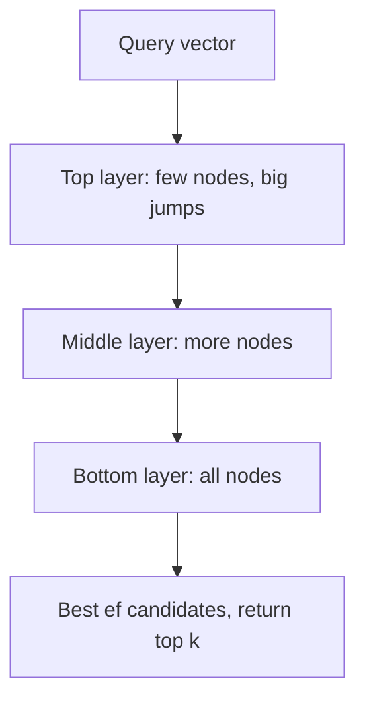
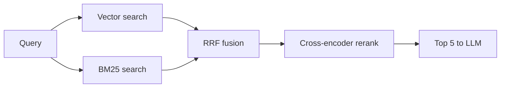

## The big idea

After [chunking and embedding](../chunking-and-embeddings/) your documents, you have millions of vectors. At query time you embed the question and need the chunks whose vectors are closest to it, within tens of milliseconds. This is **nearest-neighbour search**.

Scanning every vector is exact but too slow at scale, so production systems use **approximate nearest neighbour (ANN)** indexes. They precompute a structure that lets a query look at only a small fraction of the data. Occasionally they miss a true neighbour, and that miss rate is the price of speed.

An analogy from storage: a full table scan versus a B-tree index. An ANN index plays a similar role, but it is *lossy*. Think of a library with no catalogue. Exact search walks every shelf. IVF is like walking to the right section first and browsing only there. HNSW is like asking a well-connected person who points you to someone closer, who points you to someone closer still, until nobody knows anyone nearer. Both can miss a book that was shelved in an odd place.

Fast similarity is only the first stage. A good retrieval pipeline is a funnel. A cheap, broad stage (vector plus keyword) fetches maybe 50–200 candidates, and a slower, smarter stage (a reranker) picks the best 5–10 to give the LLM.

## Why it matters

Retrieval quality caps RAG quality. If the right chunk isn't in the top-k passed to the model, no prompt can fix that, and the model will answer from the wrong context or hallucinate. See [What RAG is, and when to use it](../what-is-rag/) for that framing.

Engineers meet this in several ways:

- **Latency and cost.** Exact search over 10M vectors at 1024 dimensions means about 10 billion multiply-adds per query. That is too slow for interactive use at any real query rate.
- **Memory.** Vector indexes are usually served from RAM, so a corpus that "fits on disk" may not fit in memory.
- **Silent misses.** Pure semantic search tends to fail on exact identifiers ("ERR_4012", a product code, a person's surname). Users notice immediately.
- **Operational choices.** You have to decide between a dedicated vector database and a vector index in a database you already run.

Without these techniques you get either slow queries, an unaffordable RAM bill, or plausible-looking retrievals that miss the one document that mattered.

## How it works

### Exact vs approximate search

**Exact (brute-force, "flat") search** computes the distance from the query to every stored vector and keeps the top k. It has 100% recall, needs no index build, and is perfectly reasonable up to roughly hundreds of thousands of vectors, especially with SIMD or a GPU. Many "we need a vector database" decisions are really premature.

**Recall@k** measures an ANN index: of the true top-k neighbours (as found by exact search), what fraction did the index return? A recall of 0.95 means about 1 in 20 true neighbours is missed. Note that recall is measured against exact *vector* search, which is different from whether the answer was relevant.

Distance is typically cosine similarity, dot product or Euclidean (L2). Use whichever metric your embedding model was trained for. For normalized vectors, cosine and dot product give the same ranking.

### HNSW: navigate a graph

**HNSW** (Hierarchical Navigable Small World) builds a proximity graph: each vector is a node linked to nearby vectors. It stacks several layers. The top layer is sparse, with a few long-range links, and the bottom layer contains every vector with short links.

A search enters at the top layer and greedily hops to whichever neighbour is closest to the query. When no neighbour is closer, it drops a layer and continues. At the bottom layer it explores a beam of candidates and returns the best k. This gives roughly logarithmic scaling in corpus size ([Malkov & Yashunin](https://arxiv.org/abs/1603.09320v1)).

The main knobs, using the common naming:

- **M**: links per node. Higher M gives better recall and more memory.
- **efConstruction**: beam width while building. Higher gives a better graph and slower builds.
- **efSearch** (`ef`): beam width at query time. Higher gives better recall and higher latency. You can change it per query without rebuilding.

HNSW gives an excellent speed/recall curve and supports incremental inserts. The costs are high memory (the graph sits on top of the full vectors), slower builds, and awkward deletes (often tombstones, then a rebuild or compaction).

### IVF: cluster, then search a few clusters

**IVF** (inverted file index) first runs k-means clustering over the vectors to get `nlist` centroids. Each vector is assigned to its nearest centroid's list. At query time you find the `nprobe` nearest centroids and scan only those lists.

- Larger `nprobe` means higher recall and more latency.
- Larger `nlist` means smaller lists but more centroids to compare.
- IVF needs a **training** step (the clustering) on representative data. If your data distribution drifts, the clusters go stale.

Because IVF scans lists sequentially, it combines well with **compression**: IVF-PQ stores product-quantized codes instead of full vectors. This is the standard approach for billion-scale, memory-limited setups (see [the Faiss paper](https://arxiv.org/abs/2401.08281v2)).

| | Flat | IVF | HNSW |
|---|---|---|---|
| Recall | 100% | Tunable (nprobe) | Tunable (ef), usually excellent |
| Query speed | Slowest | Good | Usually fastest at high recall |
| Memory | Vectors only | Vectors (or compressed) plus small centroid table | Vectors plus graph links |
| Build | None | Needs training, fast | Slow |
| Updates | Trivial | Fine, but clusters drift | Inserts fine, deletes awkward |

pgvector's documentation summarizes the same trade-off for its two index types: HNSW has a better speed-recall trade-off but slower builds and more memory, while IVFFlat builds faster and uses less memory ([pgvector README](https://pgxn.org/dist/vector)).

### Vector database vs vector index in an existing database

A **vector index** is the data structure (HNSW, IVF). A **vector database** wraps one or more such indexes with storage, replication, filtering, an API, and operations. The practical choice:

| Option | Fits when | Watch out for |
|---|---|---|
| Vector support in your existing DB (Postgres + pgvector, Elasticsearch/OpenSearch, MongoDB, etc.) | Millions of vectors; you want transactions, joins, one backup story, and filters over existing columns | Index builds and memory competing with your OLTP workload; fewer ANN tuning options |
| Dedicated vector DB | Very large scale, high QPS, specialized features (quantization, sharding, multi-tenancy) | A second system to sync, back up and secure; consistency between source of truth and index |
| Library (Faiss, hnswlib) embedded in your service | Static or batch-built corpora; full control | You own persistence, replication and updates |

A dedicated store is a **derived index** of your source of truth. Treat it like a search index or cache: you need a way to rebuild it, and a plan for keeping it in sync as documents change. The best choice is a moving target, so benchmark on your own data.

### BM25: keyword search

**BM25** is the classic lexical ranking function behind Lucene, Elasticsearch and OpenSearch. It uses an **inverted index** (term → list of documents containing it). A document scores higher when:

- it contains query terms many times (with diminishing returns, via term-frequency saturation),
- those terms are rare across the corpus (IDF, inverse document frequency),
- and the document isn't unusually long (length normalization).

BM25 is exact on tokens, so `ERR_4012` matches `ERR_4012`. It needs no model and is cheap. It cannot match "car" to "automobile". Dense vectors have the opposite profile: they capture meaning but can blur rare tokens.

### Hybrid search and reciprocal rank fusion

**Hybrid search** runs both a vector search and a BM25 search, then merges the two ranked lists. Raw scores aren't comparable (cosine similarity of 0.78 vs BM25 of 14.2), so a popular merge method uses ranks only.

**Reciprocal rank fusion (RRF)** gives each document the score

`score(d) = Σ over lists 1 / (k + rank_in_list(d))`

with k commonly set to 60, the value from the [original paper](https://research.google/pubs/pub36196/). Documents that rank well in several lists rise to the top, and a document missing from a list simply contributes nothing from it. It needs no score normalization and no training data. The alternative is a weighted sum of normalized scores, which can be tuned but is more fragile.

### Cross-encoder rerankers

The embedding model used for search is a **bi-encoder**: query and chunk are embedded *separately*, so chunk vectors can be precomputed. That is fast but lossy, because the model never sees query and chunk together.

A **cross-encoder** feeds the query and one candidate chunk *together* into a transformer, which outputs a relevance score. It's much more accurate because attention runs across both texts. It is also far too slow to run over the whole corpus, since nothing can be precomputed and each (query, chunk) pair needs a forward pass. So you use it only on the shortlist ([Sentence Transformers: Retrieve & Re-Rank](https://sbert.net/examples/applications/retrieve_rerank/README.html)).

Rerankers are available as open models you host and as hosted APIs. Latency scales with the number of candidates and chunk length, so measure it.

### Filtering by metadata

Real queries come with constraints: tenant ID, document type, date range, access permissions. There are three strategies:

- **Post-filtering**: search for top-k, then drop non-matching results. This is simple but can return far fewer than k (or zero) when the filter is selective.
- **Pre-filtering**: compute the matching set first, then search only within it. This is exact for the filter, but on a graph index it can break connectivity or force a brute-force fallback.
- **Filtered traversal**: the index checks the filter *while* exploring. Many engines do this, often switching to brute force when the filter is very selective. Behaviour differs a lot between products.

For hard boundaries such as tenant isolation or access control, don't rely on a lossy "hope the top-k survives" approach. Use per-tenant partitions or indexes, or an engine that guarantees filter semantics. Filters on permissions are a security issue, not a relevance tweak.

### Storage and memory footprint

The footprint of a vector index is roughly:

`vectors: N × dims × bytes_per_value` + `index overhead` + `chunk text and metadata`

- float32 uses 4 bytes per dimension. float16 uses 2. int8 scalar quantization uses 1. Binary quantization uses 1 bit.
- HNSW overhead is about `M × 2 × 4 bytes` per vector at the bottom layer (links are typically 4-byte IDs, and layer 0 allows up to 2M links), plus small upper layers. Exact numbers vary by implementation.
- **Product quantization (PQ)** splits each vector into sub-vectors and stores a short code for each. This gives 16–64× compression with some recall loss.
- Quantization is often paired with **rescoring**: search compressed vectors, then re-rank the top candidates using full-precision vectors kept on disk.
- Lower-dimension embeddings, such as models whose vectors can be truncated (Matryoshka-style), also shrink the footprint. Check your embedding model's documentation.

Disk-based ANN indexes exist and trade some latency for far less RAM. Updates also matter: re-embedding your corpus with a new model means rebuilding the entire index.

## A worked example

**Scenario:** an internal support-knowledge assistant with 10 million chunks, 1024-dimension float32 embeddings, a target of p95 retrieval under 100 ms, and a RAM budget on a single node.

**Raw vector size:** 1024 × 4 bytes = 4,096 bytes per vector. For 10M vectors: 4,096 × 10,000,000 = 40.96 GB (about 38 GiB).

**HNSW with M = 16:** layer-0 links are 2 × 16 = 32 neighbours × 4 bytes = 128 bytes per vector, plus a little for upper layers and bookkeeping, call it about 140 bytes. That is 140 × 10M = 1.4 GB. Total is about 42.4 GB, which fits on a 64 GB node but leaves little headroom. Add chunk text and metadata (stored elsewhere).

**Shrink it with int8 scalar quantization:** 1024 bytes per vector gives 10.24 GB, plus 1.4 GB of graph, about 11.7 GB. Keep the float32 originals on SSD for rescoring the top 100. Recall typically drops slightly without rescoring and mostly recovers with it, but measure it on your data.

**Retrieval pipeline:**

1. Embed the query (~10–30 ms, depending on the model and whether it's hosted).
2. HNSW search for top 100 (tens of ms at a tuned `ef`).
3. BM25 top 100 from the keyword index (~10–20 ms, run in parallel).
4. RRF fusion (negligible).
5. Cross-encoder rerank of the top 50 fused candidates. Suppose it takes about 4 ms per pair batched on a GPU, i.e. ~200 ms total in this scenario, which blows the budget. Cut to the top 30 and use a smaller reranker, and re-measure.

**RRF by hand, with k = 60:**

| Doc | Vector rank | BM25 rank | RRF score |
|---|---|---|---|
| A | 1 | 3 | 1/61 + 1/63 = 0.01639 + 0.01587 = 0.03227 |
| B | 2 | 1 | 1/62 + 1/61 = 0.01613 + 0.01639 = 0.03252 |
| C | 3 | not in list | 1/63 = 0.01587 |

B beats A even though A was the vector search's top hit, because B did well in both lists. If the user's query contained the exact error code that only B mentions, BM25's vote is what rescues it. The reranker then judges A and B on their actual text.

## Common pitfalls and misconceptions

- **"Vector search always beats keyword search."** It doesn't. On identifiers, rare names and short queries, BM25 often wins. Default to hybrid, and test on your own queries.
- **Tuning recall against the wrong target.** ANN recall measures agreement with exact vector search, not answer quality. A 99%-recall index of poor embeddings still retrieves poorly. Evaluate end to end (see the evaluation lesson later in this track).
- **Never measuring ANN recall.** Build a small ground-truth set using brute force and measure recall@k as you change `ef`/`nprobe` and quantization settings.
- **Reranking too many or too few candidates.** Too few and the answer never reaches the reranker. Too many and latency balloons. Tune the candidate count against measured recall and latency.
- **Mixing score scales.** Adding cosine and BM25 scores directly is unreliable. Use RRF or normalize carefully.
- **Post-filtering surprises.** A selective filter on top-k returns nothing. Test filters at realistic selectivity, and use partitioning for tenants.
- **Forgetting memory.** Capacity-plan for vectors plus index plus replicas plus build-time spikes. An HNSW build can need much more memory than serving does.
- **Changing the embedding model without re-indexing.** Vectors from different models (or versions) live in different spaces and can't be compared. Plan for a full rebuild and a safe cutover.
- **Assuming your index stays in sync.** Deleted or updated source documents leave stale vectors unless you design the sync path explicitly.

## How it connects

This lesson sits between two others. [Chunking and embeddings: preparing your data](../chunking-and-embeddings/) determines what the vectors are: chunk size, boundaries, embedding model and dimensions all affect both retrieval quality and index size. [What RAG is, and when to use it](../what-is-rag/) frames why retrieval is the bottleneck for grounded answers.

Next, the evaluation lesson shows how to measure retrieval (recall@k, MRR, nDCG) separately from generation, so you can tell which stage is failing. The advanced lesson builds on this stage with query rewriting, graph-based retrieval and agents that decide when to search.

For data-infrastructure engineers, the recurring theme is familiar. An ANN index is a derived, rebuildable index with a recall/latency/memory trade-off. It needs consistency with the source, backup or rebuild plans, and capacity planning, just like a search or secondary index.

## Check your understanding

**1. Your HNSW index has 0.97 recall@10 against exact search, but users say the right document is often missing from RAG answers. Where do you look?**

Show answer

High ANN recall only means the index faithfully reproduces exact vector search. The problem could be upstream (chunking or embedding model), a failure on exact tokens that hybrid search would fix, or no reranking. Build a labelled set of queries with known relevant chunks and measure retrieval recall at each stage.

**2. Why can't you use a cross-encoder instead of a vector index for the whole corpus?**

Show answer

A cross-encoder needs a full forward pass for every (query, chunk) pair, and nothing can be precomputed because the query is part of the input. Over millions of chunks, that is far too slow and expensive per query. A bi-encoder precomputes chunk vectors, so it can narrow the field cheaply, and the cross-encoder then refines a short list.

**3. You raise `efSearch` from 50 to 200. What happens, and how do you decide if it's worth it?**

Show answer

Query latency rises because the search explores more candidates, and recall rises with diminishing returns. Memory doesn't change, since this is a query-time parameter. Plot recall@k against p95 latency on your own data and pick the cheapest setting that meets your recall target.

**4. A multi-tenant app filters by `tenant_id` after a top-10 vector search, and small tenants often get 0–2 results. Why, and what are the fixes?**

Show answer

The top 10 are drawn from all tenants, so for a small tenant most or all of them are discarded afterwards. Fixes are filtering during traversal in an engine that supports it well, or partitioning by tenant (separate indexes or collections). Partitioning also gives a cleaner security boundary.

**5. In RRF, why is k = 60 added to the rank, and what would happen with k = 0?**

Show answer

The constant k dampens the difference between top ranks. With k = 0, rank 1 scores 1.0 and rank 2 scores 0.5, so a single list's top hit dominates. With k = 60, ranks 1 and 2 score 0.0164 and 0.0161, so agreement across lists matters more than a top spot in just one.

## Further reading

- [Malkov & Yashunin, "Efficient and robust approximate nearest neighbor search using Hierarchical Navigable Small World graphs"](https://arxiv.org/abs/1603.09320v1): the original HNSW paper.
- [Douze et al., "The Faiss library"](https://arxiv.org/abs/2401.08281v2): covers IVF, PQ, HNSW and the design trade-offs in vector search.
- [Cormack, Clarke & Büttcher, "Reciprocal Rank Fusion outperforms Condorcet and individual rank learning methods"](https://research.google/pubs/pub36196/): the original RRF paper (SIGIR 2009).
- [pgvector README (PGXN)](https://pgxn.org/dist/vector): documentation for HNSW and IVFFlat indexes in Postgres, with tuning guidance.
- [Sentence Transformers: Retrieve & Re-Rank](https://sbert.net/examples/applications/retrieve_rerank/README.html): the bi-encoder plus cross-encoder pattern, with examples.
