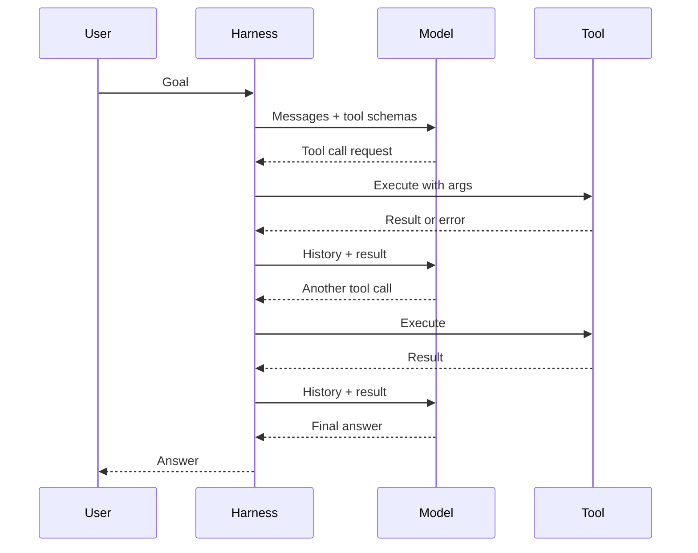

## The big idea

A plain model call is a pure function: text in, text out. It can't check a database, read a file, or find out whether the code it just wrote compiles. **Tool calling** gives it a way to ask for those things. You describe the available functions, and the model can reply with "please call `search_orders` with these arguments" instead of prose.

An **agent** puts that capability in a loop. The model looks at the goal and the history so far and picks an action. Your program runs the action and appends the result to the history. The model then looks again and picks the next action, until it decides it's done. The model supplies judgment, and the surrounding program supplies the hands.

Think of an on-call engineer working through an incident with a runbook and a terminal. They read the alert and run a command. Then they read the output, decide what to check next, and repeat until the problem is solved or they escalate. They don't plan every command upfront, because each output changes what they do next. An agent works the same way. The model is the engineer, the tools are the terminal, and the harness is everything that keeps the session safe and bounded.

## Why it matters

Many useful tasks can't be done in one shot. Examples are "find why this test fails and fix it", "reconcile these two datasets", and "research this vendor". The needed information isn't in the prompt, and the right next step depends on what the last step revealed. A single call guesses. A loop can look, act, and correct itself.

Engineers meet this in coding assistants, support bots that look up accounts, and data-pipeline helpers that inspect schemas before writing queries. Once a model can take actions, you are building a system that makes decisions with side effects.

Without a clear mental model of the loop, common failures follow. Agents spin forever, costs balloon unexpectedly, and a malformed tool call crashes the run. Teams also build an autonomous agent where a fixed three-step pipeline would have been cheaper and more reliable.

## How it works

### Tool calling mechanics

Tool calling has three parts: schema in, structured call out, result back.

1. **Schema in.** With each request, you send a list of tool definitions. Each has a name, a natural-language description, and a JSON Schema for its inputs. The description matters a lot, because it's the only thing the model knows about the tool.
2. **Structured call out.** If the model decides a tool would help, its response contains a structured block holding the tool name and a JSON arguments object, not just text. In Anthropic's API the response has `stop_reason: "tool_use"` and one or more `tool_use` blocks. OpenAI's API has an analogous function-call item. The model may request several calls at once.
3. **Result back.** Your code validates the arguments, runs the function, and sends the output in the next request, tagged with the ID of the call it answers (a `tool_result` block in Anthropic's API). The model sees it as new context and continues.

```json
{
  "name": "get_order_status",
  "description": "Look up the shipping status of an order by its ID.",
  "input_schema": {
    "type": "object",
    "properties": { "order_id": { "type": "string" } },
    "required": ["order_id"]
  }
}
```

Two points are easy to miss. The model only *proposes* the call, and your code decides whether to run it. Also, the API is stateless: each request carries the entire conversation, including earlier calls and results. Some providers offer a "strict" mode that constrains calls to match your schema. Without it, validate arguments yourself, because models can produce malformed or invented values.

Some tools, like web search or code execution, can run on the provider's servers, so you only see the result. The loop below describes tools that run in your process.

### The agent loop



The **harness** is the program around the model. Here it just runs the loop. [Harness engineering: everything around the model](../harness-engineering/) covers it in depth.

### A minimal agent in pseudocode

```python
def run_agent(goal, tools, max_steps=10):
    messages = [user(goal)]
    for step in range(max_steps):
        reply = model.call(messages, tools=schemas(tools))
        messages.append(reply)

        calls = reply.tool_calls
        if not calls:                      # model chose to answer
            return reply.text

        for call in calls:
            try:
                args = validate(call.args, tools[call.name].schema)
                out = tools[call.name].run(args)
            except Exception as e:
                out = f"Error: {e}"        # let the model see and adapt
            messages.append(tool_result(call.id, out))

    return "Stopped: step limit reached"
```

The whole agent is a `for` loop, a list that grows, and a dispatch table. Errors are returned as results instead of raised, so the model can retry with different arguments. This pattern is often called ReAct (reason and act), after the [paper](https://arxiv.org/abs/2210.03629) that showed interleaving reasoning with actions helps on multi-step tasks.

### Workflows vs agents

Anthropic's [Building effective agents](https://www.anthropic.com/research/building-effective-agents) draws a useful line. In a **workflow**, LLMs and tools are orchestrated through predefined code paths. In an **agent**, the LLM dynamically directs its own process and tool use.

| | Workflow | Agent |
|---|---|---|
| Control flow | Written by you | Chosen by the model each step |
| Steps | Known in advance | Unknown, variable |
| Cost and latency | Predictable | Variable, often higher |
| Debugging | Like normal code | Need traces of decisions |
| Best for | Well-defined, repeatable tasks | Open-ended tasks where the path depends on findings |

Examples of workflows: classify a ticket, then route it to one of three prompts. Or extract fields, validate them in code, and write to a database. If you can draw the flowchart ahead of time, write it as code and call the model at specific nodes. Use an agent when you can't enumerate the steps, such as "fix this bug in an unfamiliar repository". The guidance from Anthropic is to start with the simplest approach and add autonomy only when it measurably helps, since agents trade cost and latency for capability.

### Stopping conditions

A loop needs ways to end. Typical ones:

- **Natural finish:** the model replies with no tool call.
- **Step cap:** a hard limit on iterations, as in `max_steps` above.
- **Budget:** a limit on tokens, dollars, or wall-clock time.
- **Repetition detection:** the same call with the same arguments several times in a row means it's stuck.
- **Failure rule:** repeated tool errors lead to escalation to a human.
- **Human gate:** approval required before irreversible actions.

When a cap triggers, return a clear partial result instead of silently dropping the work.

## A worked example

Task: "Why was order 8841 delayed?" Tools: `get_order` and `get_shipment_events`. Assume a system prompt and tool schemas of 1,500 tokens, a user message of 50 tokens, and about 400 tokens per tool call plus result.

| Call | Input tokens sent | Output tokens |
|---|---|---|
| 1: model requests `get_order` | 1,550 | 50 |
| 2: after order result, requests events | 1,550 + 450 = 2,000 | 50 |
| 3: after events, writes answer | 2,000 + 450 = 2,450 | 200 |

Total input is 1,550 + 2,000 + 2,450 = 6,000 tokens, versus about 2,450 if the final context were sent once. Each step re-sends everything before it.

Generalize: with a base of B tokens and about d tokens added per step, step *n* sends roughly B + n·d tokens. Over *N* steps the total input is about N·B + d·N(N−1)/2. That second term is quadratic. At B = 2,000 and d = 1,000, ten steps send 20,000 + 45,000 = 65,000 input tokens, and twenty steps send 40,000 + 190,000 = 230,000. Doubling the steps nearly quadruples the history cost. At a hypothetical $3 per million input tokens, that is about $0.20 versus $0.69 per run. These prices are illustrative, so check current rates.

Latency adds up too. If each model call takes about 2 seconds and each tool about 0.5 seconds, a 10-step run takes about 25 seconds, because the steps depend on each other and can't run in parallel. Provider **prompt caching**, which reuses the processed prefix of a repeated prompt at a lower price, softens the cost problem. It doesn't remove the growth. Controlling what goes into the history is the subject of the track's lesson on context engineering.

## Common pitfalls and misconceptions

- **"The model executes the tool."** It doesn't. It emits text-shaped intent, and your code runs it. Treat arguments as untrusted input, since they can be wrong or manipulated by content the model read.
- **Using an agent by default.** If the steps are known, a workflow is cheaper, faster and easier to test. Add autonomy only where fixed paths fail.
- **No step or budget cap.** One confused run can loop for a long time. Always set limits.
- **Raising exceptions instead of returning errors.** The model can often recover from "no such order, IDs look like `ORD-1234`" but not from a crashed process.
- **Vague tool descriptions.** The model picks tools by reading them. Ambiguous or overlapping tools cause wrong calls. Tool design is covered later in this track.
- **Ignoring side effects.** Retrying a "send email" or "charge card" call is not like retrying a read. Make writes idempotent or gate them behind approval, as you would in a replicated system.
- **Assuming more steps means better results.** Errors compound, and long histories can dilute the model's attention. Measure it rather than assuming.

## How it connects

This lesson is the base for the rest of the track. [Harness engineering: everything around the model](../harness-engineering/) expands the `run_agent` function into a real system with retries, permissions, sandboxing, logging and state. Context engineering deals with the growing-history problem above. Tool design and the Model Context Protocol (MCP) cover how to write good schemas and share tools across applications. The final lesson covers how to evaluate and harden agents, since a nondeterministic loop can't be tested like a pure function.

For data-infrastructure engineers, the loop resembles a control loop or a job scheduler with a non-deterministic planner. Tool calls are RPCs with at-least-once risk, so idempotency matters. The message history is state that you must checkpoint if you want to resume after a crash.

## Check your understanding

**1. A teammate says "the model queried our database." What actually happened, and why does the distinction matter for security?**
<details><summary>Show answer</summary>

The model emitted a structured request naming a function and arguments. Your harness code chose to execute it against the database. Because your code is the executor, it is the place to enforce permissions, validate arguments, and require approvals. If you assume the model "has access", you may skip those checks.

</details>

**2. You need to process incoming invoices: extract fields, check them against a vendor list, then file them. Workflow or agent?**
<details><summary>Show answer</summary>

Use a workflow. The steps are known and fixed, so you can write them as code and call the model only for extraction. This gives predictable cost, easier testing and fewer failure modes. Move to an agent only if invoices need open-ended investigation that you can't script.

</details>

**3. An agent run uses 10 steps and costs $0.65. A change makes typical runs take 20 steps. Why might cost more than double, and how would you estimate it?**
<details><summary>Show answer</summary>

Each step re-sends the entire history, so total input tokens contain a term proportional to N², roughly N·B + d·N(N−1)/2. Doubling the steps roughly quadruples the history part. Estimate by measuring the base prompt size and average tokens added per step, then plug in the numbers. Caching and context trimming reduce but don't remove the effect.

</details>

**4. Your agent calls the same search tool with identical arguments five times in a row. Which stopping conditions help, and what should happen when they fire?**
<details><summary>Show answer</summary>

A repetition detector and the step cap are the direct fixes, and a budget limit is the backstop. When one fires, the harness should end the run with a clear partial result, or give the model one nudge such as "this call already returned X, try something else". It could also escalate to a human. It should not silently continue.

</details>

**5. Why return a tool's error message to the model instead of failing the run?**
<details><summary>Show answer</summary>

The error becomes an observation the model can use. A message like "invalid date format, expected YYYY-MM-DD" lets it fix the arguments and retry. This self-correction is one of the main advantages of the loop. You still need a cap on retries so that a persistent error doesn't loop forever.

</details>

## Further reading

- [Building effective agents (Anthropic)](https://www.anthropic.com/research/building-effective-agents): the workflow-vs-agent distinction and advice to start simple.
- [ReAct: Synergizing Reasoning and Acting in Language Models](https://arxiv.org/abs/2210.03629): the paper that popularized interleaving reasoning steps with tool actions.
- [Toolformer: Language Models Can Teach Themselves to Use Tools](https://arxiv.org/abs/2302.04761): research on training models to decide when and how to call external APIs.
- [Tool use with Claude (Anthropic docs)](https://platform.claude.com/docs/en/agents-and-tools/tool-use/overview): the `tool_use` / `tool_result` message flow and client vs server tools.
- [Function calling guide (OpenAI docs)](https://developers.openai.com/docs/guides/function-calling): the same pattern in OpenAI's API, including strict schemas.
