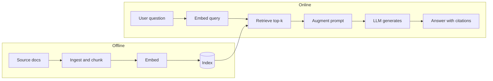

## The big idea

A language model is trained once on a large pile of text, and what it learned ends up in its weights. That knowledge is lossy, frozen at the training cutoff, and limited to public data. Ask about your company's refund policy or last week's incident and it will often produce something fluent and wrong.

RAG changes the question from "answer from memory" to "answer from these documents." Before calling the model, your system searches a knowledge base for the passages most relevant to the question. It pastes them into the prompt and tells the model to answer using only that material. The original 2020 paper by Lewis et al. framed this as combining *parametric memory* (the weights) with *non-parametric memory* (an external index you can update).

The analogy is an open-book exam. A closed-book student relies on whatever they memorized and may bluff when unsure. An open-book student still needs to be smart, but looks up the relevant pages first and can point to where the answer came from. A good student also has to find the right pages quickly. That is why most RAG quality problems are search problems.

## Why it matters

Three problems push teams toward RAG:

- **Hallucination.** The model is trained to produce likely text, not to verify facts. When the needed fact is missing or weakly learned, it fills the gap with something plausible. See [Ji et al.'s survey](https://arxiv.org/abs/2202.03629v1) for background on why this happens.
- **Missing private knowledge.** Wikis, tickets, contracts, runbooks, and customer records were never in the training data.
- **Stale knowledge.** The world changes after the training cutoff. Retraining a model to learn one new policy is slow and expensive.

You will meet RAG in support bots, internal "ask the docs" assistants, code search helpers, and compliance or legal Q&A tools. Without it, you get confident wrong answers, no way to trace where a claim came from, and a model you must retrain whenever your data changes.

A storage analogy fits here. Putting all your knowledge in the weights is like baking your database into the application binary. RAG separates compute (the model) from state (the index). You can update, access-control, and delete data without redeploying the model.

## How it works

The pipeline has an offline half, which prepares the data, and an online half, which runs on every question.



### 1. Ingest

Collect documents (PDFs, HTML, tickets, database rows), extract clean text, and keep metadata such as source URL, title, date, and access permissions. Then split documents into **chunks**, which are passages small enough to retrieve precisely and fit in a prompt. Chunking has real tradeoffs. See [Chunking and embeddings: preparing your data](../chunking-and-embeddings/).

### 2. Index

An **embedding model** turns each chunk into an **embedding**, a vector of numbers (often hundreds to a few thousand dimensions) where texts with similar meaning land close together. The vectors and chunk text go into an index, usually a vector database or a search engine with vector support. This is the same job as building a secondary index on a table, except the key is meaning rather than a column value.

### 3. Retrieve

At query time, embed the question with the same model and ask the index for the **top-k** nearest chunks, where k is a small number such as 3 to 10. Closeness is typically measured by cosine similarity. Production systems often combine this with keyword search and a reranker. Those techniques are covered in later lessons.

### 4. Augment

Build the prompt: instructions, the retrieved chunks (labeled with IDs), and the user's question. Instructions usually say to answer only from the context and to say so when the context doesn't contain the answer.

### 5. Generate

The LLM reads the prompt and writes an answer. A well-built prompt asks it to cite chunk IDs, so each claim can be traced to a source.

### A minimal example

This pseudocode-style Python shows the whole loop. `embed`, `vector_store`, and `llm` stand in for whatever libraries you use.

```python
# --- Offline: ingest + index ---
for doc in load_documents():
    for i, chunk in enumerate(split(doc.text, max_tokens=300)):
        vector_store.add(
            id=f"{doc.id}#{i}",
            vector=embed(chunk),
            text=chunk,
            metadata={"source": doc.url},
        )

# --- Online: retrieve + augment + generate ---
def answer(question: str) -> str:
    hits = vector_store.search(embed(question), top_k=4)
    context = "\n\n".join(f"[{h.id}] {h.text}" for h in hits)
    prompt = f"""Answer using ONLY the context below.
Cite sources like [id]. If the answer is not in the context, say "I don't know."

Context:
{context}

Question: {question}"""
    return llm(prompt)
```

### Citations and grounding

**Grounding** means the answer is anchored in supplied evidence rather than the model's memory. **Citations** make that visible: each claim points to a chunk ID, which maps to a document and link. This gives users a way to verify, and gives you a way to debug. If a citation doesn't support the claim, you have found a generation failure. If the right chunk was never retrieved, you have found a retrieval failure.

Citations are generated text too, so they can be wrong. The model may cite a chunk that doesn't support the claim, or invent an ID. Validate that cited IDs were actually in the prompt, and evaluate whether cited text supports the claim (see lesson 4).

### RAG vs. fine-tuning vs. long context

**Fine-tuning** continues training a model on your examples to change its weights. A **long context window** means pasting a lot of material directly into the prompt, with no retrieval step.

| Question | RAG | Fine-tuning | Long context |
|---|---|---|---|
| Best for | Large or changing knowledge, citations | Style, format, tone, narrow skills | Small corpora, one-off analysis |
| Updating knowledge | Re-index changed docs (minutes) | Retrain (hours to days) | Re-paste |
| Data size | Millions of chunks | Hundreds to thousands of examples | Bounded by the window |
| Per-query cost | Small prompt, plus a search | Same as the base model | High: pay for every token each time |
| Source attribution | Natural | Hard | Possible, but you manage it |
| Per-user access control | Filter at retrieval | Hard (knowledge is in the weights) | You choose what to paste |
| Main failure | Retrieval misses | Stale or forgotten facts; may still hallucinate | Cost, latency, and degraded use of the middle of long inputs |

Some guidance:

- **Fine-tuning is poor at injecting facts reliably.** It is better at teaching behavior, such as "answer in our JSON schema" or "write like our support team." Many production systems fine-tune and use RAG together.
- **Long context is often the simplest start** if your material is small, say a few documents. Models don't use long inputs evenly. [Lost in the Middle](https://arxiv.org/abs/2307.03172v3) found accuracy often drops when the key fact sits mid-prompt. Windows keep growing and models keep improving, so test with your own data instead of trusting a rule of thumb.
- **RAG wins** when the corpus is too big to paste, changes often, needs per-user permissions, or must cite sources.

## A worked example

Scenario: an internal HR assistant over 2,000 policy pages. The numbers are illustrative.

**Sizing.** Suppose each page averages 600 words, which is about 800 tokens. The corpus is 2,000 × 800 = 1.6 million tokens. Split into 300-token chunks, that gives 1,600,000 / 300 ≈ 5,300 chunks.

**Why not paste everything?** Each question would send 1.6M tokens. At an assumed $3 per million input tokens, that is about $4.80 per query. For 10,000 queries a month, that is $48,000. It would also likely exceed many models' context windows.

**With RAG.** Retrieve k = 4 chunks of 300 tokens = 1,200 tokens. Add about 300 tokens of instructions and the question, for roughly 1,500 input tokens. That costs 1,500 × $3 / 1,000,000 ≈ $0.0045 per query, or about $45 per month for 10,000 queries. That is about 1,000× cheaper. You also pay a one-time embedding cost for 1.6M tokens and a small cost per query to embed the question.

**A query.** The user asks, "How many days of parental leave do I get?" The system embeds the question and retrieves four chunks. Suppose chunk `hr-leave.pdf#7` says: "Primary caregivers receive 16 weeks of paid parental leave..." The prompt includes that chunk, and the model answers: "Primary caregivers get 16 weeks of paid leave [hr-leave.pdf#7]." The user can click through and verify.

**A failure.** The user asks about leave in the Berlin office, which has a separate policy. If retrieval returns only the general US chunk, the model may confidently give the US answer. The fix is in retrieval (metadata filters, better chunking, hybrid search), not in prompting the model harder. The later lessons cover this.

## Common pitfalls and misconceptions

- **"RAG eliminates hallucination."** It reduces it. The model can still ignore context, blend context with memory, or misread a chunk. Instruct it to abstain when the context is insufficient, require citations, and evaluate faithfulness.
- **"RAG is just a vector database."** The database is one component. Chunking, metadata, query handling, ranking, prompt design, and evaluation matter as much.
- **"If the answer is wrong, the model is bad."** Check retrieval first. Log the retrieved chunks. Most failures are that the right chunk wasn't retrieved or ranked high enough.
- **"Fine-tune to teach it our documents."** This is unreliable for facts and hard to update or audit. Use RAG for knowledge, and fine-tune for behavior if needed.
- **"More chunks in the prompt is always better."** Extra irrelevant chunks add cost, latency, and distraction. Tune k against measured quality.
- **Ignoring access control.** If the index holds documents users shouldn't see, the model may reveal them. Enforce permissions at retrieval time with metadata filters, not in the prompt.
- **Stale indexes.** Documents change, and the index doesn't update itself. Plan for re-ingestion and deletion, as you would for any derived data store or replica.
- **"Long context makes RAG obsolete."** It covers some cases, mainly small corpora. For large, changing, permissioned, or cost-sensitive workloads, retrieval is still useful. This is a moving target, so re-evaluate periodically.

## How it connects

This lesson is the map for the track:

- [Chunking and embeddings: preparing your data](../chunking-and-embeddings/) covers the ingest and index stages: how to split documents and what embeddings represent.
- Lesson 3 covers the retrieve stage in depth: approximate nearest neighbor (ANN) indexes, hybrid keyword plus vector search, and reranking.
- Lesson 4 covers evaluating retrieval and generation separately so you can tell which half failed.
- Lesson 5 covers advanced patterns such as query rewriting, GraphRAG, and agentic retrieval, where the model decides what to look up.

For data engineers, the index is a derived, eventually consistent copy of your source of truth. It brings the usual questions: freshness lag, backfills, schema (metadata) changes, deletions, and permissions. Your existing instincts about replication and pipelines apply directly.

## Check your understanding

**1. A team fine-tunes a model on their product docs, but it still gets details wrong and the docs change weekly. Why, and what would you change?**
<details><summary>Show answer</summary>

Fine-tuning teaches patterns and style but stores facts unreliably in the weights, and it must be redone whenever the docs change. Moving the knowledge into a RAG index fixes both problems: updates are just re-indexing changed documents, and answers can cite sources. They might still fine-tune for tone or output format.

</details>

**2. Your RAG bot gives a wrong answer. What is the first thing you check, and why?**
<details><summary>Show answer</summary>

Check what chunks were retrieved. If the right chunk wasn't in the prompt, it's a retrieval problem (chunking, search, filters), and changing the prompt won't help. If the right chunk was there and the answer is still wrong, it's a generation problem, such as the model ignoring or misreading the context.

</details>

**3. You have a 40-page document and one user asking a few questions a day. Is RAG necessary?**
<details><summary>Show answer</summary>

Probably not. 40 pages likely fits in a modern context window, and at low volume the extra cost is small. Pasting it in is simpler and avoids retrieval misses. Reconsider RAG if the corpus grows, query volume rises, or you need citations at passage level or per-user filtering.

</details>

**4. Why can't you rely on the prompt line "only show the user documents they're allowed to see" for access control?**
<details><summary>Show answer</summary>

The model has already seen whatever you put in the prompt, and prompt instructions are not a security boundary. They can be bypassed or simply ignored. Apply permission filters in the retrieval query so unauthorized chunks never enter the prompt.

</details>

**5. A model's answer cites `[doc-12#3]`, and that chunk was in the prompt. Does that prove the answer is grounded?**
<details><summary>Show answer</summary>

No. It shows the ID is valid, but the model may have attributed a claim to a chunk that doesn't support it. You need to check that the cited text actually entails the claim, either by sampling and human review or with automated faithfulness evaluation.

</details>

## Further reading

- [Retrieval-Augmented Generation for Knowledge-Intensive NLP Tasks (Lewis et al., 2020)](https://arxiv.org/abs/2005.11401): the original RAG paper, which introduced the parametric and non-parametric memory framing.
- [Lost in the Middle: How Language Models Use Long Contexts (Liu et al.)](https://arxiv.org/abs/2307.03172v3): evidence that models use information in long prompts unevenly, relevant to the RAG vs. long-context choice.
- [Survey of Hallucination in Natural Language Generation (Ji et al.)](https://arxiv.org/abs/2202.03629v1): a broad survey of why generative models produce unfaithful output and how it is measured and mitigated.
- [Introducing Contextual Retrieval (Anthropic)](https://www.anthropic.com/news/contextual-retrieval): a practical engineering write-up on improving retrieval quality, which previews topics from later lessons.
