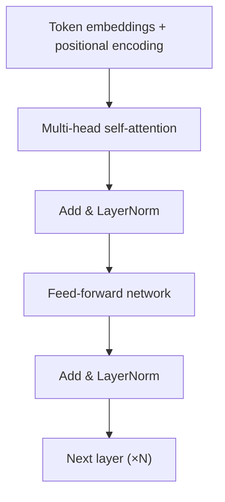

## What happened

A Google team introduced the **Transformer**, a sequence model built entirely from attention and feed-forward layers, with no recurrence or convolution. It set new records in machine translation while training in a fraction of the time of previous models.

## Why it matters

Recurrent networks (RNNs and LSTMs) process tokens one after another, which limits parallelism and makes long-range dependencies hard to learn. The Transformer processes all positions at once. That made it possible to train much bigger models on much more data, and that recipe led to BERT, GPT and today's LLMs.

## How it works



**Self-attention.** Each token produces a *query*, a *key* and a *value*. A token's output is a weighted mix of all values, where the weights come from how well its query matches each key:

```
Attention(Q, K, V) = softmax(Q·Kᵀ / √d_k) · V
```

**Multiple heads.** Several attention "heads" run in parallel on different projections. One head might track syntax while another tracks coreference.

**Positional encoding.** Attention itself has no sense of order, so position information is added to the embeddings.

## Trade-offs and open questions

| | RNN/LSTM | Transformer |
|---|---|---|
| Training parallelism | Low (sequential) | High |
| Path length between distant tokens | O(n) | O(1) |
| Compute/memory vs sequence length | O(n) | O(n²) |

The quadratic cost is the main limit. It drives work on efficient attention (FlashAttention), sparse and linear attention, and state-space models.

## What you can apply

- When you reason about LLM cost and latency, remember that context length enters attention quadratically. Prompt size matters.
- KV caching, which stores keys and values for earlier tokens, follows directly from this design. It is why generating text gets cheaper per token after the prompt is processed.

## Glossary

- **Query/Key/Value:** learned projections used to compute attention weights and outputs.
- **Head:** one independent attention computation within a layer.
- **Positional encoding:** a signal added to embeddings so the model knows token order.
