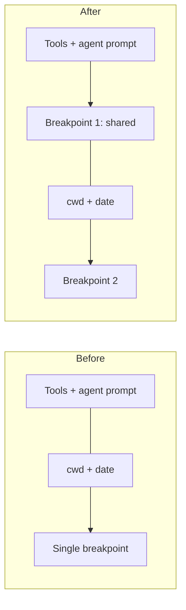
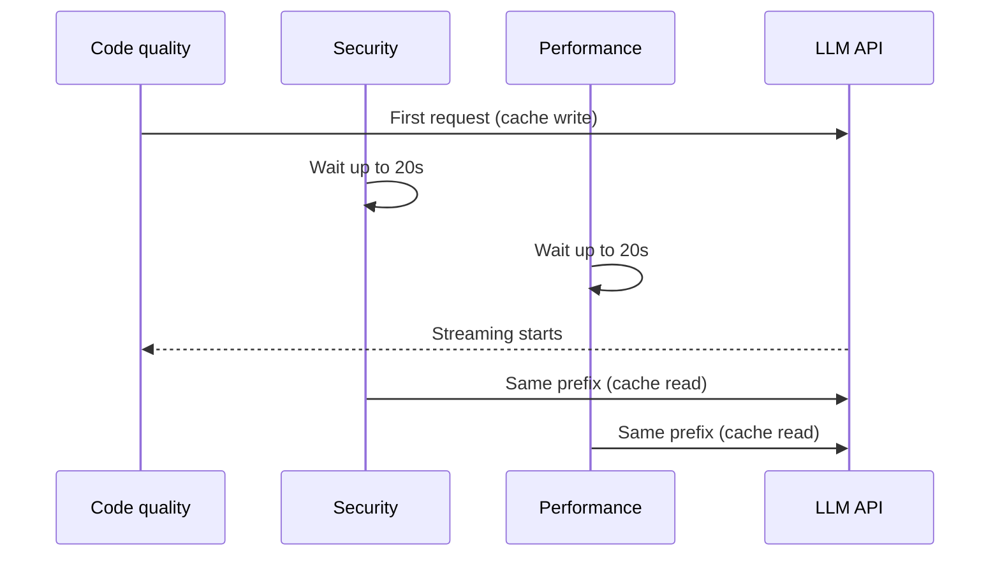

## What happened

Cloudflare runs an AI code reviewer in CI (GitLab jobs). A coordinator agent fans out to specialist sub-reviewers: code quality, security, performance, documentation, an AGENTS.md standards reviewer, and a Codex-based standards reviewer. Its cost per run kept rising. Average cost was $1.19 in April and $2.32 in August, on a fixed tier mix. Reviews also got slower: in August the median was 14% slower and the 99th percentile 48% slower than in April.

The team dug into token usage and found several compounding causes. Full-tier reviews grew from 59% to 65% of the mix. All reviewers moved to Anthropic models in early August, because they did better in evals, and cost per job rose from $1.38 to $2.03. The Codex standards reviewer moved to Claude Opus 4.7, which raised its cost from about $0.25 to $0.88. Tokens per review went from 0.91M to 2.99M.

Over the following weeks they fixed caching, trimmed wasted calls, and tested models and effort levels. The results:

| Metric | Before | After |
|---|---|---|
| Avg cost per review | ~$2.43 | $0.77 |
| Median full-tier time | 5m 16s | 1m 54s |
| Reviews over 5 min | 37.9% | 0.7% |
| p99 latency | 15m 20s | 4m 41s |
| Reviews with no verdict | 0.79% | 0.27% |
| Security reviewer retries | 3.5% | 0.04% |

## Why it matters

Agentic LLM workloads are different from chat. One review is an agent loop of about 16 calls, and each call resends the full history. Cost is therefore driven by context size times the number of calls, and output tokens are a smaller share. Before optimization, spend split roughly 23% output, 43% cache writes and 34% cache reads. Cache traffic dominated.

The case is useful because the dashboard looked healthy. The cache hit rate had climbed from 85.7% to 97%, yet the bill doubled. Aggregate metrics hid the per-session failure, and token volume grew faster than the hit rate improved.

Anyone running agents in CI, coding assistants or multi-agent pipelines faces the same pattern. Model upgrades, more reviewers and more context each look reasonable alone, and together they multiply cost and latency. The post also shows how to check that savings didn't quietly cost quality.

## How it works

### Prompt caching basics

Caching works on prefixes. Everything from the start of the prompt up to a breakpoint must be byte-stable to hit. The pricing in the post: cache writes cost 1.25x normal input, reads cost 0.1x, and entries expire after five minutes unless read. So a write only pays off if something reads it soon.

### Fix 1: cache the shared first-request prefix

Each session's first request carried 11k–21k tokens of tools and agent prompt that were identical across repositories. Yet first requests hit the cache only 14–26% of the time. OpenCode v1 placed a single breakpoint at the end of a block that also contained the working directory and the date. Those vary per job, so the stable part was never cached by itself.

The fix, shipped September 16:

- A marker at the end of each agent prompt, plus a plugin hook that splits the block at that marker, so the stable part gets its own breakpoint.
- The skills list was disabled, and tool descriptions were kept stable across jobs.
- First-request cache reads rose to 91–99.5%.

Moving the Codex reviewer's reference index into its prompt cut its LLM calls from 15.9 to 9.6 and its cost from $1.12 to $0.72. Together, these changes took cost per review from $2.47 to $2.02.

### Fix 2: fewer calls (about $0.20 per review)

Since every call resends the history, removing calls helps twice. The changes, made September 21 and 23:

- **Removed an unusable tool.** Sub-reviewers tried to call a posting tool in 57–76% of sessions, though they couldn't use it. That wasted a call and about 2.9k tokens per request.
- **Parallel file reads.** 64% of code quality turns made only one tool call. Reviewers now read shared context and patches in the first response.
- **Skipped reviewers on re-reviews.** About two-thirds of jobs are re-reviews. On full-tier re-reviews the AGENTS.md reviewer was skipped 56% of the time, performance 23% and documentation 13%.
- **Stopped after posting.** This saved about $0.07 per job.
- **Timeouts as slow, not failed.** Treating them as provider failures caused retries. Security reviewer timeouts fell from 1.8% of runs to almost none.
- **Real cancellation.** GitLab's Kubernetes executor doesn't signal cancelled jobs. In a sample of 446, 358 kept running. Jobs now poll their status every 15 seconds.

### Sharing a cache across reviewers

Code quality, security and performance send identical first requests. Fired in parallel, each would pay for its own cache write. Now one writes and the other two wait up to 20 seconds for its first response to start streaming, then read. That saves about nine cents per reviewer.

### Model and effort experiments

About $1.06 of the $1.67 drop came from model and effort choices, and about $0.65 from code. The post says this is a before-and-after comparison by weekday hours, not a controlled experiment.

- **Coordinator:** two of three model/effort combinations were dropped. Medium effort on the same model finished full-tier jobs 20% sooner. Opus 5.5 at medium showed no measurable change in outcomes against Opus 5, so it was adopted. High effort cost more without a meaningful rise in findings.
- **Price isn't the explanation:** Opus 5.5 is cheaper per token, but price explains only about $0.20 of the drop. Since September, cache reads per review fell 82%, cache writes 54% and output 67%. The model simply does less work.
- **Sonnet 5 vs 5.5** (50/50 split from October 3): after 2.5 days, 5.5 cost 62% less per run for code quality, 58% less for performance and 47% less for security, at the same per-token price. Code quality averaged 1.7 calls at medium (down from 6.2), and over half of runs finished in one call. All Sonnet reviewers moved to 5.5 on October 5.

### Platform changes

The reviewer moved to OpenCode v2, a rewrite. In shadow mode, v1 and v2 agreed on the approval decision in 98% of merge requests, and full-tier reviews on v2 were about 13% faster. The team is also testing the reviewer on Durable Objects via pi-durable.

## Trade-offs and open questions

**Quality evidence is mixed but honest.** Cloudflare checked for quality loss in several ways:

- Fewer findings were posted: code quality (high) 40% fewer critical and warning findings than in late August, security (medium) 56% fewer, performance (medium) 71% fewer.
- The author action rate on code quality's serious findings rose from 34% to 59%. A coincidental-edit baseline, measured from lines 30–40 away from each finding, was about 15%.
- Actioned findings per 1,000 reviews for code quality were 145 before and 132 now, within the margin of error. Across all four reviewers they rose from 229 to 321.
- In blinded judging, two models from different providers rated 657 findings, with a third resolving disagreements. Important findings per review were 0.28 before and 0.30 now. Findings judged too severe fell from 0.46 to 0.14 per review. Most lost findings were minor, duplicate or unverifiable.

**Caveats the post states:** only 35–66 findings per group, a one-day "now" window, and author edits show action, not correctness. Models judging models has its own bias risk, though they used two providers.

**Medium effort lost real findings.** Code quality at medium led to about a quarter as many acted-on findings as at high. Performance at medium had ~64% fewer important issues per review (about one fewer every 24 full-tier reviews). Security fell about a quarter, not significantly. Code quality is therefore going back to high: 61% more per run, 58% more critical and warning findings, about two cents per review. Performance and security at high effort are still to be tested.

**Other limits:**

- The model comparisons are before-and-after or short splits, so confounders such as traffic mix and day of week remain.
- The shared-cache wait trades up to 20 seconds of delay for savings, and depends on provider cache semantics and TTLs.
- Skipping reviewers on re-reviews assumes earlier findings still cover unchanged areas.
- Prompt-stability work is fragile. Any dynamic string added early in a prompt can silently break the cache again.

## What you can apply

1. **Measure cache hits on the first request of each session, not only in aggregate.** A 97% overall rate coexisted with 14–26% on first requests. Put the stable content (tools, system prompt) first, and per-job values (paths, dates) after the breakpoint.
2. **Add multiple breakpoints** if your framework supports it, so shared and per-tenant prefixes cache separately.
3. **Count calls per task.** In an agent loop, each call re-reads the full context. Audit traces for tools the agent can't use, serial calls that could be parallel, and work done after the goal is met.
4. **Serialize the first of several identical parallel requests.** Let one write the cache and have the others read it, with a bounded wait.
5. **Skip work on incremental runs.** Re-reviews don't need every specialist.
6. **Handle cancellation and timeouts explicitly.** Poll job status if your executor doesn't signal cancellation, and don't count slow responses as provider failures that trigger retries.
7. **Test models and effort levels rather than assuming.** A newer model at the same per-token price used far fewer calls. Cheaper per token isn't the same as cheaper per task.
8. **Pair every cost cut with a quality check.** Use action rates with a baseline, blinded LLM judges from several providers, and the counts of findings lost. Watch for effort levels that quietly drop real findings.

## Glossary

- **Prompt caching:** reusing the computed state of a stable prompt prefix, so repeat reads cost far less than fresh input.
- **Cache breakpoint:** the marker in a prompt marking where a cacheable prefix ends.
- **Cache write / read:** storing a prefix (1.25x input price in this post) versus reusing it (0.1x).
- **TTL:** how long a cache entry lives. Five minutes here unless it is read.
- **Effort level:** a setting (e.g. medium, high) controlling how much reasoning and work the model does.
- **Coordinator:** the top-level agent that dispatches the specialist reviewers.
- **Full / lite / trivial tier:** Cloudflare's review sizes, which scale with the change.
- **Shadow mode:** running a new system alongside the old one to compare outputs without acting on them.
- **Action rate:** the share of findings that authors changed code in response to.
