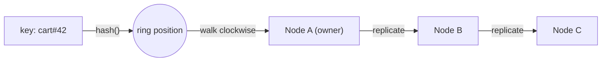

## What happened

In 2007 Amazon published the design of **Dynamo**, the key-value store behind the shopping cart and other services. Its stated goal was to stay "always writeable", even when disks, servers or whole data centres fail. The paper drew together several known techniques into one production design, and it shaped a generation of NoSQL systems.

## Why it matters

Any system that spreads data across machines has to answer two questions: *which node owns this key?* and *what happens when nodes come and go?* The obvious answer, `node = hash(key) % N`, falls apart the moment `N` changes, because almost every key moves to a different node. In a cache, that means a sudden miss storm. In a database, it means a huge rebalance.

Dynamo's answers are still the default toolkit for sharded caches, partitioned databases and load balancers.

## How it works

### The hash ring

Picture the hash space as a circle. Each node is hashed to one or more positions on it. A key is stored on the **first node clockwise** from the key's own hash.

When a node joins, it takes over only the keys between itself and its predecessor. When a node leaves, only its keys move to its successor. On average, just `1/N` of the data moves.

### Virtual nodes

One position per server gives uneven ranges. Dynamo gives each physical server **many virtual positions** (tokens). This smooths out load. It also lets a more powerful machine take more tokens, and it spreads a failed node's load across many peers instead of just one.

### Replication and quorums

Each key is stored on the first **N** distinct nodes clockwise, called its *preference list*. Reads wait for **R** replies and writes wait for **W** acknowledgements:

| Setting | Effect |
|---|---|
| `R + W > N` | Read and write sets overlap, so reads usually see the latest write |
| Low `W` | Fast, highly available writes, with a higher chance of conflicts |
| Low `R` | Fast reads that may be stale |

A common configuration is `(N, R, W) = (3, 2, 2)`.

### Handling failure

- **Sloppy quorum and hinted handoff:** if a replica is down, the write goes to the next healthy node with a *hint*. That node hands the data back once the original recovers.
- **Vector clocks:** concurrent writes can produce conflicting versions. Dynamo keeps them all and lets the application reconcile. The shopping cart, for example, merges items.
- **Anti-entropy with Merkle trees:** replicas compare hash trees of their key ranges, so they only exchange the parts that differ.

## Trade-offs and open questions

- **Eventual consistency leaks into the application.** Reconciling with vector clocks is powerful but awkward. Many later systems (Cassandra, for example) chose last-write-wins, which is simpler but can silently drop concurrent updates.
- **Hot keys still hurt.** Consistent hashing spreads *keys*, not *traffic*. One very popular key still lands on N nodes.
- **Membership is hard.** Gossip-based membership converges slowly, and operators still need tools to stop accidental partitions from looking like failures.

## What you can apply

- Use consistent hashing with virtual nodes whenever you shard caches or route sticky traffic. Most client libraries support it, for example ketama-style hashing for memcached.
- Choose quorum settings per use case rather than globally. Not every table needs the same consistency.
- Plan for hot keys separately, with request coalescing, local caching or key splitting.

## Glossary

- **Preference list:** the ordered set of nodes responsible for a key.
- **Quorum (R/W):** how many replicas must respond before a read or write succeeds.
- **Hinted handoff:** temporarily storing another node's write until it recovers.
- **Merkle tree:** a hash tree that lets two replicas find differing ranges cheaply.
