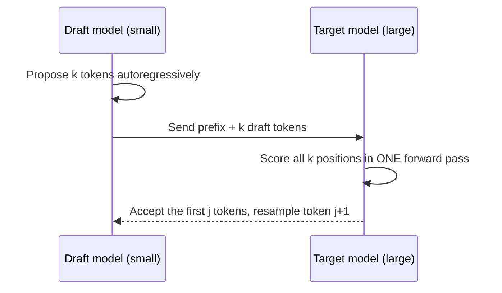

## What happened

Researchers at Google proposed **speculative decoding**, a way to speed up autoregressive generation from large transformers *without changing the outputs*. In their experiments it gave roughly 2–3× faster generation on T5-XXL. The technique is now standard in production inference stacks.

## Why it matters

LLMs generate one token at a time, and each step must read all the model's weights from memory. At small batch sizes the GPU spends most of its time *waiting on memory*, not computing. That leaves spare compute, and speculative decoding puts it to work.

## How it works



1. A **draft model**, which is small and fast, generates `k` candidate tokens.
2. The **target model** runs once over the prefix plus all `k` drafts. Because transformers process positions in parallel, this costs about the same as one normal step.
3. Each draft token is **accepted** with probability `min(1, p_target / p_draft)`. At the first rejection, a replacement token is sampled from an adjusted distribution and the rest are thrown away.

This acceptance rule is a form of rejection sampling. It makes the final output **statistically identical** to sampling from the target model alone.

A simple sketch of the loop:

```python
while not done:
    drafts = draft_model.generate(prefix, k)
    p_t = target_model.probs(prefix + drafts)   # one parallel pass
    n = accept_prefix(drafts, p_draft, p_t)     # rejection sampling
    prefix += drafts[:n] + [resample(p_t[n], p_draft[n])]
```

## Trade-offs and open questions

| Factor | Effect on speed-up |
|---|---|
| Draft/target agreement | Higher agreement means more tokens accepted per pass |
| Draft model cost | It must be much cheaper than the target, or the gains disappear |
| Batch size | Large batches already use the compute, so the gains shrink |
| Draft length `k` | Too long wastes work after the first rejection |

Later variants remove the separate draft model by adding extra decoding heads (Medusa) or by reusing the target model's own features (EAGLE). This makes serving simpler.

## What you can apply

- For latency-sensitive, low-batch serving, turn on speculative decoding in your inference server. Most major stacks support it.
- Pick a draft model from the same family and tokenizer. Measure the **acceptance rate** on your real traffic.
- Expect the biggest wins on predictable text such as code, JSON and templated output.

## Glossary

- **Draft model:** a small model that proposes candidate tokens.
- **Target model:** the large model whose output distribution you want.
- **Acceptance rate:** the share of drafted tokens the target keeps.
- **Memory-bandwidth bound:** limited by how fast weights load from memory, not by arithmetic.
