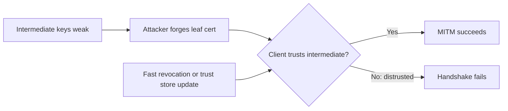

## What happened

Cloudflare learned around 17:00 UTC on October 19, 2026 that the private keys for eight eMudhra intermediate certificates had been compromised. The weakness is in the keys. It is not a flaw in TLS encryption. Anyone holding those keys could issue a certificate for any domain and then impersonate servers, intercepting or modifying traffic.

The post does not say who discovered the problem. It also gives no technical detail on the weakness, such as key sizes or algorithms, so I can't tell you more about how the keys were broken.

Cloudflare's timeline:

| Time (UTC) | Event |
|---|---|
| Oct 19, ~17:00 | Cloudflare becomes aware and starts assessing |
| Oct 20, 02:00 | WARP and 1.1.1.1 client updates published on all platforms, except the Cloudflare One Agent on iOS, which is awaiting app review |
| Oct 20, 09:15 | `cloudflared` security update published |
| Oct 20, 19:20 | CDN and server-side Zero Trust mitigations fully deployed |

Cloudflare says it found no active exploitation on its services and that more remediation work remains.

## Why it matters

TLS authentication rests on a chain. A client trusts a root CA, the root signs intermediates, and intermediates sign leaf certificates. If an intermediate's private key is compromised, whoever holds it can mint valid-looking certificates for any hostname. Anything that trusts that chain will accept them.

The dangerous part is how much software carries its own idea of trust. Browsers can push out a distrust list within hours. A Go service in a container image, a Java app with a custom keystore, or an embedded device with a bundled CA file will keep trusting the compromised intermediates until someone rebuilds and redeploys it.

If you run services that call external APIs, proxy to origins, or verify client certificates, you are affected. This also fits a wider trend: revocation has long been weak outside browsers, and this incident shows how uneven it is. Cloudflare points to the upki project as a way to bring fast updates, such as revocation data and Certificate Transparency keys, to more systems.

## How it works

### The attack

With a compromised intermediate key, an attacker can sign a leaf certificate for, say, `api.example.com`. The leaf chains up to a trusted root, so a client that hasn't distrusted the intermediate will accept it. The attacker still needs a network position to intercept traffic, such as a hostile Wi-Fi network or a compromised router.

### Cloudflare's mitigation approach

Cloudflare prioritized places where its software validates a remote server's public certificate:

- Proxies connecting to customer origins.
- Applications calling external APIs.
- Shared trust stores, base images and other shared foundations, which were then reloaded, restarted or redeployed to take effect.
- Applications with bundled or custom trust stores, which are being assessed separately.

### What Cloudflare shipped

- **WARP / Cloudflare One Client and 1.1.1.1 app:** Android v2.5.6 and v6.38.10, iOS v1.12.16 and v6.31.7, desktop/Linux 2026.8.2115.0.
- **`cloudflared`:** 2026.10.2. Container deployments need the fixed image redeployed.
- **Server side:** CDN, Developer and Zero Trust mitigations. Gateway users with an up-to-date client are protected automatically.
- **Containers and Sandboxes:** enabling HTTPS egress interception moves validation of remote-server certificates to Cloudflare, so those containers already get its trust-store mitigations.

### Why browsers were quick

The post says browser maintainers fixed this quickly because browsers have quick-revocation mechanisms such as Chrome CRLSets. Cloudflare uses a similar mechanism for some products.

## Trade-offs and open questions

- **Missing detail:** The post doesn't explain the root cause, how it was found, or whether eMudhra certificates were misused before disclosure. Cloudflare reports no exploitation on its own services, which says nothing about the wider internet.
- **Breakage risk:** Distrusting these intermediates will break anything that legitimately uses certificates chained to them. For origins on Full (strict) or Strict mode, Cloudflare is updating Automatic SSL/TLS to notify customers still using the distrusted certificates, since those would fail.
- **Long tail:** Bundled trust stores, indirect dependencies and containers will lag. Cloudflare says it is still assessing applications with custom trust stores.
- **Partial rollout:** The Cloudflare One Agent on iOS was still pending app review at publication.
- **Systemic gap:** Browsers have fast distrust channels and most other software doesn't. upki is one proposed answer, but the post gives no evidence yet of its adoption.

## What you can apply

1. **Patch the clients you control.** If you use Cloudflare, upgrade WARP, 1.1.1.1 and `cloudflared` to the versions above, and redeploy container images.
2. **Review mTLS and origin trust.** Check the trust stores or uploaded CAs you use to verify client certificates. Check custom origin certificates if you use Full (strict) or Strict mode.
3. **Inventory trust stores.** Find where your software gets its CAs: OS, language runtime, a bundled `ca-bundle.crt`, a pinned keystore or a base image. Rebuild images and redeploy so the changes take effect.
4. **Check the whole dependency tree.** Indirect dependencies may do their own verification. Mozilla's Dennis Jackson has compiled a crowdsourced list of patched packages.
5. **Test the real path.** Use the test site at emudhra.we-have-a-problem.com from inside each application. A passing browser or curl check doesn't prove your other services are protected.
6. **Don't disable verification** to get past new errors. Fix the certificate or trust configuration instead.
7. **Plan for the next one.** Make trust-store updates a routine, fast deployment path, and look at upki-style mechanisms for revocation outside the browser.

## Glossary

- **Intermediate CA certificate:** A certificate, signed by a root CA, that signs end-entity (leaf) certificates.
- **Trust store:** The set of CA certificates a client uses to decide which certificates to accept.
- **Revocation:** Declaring a certificate untrustworthy before it expires.
- **CRLSets:** Chrome's pushed lists of revoked certificates, which allow quick distrust.
- **mTLS (mutual TLS):** TLS where the client also presents a certificate that the server verifies.
- **Full (strict) mode:** A Cloudflare SSL/TLS setting that requires a valid, trusted certificate on the origin.
- **HTTPS egress interception:** Cloudflare Containers feature that moves validation of outbound server certificates to Cloudflare.
- **upki:** A project aiming to bring fast revocation and Certificate Transparency key updates to more systems.
- **MITM:** Man-in-the-middle, an attacker who intercepts or alters traffic between two parties.
