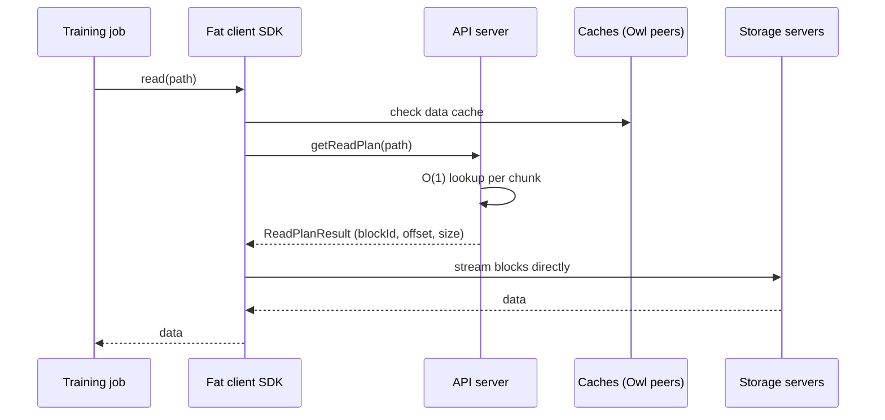

## What happened

Meta published "Inside Prometheus" on Oct 19, 2026, and Blocks and Files summarized the storage side the next day. Prometheus is a gigawatt-scale GPU supercluster in New Albany, Ohio. It is used to build Meta's Muse family of foundation models and is growing from hundreds of thousands of GPUs to about 1 million. A second supercluster, Hyperion, is in Louisiana.

The headline for storage people is that Meta serves training data through a custom, multi-tier object (BLOB) stack on top of its Tectonic storage layer. This replaces the Llama-era approach, an NFS-like file system layered on Tectonic. The article says the file-system design is still widely used elsewhere at Meta.

Note that this is a secondary summary of Meta's own engineering posts. It gives few details on benchmarks, workload mix, or the methodology behind the ingestion numbers.

## Why it matters

Training at this scale makes storage a gating factor for GPU utilization. If thousands of GPUs run in lockstep, one slow read stalls the whole step. That is why the design focuses on tail latency, not just average throughput. Job startup is also costly: loading datasets can leave very expensive hardware idle, which is why the 89-hour to about 3-hour improvement matters.

It also shows an industry direction. Meta's earlier clusters used third-party and file-oriented components: Hammerspace for data orchestration on the Llama 3 clusters, and Pure Storage arrays in the older 16,000-GPU A100 cluster. Prometheus relies on in-house software, with object semantics, client-side intelligence, and heavy caching. Engineers building AI platforms should care about this, because few organizations can do the same, and the article suggests smaller ones could use standalone object stores such as Cloudian, MinIO, or Scality.

## How it works

### Tiers

| Tier | What | Role |
|---|---|---|
| L1/L2 | Host memory and local flash on GPU servers | Fastest cache, including spare GPU-host memory |
| L3 | Regional flash-backed BLOB storage | Staging and reuse across epochs |
| L4 | Durable HDD-backed BLOB/Tectonic, global or regional | Source of truth |

A regional BLOB stack sits alongside the GPUs in every AI region. Tectonic is Meta's regional, multi-tenant storage fabric, which uses erasure coding and HDD/flash tiering.

### Read path

The metadata design is flat. A unified schema on ZippyDB (Meta's key-value store) allows O(1) lookups from path to storage address. The old dataplane proxy is gone. A "fat client" SDK, which embeds a Tectonic BlockClient, talks to storage servers directly.

### Caching and prefetching

- **Distributed data cache.** It uses spare GPU-host memory. Owl components are built into the SDK, so all access passes through the cache. Owl is Meta's system for distributing large hot objects (GBs to TBs) to millions of hosts, using short-lived peer-to-peer trees and a tracker-based control plane.
- **Read-plan metadata cache.** A memcache-like store holds path-to-location mappings for frequently read BLOBs.
- **Prefetching.** Dataloaders fetch the next batch while the current one is processed. An explicit `prefetch()` API hydrates L3 with data needed in the next few minutes and prewarms the metadata cache.
- **Retention.** L3 keeps data for a configured period so later epochs can reuse it. Eviction supports TTL and LRU and is capacity- and quota-aware.
- **Tail-latency tools.** Hedged reads (issuing a duplicate request when one is slow) and dynamic concurrency control.

### Checkpointing

Checkpoints of weights, gradients, and optimizer state are written asynchronously. Data is staged in memory, then flushed to flash, then HDD, and delta checkpointing reduces the volume written. The aim is to limit training stalls. The article cites goodput above 85% for pre-training; it doesn't define goodput further.

### Hardware and network

Storage hardware includes flash platforms (Olympic, Yosemite V3.5 Crater Lake) and Grand Canyon, a 4OU chassis holding up to 72 3.5-inch HDDs (216 or more with head-node-plus-JBOD setups). Meta contributed Yosemite, Crater Lake, and Grand Canyon designs to the Open Compute Project.

On the compute side, Prometheus uses Nvidia GB200 NVL72 (Catalina) and GB300 NVL72 (Clemente), with Vera Rubin (San Miguel) planned. Each building has an Ethernet fabric. Buildings are connected by a Backend Aggregation network spanning 2 km to over 100 km, built from Arista 7800 chassis with Broadcom Jericho3 deep-buffer silicon, offering multiple Pbps per region pair.

## Trade-offs and open questions

- **Sparse evidence.** The 150-minute to 10-minute and 89-hour to about 3-hour numbers come without a stated baseline, job mix, or what "ingestion" includes. Treat them as directional.
- **Fat clients.** Putting logic in the SDK removes a hop, but it makes client upgrades, version skew, and debugging harder, and every training framework must integrate it.
- **Cache dependence.** Spare GPU-host memory is a shared resource. Cache pressure could interact with training memory needs, though the article doesn't discuss this.
- **Prefetch correctness.** Explicit `prefetch()` assumes the job can predict near-term access. Random or irregular access patterns may benefit less.
- **Not generalizable as-is.** This is a bespoke stack built on Tectonic, ZippyDB, and Owl. The article says only hyperscale or near-hyperscale organizations could build similar software themselves.
- **Inference and agents.** The author wonders whether Prometheus will also serve inference and agentic workloads, which have smaller ingestion needs and don't need huge lockstep GPU counts.
- **File vs object.** The article doesn't explain the reasons for dropping the file system for this workload, and it notes the file-system design remains widely used at Meta. So this is not a universal verdict against POSIX-style access.

## What you can apply

- **Treat ingestion as a first-class metric.** Measure time-to-first-step and the longest ingestion across jobs. Tail jobs dominate wasted GPU time.
- **Stage data close to compute.** A regional flash tier between cold storage and GPUs, with TTL/LRU retention matched to epoch reuse, is a pattern you can mimic with commodity object storage plus a cache layer.
- **Prefetch explicitly.** If your dataloader knows the next shards, expose an API to warm caches and metadata ahead of time rather than relying only on reactive caching.
- **Cut hops and metadata cost.** Flat metadata with O(1) lookup, and clients that fetch a read plan then stream directly from storage nodes, avoids proxy bottlenecks.
- **Defend the tail.** Use hedged reads and adaptive concurrency for synchronous workloads where one slow read stalls many workers.
- **Checkpoint asynchronously and tier it.** Snapshot to memory first, flush to flash and then durable storage in the background, and consider deltas. Keep in mind the durability trade-off: a checkpoint in memory or flash only is not yet safe against node or rack loss, so define how long a checkpoint stays in each tier before you count it as recoverable. The article doesn't give Meta's RPO or recovery targets.
- **Smaller teams.** Standalone object stores (MinIO, Scality, Cloudian) with a caching layer may cover the need without a custom stack.

## Glossary

- **Prometheus:** Meta's gigawatt-scale AI training supercluster in Ohio.
- **Tectonic:** Meta's regional, multi-tenant storage fabric using erasure coding and HDD/flash tiering.
- **BLOB:** Binary large object; object-storage-style access, as opposed to a file-system interface.
- **Owl:** Meta's peer-to-peer system for distributing large, hot objects to many hosts.
- **ZippyDB:** Meta's key-value store, used here for flat metadata.
- **Fat client:** An SDK that carries significant logic and talks directly to storage servers instead of via a proxy.
- **Hedged read:** Sending a backup request when the first is slow, to reduce tail latency.
- **Goodput:** The fraction of time spent doing useful training work. The article doesn't define it further.
- **BAG:** Backend Aggregation network linking buildings over 2 km to over 100 km.
- **Delta checkpointing:** Saving only what changed since the last checkpoint.
