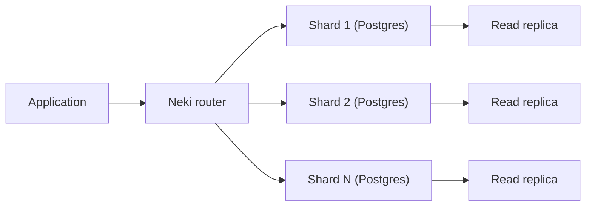

## What happened

PlanetScale published a progress update on Neki after about a month in platform preview. The post is by Nick Van Wiggeren. The team says it is working toward production readiness and lists what has shipped since launch.

The update covers four areas:

- **Infrastructure:** read-only replicas, smaller and cheaper Metal nodes, Azure support, and a huge-pages setting.
- **Tooling:** Terraform and CLI updates, extension management, and MCP metrics.
- **Query layer:** broader SQL coverage and faster bulk operations.
- **Evaluation:** how to start testing Neki against your workload.

I could only get a summary of the page, not the full text. This write-up relies on that summary. The post may contain detail I haven't seen.

## Why it matters

Postgres scales vertically very well. At some point a single primary stops being enough, because of write throughput, dataset size, or operational limits. Then you have three choices:

- Shard the application yourself.
- Adopt a distributed-SQL system that is Postgres-compatible but not Postgres.
- Use a sharding layer on top of real Postgres.

Neki is the third option. PlanetScale is best known for Vitess, which shards MySQL. Neki is its effort to bring a similar model to Postgres.

The update matters mainly because of where the work went. Sharding layers usually fail on compatibility, not raw speed. If `MERGE`, correlated `EXISTS`, cursors, or `INSERT ... ON CONFLICT` break once data is sharded, the application has to change. The list of constructs that now work unchanged is the most useful part of the post.

Read replicas also matter. The post says customers with large, global user bases asked for them. That points to Neki's expected users: teams with big, geographically spread read traffic.

## How it works

The post is a feature roundup, not an architecture paper, so the internals are only partly visible. These are the pieces it names:

- **Router:** a Terraform resource called `planetscale_neki_router` exists, so queries go through a routing tier.
- **Admins and sidecars:** the CLI mentions these components alongside configuration profiles.
- **Shards:** each shard is a Postgres instance. The `EXPLAIN` feature shows the plan each shard ran.
- **Configuration profiles:** these hold Postgres parameters and enabled extensions.

This diagram is my simplification from the component names, not a diagram from the post.

### Distributed queries and EXPLAIN

A query that touches several shards needs a distributed plan. The router splits the work, sends fragments to shards, and merges the results. `EXPLAIN (NEKI_PG_PLAN)` prints that distributed plan plus the standard Postgres plan from each shard. You can see whether a query hit one shard or fanned out to all of them, and what each shard did with its piece.

### SQL coverage

The post lists these as now working unchanged:

| Area | Newly supported |
|---|---|
| Writes | `INSERT ... SELECT ... ON CONFLICT`, cross-shard `UPDATE ... FROM`, `DELETE ... USING`, `MERGE` |
| Subqueries | Correlated `EXISTS` in most positions, `ARRAY(SELECT ...)` |
| Session and server features | SQL cursors, `LISTEN`/`NOTIFY`, materialized views, PL/pgSQL exception handlers |
| Export | `COPY ... TO STDOUT` on sharded tables (text, CSV, binary), so pg_dump-style tools can export |

"Most query positions" for `EXISTS` means some positions still don't work.

### Infrastructure details

- **Metal sizing:** the smallest nodes are 1/8 vCPU, 1 GB RAM, and 10 GB of local NVMe. They start at $50/month. "Metal" means locally attached NVMe storage, not network-attached volumes.
- **Huge pages:** set to `on` in the Parameters tab of a configuration profile, on supported cluster sizes. It needs a restart.
- **Extensions:** enable them by name with the `planetscale_neki_configuration_profile` Terraform resource or `pscale branch config-profile update --extensions`.
- **Versions:** Terraform provider v1.13.0 adds parameter management for the router. CLI v0.346.0 adds a "requires update" column and JSON field, so you can see which components are behind their configuration.
- **MCP:** `planetscale_get_branch_metrics` returns CPU, memory, disk, replication lag, and connections for Neki, Postgres, and Vitess.

## Trade-offs and open questions

- **Still a preview.** The post names no production date and no list of remaining gaps. Treat it as a progress report.
- **Unquantified performance claims.** "76x" and "5x" are relative to launch. A slow launch baseline can make a large multiplier. They don't tell you how Neki compares with unsharded Postgres or other sharded systems.
- **Cross-shard cost.** Supporting `MERGE` or `UPDATE ... FROM` across shards means the statement works. It doesn't mean it is cheap. Cross-shard writes usually need coordination, and the post doesn't describe the transactional guarantees. Check isolation, atomicity of multi-shard writes, and failure behavior before you rely on them.
- **Replica consistency.** The summary doesn't say how read-only replicas handle lag or read-your-writes. The MCP metrics expose replication lag, which suggests it is something to monitor.
- **Small nodes are for evaluation.** A 1/8 vCPU, 1 GB node is for testing, not for production load.
- **Alternatives.** Application-level sharding gives control but costs engineering time. Distributed SQL systems offer built-in scaling but are not Postgres. Neki bets on staying close to real Postgres. How close it gets, extension by extension and feature by feature, is the open question.

## What you can apply

- **Decide whether you need to shard.** The post points to the docs "When to shard," "Neki best practices," and "Data topology." Often a bigger instance, read replicas, or better indexes delay sharding.
- **Test your own SQL.** Collect your real query patterns, especially multi-table writes, upserts, and subqueries. Run them through a preview cluster. Use `EXPLAIN (NEKI_PG_PLAN)` to find queries that fan out to every shard.
- **Choose the shard key early.** This is true of any sharded system. Queries that include the key stay on one shard. Queries that don't must visit all of them. The post doesn't cover key selection, so read the Neki docs on it.
- **Check your tools.** Test pg_dump, your ORM, migration tooling, and any use of `LISTEN`/`NOTIFY` or cursors. Compatibility claims are best verified with your own stack.
- **Test bulk loads.** If you plan to migrate in, measure `COPY` and `INSERT ... SELECT` throughput with your own data shape, because the speedups are relative to launch.
- **Automate configuration.** Use the Terraform provider (v1.13.0 or later) for extensions, parameters, and the router. Use the CLI's "requires update" indicator to find components that need a restart or rollout.
- **Plan for migration safety.** The post doesn't describe a migration path. Before cutover, ask about RPO/RTO, replication-lag behavior, and how to verify row counts and checksums between the old and new systems. Run the old and new systems side by side if you can.

## Glossary

- **Sharding:** splitting a dataset across multiple database instances by a key.
- **Neki:** PlanetScale's sharded Postgres product, currently in platform preview.
- **Metal:** PlanetScale's node type with locally attached NVMe storage.
- **Read-only replica:** a copy of a shard that serves reads and does not accept writes.
- **Router:** the tier that receives queries and sends them to the right shard or shards.
- **Configuration profile:** a named set of Postgres parameters and extensions applied to a cluster.
- **Huge pages:** an OS memory feature that can reduce overhead for large memory use, and for Postgres needs a restart to enable here.
- **`EXPLAIN (NEKI_PG_PLAN)`:** Neki's command that shows the distributed plan and each shard's Postgres plan.
- **Vitess:** the open-source system PlanetScale uses to shard MySQL.
- **MCP server:** a Model Context Protocol endpoint that lets AI tools query PlanetScale data such as branch metrics.
