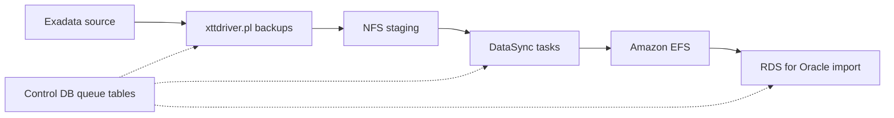

## What happened

U.S. Bank had a fixed deadline to leave its data centers. It had to move four Oracle 19c databases, about 119 TB in total, from Exadata to Amazon RDS for Oracle. The link was a shared AWS Direct Connect connection with throttled bandwidth.

AWS published the pipeline the team built. It combines Oracle's own transportable tablespace tooling with DataSync for transfer and EFS as the landing zone that RDS imports from.

| System | Data (TB) | Duration (hrs) | Throughput (MBps) |
|---|---|---|---|
| Regulatory | 8 | 12 | 204 |
| Finance Data Warehouse | 51 | 90 | 162 |
| Central Data Warehouse | 22 | 39 | 160 |
| Risk | 38 | 32 | 339 |
| **Total** | **119** | **173** | **216 (avg)** |

Each cutover averaged about 4 hours (range 2–6). The whole programme took several weeks, because cutovers were staggered to fit change windows. The 7-day baseline figure is the initial copy only.

## Why it matters

Large Oracle estates are hard to move to the cloud for three reasons, and this case has all of them:

- **Bandwidth is finite.** At 1 Gbps, even a perfectly used link moves roughly 10 TB a day. Raw copying of 119 TB would take a long time, and the business was still using the link.
- **The data keeps changing.** The source produced up to 4 TB of changes per day from ETL jobs. A one-shot copy would be stale before it finished, so the design needs an incremental catch-up loop.
- **Exadata-specific features don't carry over.** HCC (up to 50:1 compression) isn't available on RDS. Recompressing with Advanced Compression could expand the data 3–5x, which affects storage sizing and cost.

Anyone planning a data-centre exit with big databases and a modest pipe can reuse this pattern. It also shows why logical replication tools such as GoldenGate aren't always needed. If your business can accept a cutover of a few hours, physical-ish tablespace transport is cheaper and has fewer moving parts.

## How it works

### Overall flow

### 1. Source-side orchestration

- An `XTTS_SOURCE_CONFIG` table lists each tablespace with its NFS staging path, priority and an enabled flag.
- A Primary process runs from cron every 5 minutes. It starts up to 18 parallel Workers.
- Each Worker runs Oracle's `xttdriver.pl` to take a Level-0 (full) or incremental RMAN backup of one tablespace.
- On success the Worker writes a `STAGED` row to a queue table.
- The process is idempotent. It skips tablespaces that are busy or incomplete and retries them on the next cycle. No human has to babysit failures.

### 2. Transfer with DataSync

DataSync moves the converted datafiles from on-premises NFS to EFS.

- **Compression.** About 80% in-flight compression. The team saw roughly 1.16 Gbps of effective throughput while using about 0.25 Gbps of Direct Connect bandwidth. (The article cites both a 4x and a 4–5x multiplier, so treat the exact ratio as data-dependent.)
- **Scheduled throttling.** Conservative during business hours, open overnight and at weekends, in line with the 500 Mbps / 1 Gbps caps.
- **One task per tablespace.** Transient failures retry at a small granularity.
- **Integrity checks.** End-of-transfer verification, with the logs kept as audit evidence. That matters in a bank.

### 3. Target-side import

- EFS was configured with Elastic throughput and Regional (not One Zone, which caps throughput).
- Mounts followed AWS NFS guidance: NFSv4.1, 1 MB I/O sizes, hard mounts, and amazon-efs-utils.
- RDS imports with `rdsadmin.rdsadmin_transport_util.import_xtts_tablespaces`.
- EFS was chosen over S3 because it has no file-size limit and integrates directly with RDS.

### Migration sequence

| Step | Action | Source status |
|---|---|---|
| 1 | Level-0 full backup | Read-write |
| 2 to 2.N | Incremental backups | Read-write |
| 3 | Set tablespaces read-only | Read-only |
| 4 | Final incremental backup | Read-only |
| 5 | Export tablespace metadata | Read-only |
| 6 | Transfer and import on target | Read-only |
| 7 | Validate import | Read-only |
| 8 | Return source to read-write or decommission | Complete |

Only steps 3 to 7 are downtime. The long baseline and the incrementals run while the source is live. The final incremental usually took minutes. Most of the 4-hour cutover went on statistics gathering, validation and compiling objects.

## Trade-offs and open questions

- **Downtime of hours, not minutes.** XTTS suited a roughly 4-hour tolerance. The article says a sub-hour target would have required GoldenGate to provide a real-time fallback path.
- **Rollback is simple but bounded.** The source remains read-only until validation passes, so you can flip it back to read-write. After the target accepts writes, a return path would need its own design. The article doesn't describe one.
- **Throughput varies with data shape.** Risk ran at 339 MBps while the warehouses ran at about 160. The article says even tablespace sizes kept DataSync agents busy. One huge tablespace becomes a serial bottleneck. This is an inference from their explanation, not a measured experiment.
- **The compression multiplier isn't guaranteed.** The 4x vs 4–5x discrepancy in the article shows it depends on the content. Already-compressed data would gain less.
- **Platform limits force re-modelling.** The 16 TB ext4 bigfile limit meant reorganising tablespaces by business domain, plus index rebuilds and purges.
- **Operational gaps.** Terraform covered RDS, EFS, DataSync and EC2, but the team needed custom IaC for DataSync and EFS. Golden-image patching replaced automatic patching.
- **Source thinness.** The article gives results and outline code, but no failure statistics, no cost figures beyond qualitative statements, and no detail on validation methods beyond "validate import".

## What you can apply

**Plan the migration around change rate and link capacity.**
- Compute baseline time from the effective throughput, not the nominal link speed. Test your compression ratio on real data first.
- Make sure your incremental cycle finishes faster than the change accumulates. Here, up to 4 TB/day of change had to fit within the transfer capacity, hence frequent incrementals.

**Consistency and ordering.**
- Incrementals are taken while the source is read-write. Consistency is only established at the final step, when tablespaces go read-only and the last incremental plus metadata export are captured. Put your write freeze at that point and not earlier.
- Don't resume application writes on the source after cutover without a plan for the data written to the target.

**RPO/RTO.**
- RPO is effectively zero for committed data because the source is frozen before the final sync. RTO for cutover was 2–6 hours (about 4 on average). Rehearse to find your own number.
- Rollback is cheap only until the target takes writes. Decide that decision point in advance.

**Verify before you commit.**
- Keep the transfer logs as evidence. Validate the import before re-enabling writes anywhere. Budget time for statistics gathering and object compilation, which dominated the cutover.

**Pre-flight checklist (these caused real friction):**
1. Tablespace sizes against the 16 TB limit.
2. HCC usage. Find the tables early with AWR/ASH and `dba_segments`, and size the target on the uncompressed footprint.
3. Character sets. Three databases were AL32UTF8 and one was US7ASCII. The RDS DB character set can't be changed after creation.
4. Time zone file versions on source and target (`V$TIMEZONE_FILE`).
5. `COMPATIBLE` on the target equal to or higher than the source.

**Design the orchestrator for failure.**
- Use a config table, a queue table and an idempotent cron loop. Make each unit small, such as one tablespace per task, so a retry is cheap.

**Plan post-migration tuning.**
- Auto DOP chose about 28 threads, which made stats gathering overrun maintenance windows. They set it to 16 with `CONCURRENT` set to `AUTOMATIC`.
- Other settings they used: `parallel_degree_policy` AUTO, `parallel_min_time_threshold` 10, `db_file_multiblock_read_count` 128, NVMe instance storage for temp space, and Resource Manager consumer groups to separate batch from interactive work.
- Turn on CloudWatch and Database Insights from day one.

## Glossary

- **XTTS (cross-platform transportable tablespaces):** Oracle's method of copying tablespace datafiles between platforms using RMAN backups and incrementals, plus a metadata export and import.
- **Level-0 backup:** A full RMAN backup that serves as the base for later incrementals.
- **HCC (Hybrid Columnar Compression):** An Exadata-specific compression feature (up to 50:1) that isn't available on RDS.
- **AWS DataSync:** A managed transfer service that moves data between NFS and AWS storage, with compression, throttling and integrity verification.
- **Amazon EFS:** A managed NFS file system. Here it is the landing zone from which RDS imports datafiles.
- **Direct Connect:** A dedicated network connection from on-premises to AWS.
- **Bigfile tablespace:** A tablespace backed by a single large datafile. Capped at 16 TB on RDS (ext4).
- **COMPATIBLE:** An Oracle parameter setting the database's compatibility level. The target must be equal to or higher than the source.
- **Auto DOP:** Oracle's automatic choice of degree of parallelism for statements.
- **GoldenGate:** Oracle's real-time replication tool, which would be needed for sub-hour cutovers.
