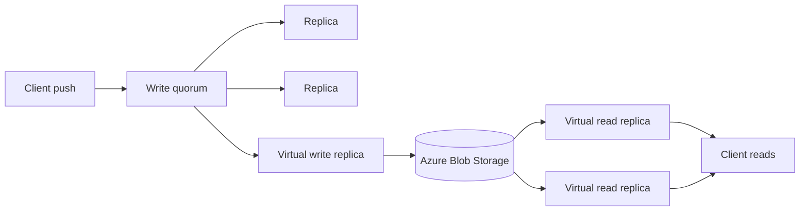

## What happened

GitHub engineers Eleanor White and Victoria Dye published a progress report on moving Git storage into Azure. They say almost all repositories are already in Azure. Most repositories now have two of their five replicas there, and Azure serves about half of Git traffic. The first Azure copy appeared in Central US in August 2025.

The hold-outs are the busiest repositories. Their write rate is already near the ceiling of the replication protocol. Adding a replica about 1,000 miles away adds about 25ms per round trip, and a write needs several round trips.

The post describes two changes. The first, per-reference quorums, lifts the write ceiling enough to move the last repositories. The second, object storage as a quorum member plus ephemeral read replicas, is the next architecture. A final post is promised for GitHub Universe on October 28–29, 2026.

## Why it matters

Agent traffic is the stated driver. Many agents and developers push, fetch and clone at once, and GitHub says Git traffic has grown rapidly over the past year. It also cites a hard ceiling on power capacity in its data centers and the surrounding region, plus supply chain limits on hardware. Remaining capacity allowed a safe migration, but not a slow one.

The sequencing is a useful lesson in itself. GitHub judged that changing the storage architecture and the hosting platform together was too risky. So it moved the data first and evolved the design afterward. Git is "Tier 0": nearly everything depends on repository data.

The broader trend is the usual one for stateful systems. Teams decouple storage from compute, put durable state in object storage, and treat compute as disposable. They also cut coordination to the minimum a correctness rule actually needs.

## How it works

### The starting point: Spokes

Spokes is GitHub's replicated Git storage layer. Most repositories have five replicas. A write commits when a majority accepts it. Spokes also does the following:
- It routes requests, preferring a replica in the same region and availability zone. Traffic follows data as replicas move.
- It exposes a unified API used by internal clients for well over 100 billion operations per day.
- It runs background "sweepers" that handle placement, repair and rebalancing.

### The long-tail problem

Spokes only needs a majority to commit, but it waits for every healthy replica to respond, up to a timeout. Each write also holds a repository-wide lock until it commits. That has three effects:
- The slowest healthy replica sets the latency of every write.
- The slowest replica also sets the throughput ceiling, because one write is in flight at a time.
- An Azure replica 25ms away makes each serialized write slower. A repository near its ceiling falls further behind with every push.

### Fix 1: per-reference quorums

Git's consistency requirement applies per reference (ref). Once a server accepts an update, no client should see an older value. That holds for fast-forwards, force pushes and deletes. Updates to different refs usually don't depend on each other. For example, agents often push to their own branches.

So the quorum's scope moves from the repository to the ref. Only writes that contend on the same ref wait for each other. Each write still pays cross-region latency, but writes to different refs can be in flight together. The ceiling rises roughly in proportion to how many refs are written concurrently.

### Fix 2: separate reads from writes

**Virtual write replica.** Object storage joins the quorum through an ephemeral compute node. It streams incoming writes and serves no reads. A write isn't acknowledged until it is durable in object storage. It also coalesces transactions on disjoint refs into one set of network I/Os, so a busy repository pays one round trip for many concurrent writes. For now it also handles compaction, and read replicas inherit the compacted state.

**Virtual read replicas.** These can be created on demand. Each warms its cache from Blob Storage and serves reads without joining the quorum. Blob Storage is the source of truth, and replicas reconcile against it in the background. Reads could then use much more memory for cache. Today that memory competes with compaction.

In GitHub's testing, its distributed load-testing harness hit its own limits before it hit the virtual read replicas' limits. The post gives no absolute numbers for this.

## Trade-offs and open questions

- **Background reconciliation** suits some read workloads but not all. A replica can lag behind the source of truth. The planned fix is in-line reconciliation, which fetches only the ref state and data changed since the replica last caught up.
- **The quorum is still the limit.** Per-reference serialization was an incremental gain. The post asks how to push write throughput further.
- **Replicas still hold full copies.** Every write waits on them, though little of a write needs ordering. Git objects are immutable and content-addressed, so they can be stored without replica agreement. What still needs ordering is small, and the hard part is ordering it quickly without moving the bottleneck.
- **Second-order problems:** where durable ref state lives, and how compaction and garbage collection scale.
- **Evidence is thin.** The 3–4x figure comes from internal testing on "realistic traffic". The post gives no baselines, percentile latencies or failure-mode data. It also says a small consensus group will remain in the stack, and promises an explanation later.

## What you can apply

- **Scope your locks to the invariant.** If correctness is per key, per ref or per partition, don't serialize at the object level. Check what your "repository-wide" lock actually protects.
- **Watch for "majority commit, wait for all."** If you wait for every healthy replica, tail latency decides your throughput. This matters most when you add a distant replica. Consider acking at quorum, or hedging.
- **Migrate in two moves.** Move the data and keep the architecture, then change the architecture. Use preferential routing so traffic follows data. Replica count stays constant, so durability doesn't drop during the move.
- **Coalesce I/O across independent writes.** Batching disjoint transactions into one object-store round trip hides latency without breaking ordering.
- **Make object storage the source of truth and compute ephemeral.** Read replicas can then be added on demand, with caches warmed from the store. Decide early whether stale reads are acceptable, or whether you need in-line catch-up.
- **Verify the ordering you need.** Immutable, content-addressed data needs no consensus. Only the small mutable pointer state, such as refs, does. Reducing the consensus footprint to that layer is a sound design principle.

The post doesn't give RPO/RTO figures, cutover procedures or verification methods, so treat those as undisclosed.

## Glossary

- **Spokes:** GitHub's replicated Git storage system. It handles routing, quorum writes and repair.
- **Quorum:** The majority of replicas that must accept a write for it to commit.
- **Reference (ref):** A named pointer in Git, such as a branch or tag, that maps to a commit.
- **Per-reference quorum:** Serializing and committing writes per ref instead of per repository.
- **Virtual write replica:** An ephemeral quorum member that streams writes to object storage and serves no reads.
- **Virtual read replica:** A stateless, on-demand reader that warms its cache from object storage and is outside the quorum.
- **Compaction:** Consolidating stored Git data into a more efficient form.
- **Tier 0:** The most critical class of service, one that other systems depend on.
- **Content-addressed:** Stored under a name derived from its contents, which makes objects immutable.
