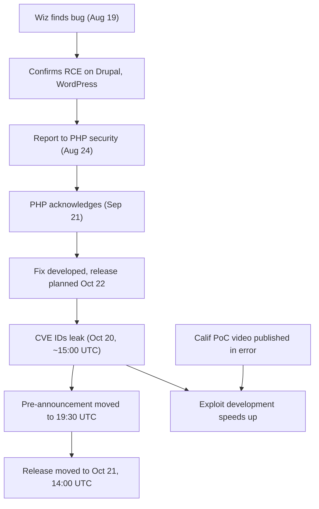

## What happened

Simon Willison's link post summarizes a PHP Foundation write-up. Today's releases cover the entire PHP 8.x line and fix two RCE vulnerabilities. Simon's advice is blunt: if you run anything on PHP, upgrade.

The release was meant to be a normal coordinated disclosure, but it leaked. On Tuesday, October 20, at around 15:00 UTC, the two CVE IDs began circulating online. The posts carried an incorrect release time and a CVSS score of 10.0. The PHP Foundation says the correct score is 9.2.

PHP then moved faster than planned:

- The pre-announcement was moved up to 19:30 UTC on October 20.
- The release was moved from October 22 to October 21 at 14:00 UTC.

A second problem made things worse. One of the reporting security firms, Calif, mistakenly published a proof-of-concept video showing the exploit against several targets. The Foundation says it revealed some extra, limited details. Copies spread on social media, which sped up exploit development.

Wiz Research's timeline, as quoted in the post:

| Date (2026) | Event |
|---|---|
| Aug 19 | Wiz discovers the first vulnerability |
| Aug 20 | Unauthenticated RCE confirmed against Drupal |
| Aug 21 | Unauthenticated RCE confirmed against WordPress |
| Aug 24 | Wiz reports to the PHP security team |
| Sep 21 | PHP acknowledges the reports and starts developing a coordinated fix |
| Oct 21 | Patched releases and public disclosure |

## Why it matters

PHP runs a large share of the web, including CMSs such as WordPress and Drupal. An unauthenticated RCE in the runtime, rather than in one application, means a single bug class can affect many unrelated sites. Wiz confirming exploits against both of those CMSs within two days shows how broadly the bugs reach.

The timing also matters. Once CVE IDs and a PoC video are public, attackers can start working on exploits before most operators have patched. Defenders usually get a quiet period between a coordinated release and the first exploits. Here that window shrank to near zero, and it may have been negative for anyone watching the right forums.

This fits a wider trend. Disclosure embargoes are hard to hold with many parties involved: reporters, maintainers, distro vendors, and CVE tooling. Each extra party is another place for a leak.

## How it works

The source post doesn't describe the technical root cause of either bug, so I won't guess. What it does show is how the disclosure pipeline worked and where it failed.

Some terms for reading this:

- **Coordinated disclosure**: reporters and maintainers agree on a date, fix privately, and publish details and patches together.
- **Pre-announcement**: an advance notice that a security release is coming, so operators can schedule patching. It usually contains no technical detail.
- **CVSS**: a 0–10 severity score. The leaked 10.0 was overstated. The Foundation's figure is 9.2, which is still critical.

Two things went wrong. The CVE IDs leaked with wrong metadata, which gave attackers a signal and misled everyone else about timing. A reporter also published a PoC video that showed exploitation against several targets and gave away limited extra detail. Copies spread on social media.

## Trade-offs and open questions

- **Detail I couldn't verify.** The page doesn't name the CVEs, the affected version ranges, or the fixed releases. It also doesn't say whether older, unsupported PHP versions are affected. "Entire 8.x line" is all I can say.
- **Who leaked and how.** The summary says the IDs began circulating online, but not the source. The Foundation's title promises changes to how it strengthens PHP security. I haven't seen those changes, so I can't assess them.
- **Time to patch.** Reports went in on Aug 24, but PHP only acknowledged them on Sep 21. That is four weeks before a fix effort began, then a month more to release. Whether that pace is acceptable is debatable, and the source doesn't explain the gap.
- **Embargo versus speed.** Moving the release up a day or two limits the exposure window, but it compresses patching time for distros, hosts, and container image maintainers.
- **Exploitation scope.** The Wiz timeline confirms PoCs against Drupal and WordPress. It's unclear which configurations are exploitable, and whether exposure depends on particular extensions or application code.

## What you can apply

1. **Patch first, then read.** Get the exact fixed versions from the PHP Foundation and Wiz posts. Upgrade production PHP runtimes now, prioritizing internet-facing hosts running WordPress, Drupal, or any public PHP endpoint.
2. **Inventory your PHP.** Include base images, shared hosting, vendor appliances, and CI containers. Rebuild and redeploy images rather than patching in place. Distro packages may lag upstream, so check your vendor's advisory.
3. **Assume exploitation is possible.** Exploits have been circulating since the night before the release. For exposed hosts, check logs from October 20 onward for unusual requests, new files in web roots, unexpected child processes of php-fpm or Apache, and outbound connections from web servers.
4. **Reduce blast radius while you roll out.** Where a patch can't land immediately, use WAF rules from your vendor, restrict network egress from web servers, run PHP as a low-privilege user, and use read-only filesystems where possible. These measures limit damage but don't fix the bug.
5. **Verify after rollout.** Check `php -v` on running workers, not just on the image. Restart php-fpm or Apache so old processes don't keep running the vulnerable binary.
6. **Fix your own embargo hygiene.** If you run coordinated disclosure, keep the list of people who see CVE IDs short. Don't put metadata in shared tools early. Review reporters' publishing practices, and have a plan to accelerate the release when a leak happens, as PHP did.

## Glossary

- **RCE (remote code execution)**: a flaw that lets an attacker run their own code on a target server.
- **Unauthenticated RCE**: RCE that needs no login.
- **CVE**: a public identifier for a specific vulnerability.
- **CVSS**: a 0–10 severity scoring system. The Foundation puts these bugs at 9.2.
- **Coordinated disclosure**: a process where fixes are prepared privately and published together with the details.
- **PoC (proof of concept)**: a demonstration that a vulnerability can be exploited.
- **PHP Foundation**: the non-profit that funds and supports PHP's core development.
- **Wiz Research**: the security research team that reported the vulnerabilities to PHP.
