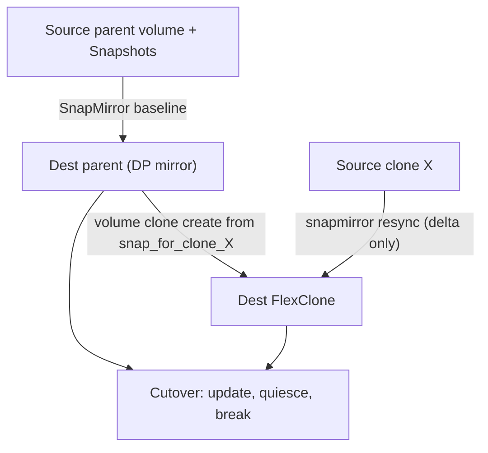

## What happened

AWS published a migration pattern for moving ONTAP volumes that have long-lived FlexClones into Amazon FSx for NetApp ONTAP. The scenarios covered are on-premises to FSx, FSx to FSx, and across AWS accounts. The post uses a customer, Pearson, as the case study. Pearson runs a 50 TB Oracle ERP platform with more than 40 development projects that depend on FlexClone. It needed to move from a Gen1 file system, capped at 192 TB, to Gen2.

The technique uses only standard ONTAP features: SnapMirror, FlexClone, and `snapmirror resync`. The post's contribution is the sequence that stitches them together so the destination keeps the space savings the source had.

## Why it matters

FlexClone is popular for dev, test, QA, and UAT copies of large databases because clones are nearly free. A clone shares blocks with its parent and only consumes space for changes. Teams often forget how much capacity depends on this until they migrate.

Migration is where the savings disappear. A cheap-looking 2 TB database with 10 clones is really about 2.2 TB of physical data. Copying it file by file produces 22 TB. That means:

- ten times the transfer time,
- ten times the destination capacity and cost, and
- a long dual-run period while you pay for both environments.

If you re-create clones from the parent instead, you lose the in-progress work and Snapshot lineage in each clone.

This matters to anyone with storage-heavy dev/test workflows who is consolidating or moving ONTAP data to the cloud. The same pattern appears in other copy-on-write systems: the efficiency lives in the storage layer's metadata, so a migration has to work at that layer.

## How it works

The core point is that the clone relationship is block-sharing metadata inside ONTAP. Only a block-level, Snapshot-aware replication engine such as SnapMirror can carry it across. The article's workflow:

**1. Mirror the parent.** On the destination, create a SnapMirror relationship (type DP, policy `MirrorAllSnapshots`) and initialize it. This is the one large transfer. In the example it was 1.95 TB. `MirrorAllSnapshots` brings the Snapshots along, and those Snapshots are the shared ancestors you need next.

**2. Find the base Snapshots.** List the Snapshots on the destination parent and identify which one each source clone was created from. The article calls them `snap_for_clone_*`.

**3. Create destination clones.** Run `volume clone create` with `-parent-snapshot` set to the matching Snapshot. The destination clone now equals the source clone's starting point and shares blocks with the destination parent. It is missing the changes made on the source clone since creation.

**4. Resync clone to clone.** Run `snapmirror resync` with the source clone as the source and the new destination clone as the destination. Because both sides share a common Snapshot, ONTAP only sends the divergent blocks. The article's figures: about 22 GB for one clone, with the clones ranging from 5 to 22 GB and about 53 GB combined across the example.

**5. Repeat and parallelize.** Once the parent mirror exists, the clone resyncs can run concurrently.

**6. Cut over.** For each volume, run a final `snapmirror update`, then `quiesce`, then `break`. Do the parent and all clones, then redirect clients.

**7. Verify.** Use `volume clone show` to confirm the relationships. Use `volume show -fields physical-used` to confirm space. The article's example shows dev1 at 22 GB, dev2 at 18 GB, qa1 at 8 GB, qa2 at 5 GB, and the parent at 1.95 TB.

| Approach | Preserves clones? | Data moved for the 2 TB + 10 clones example |
|---|---|---|
| rsync / robocopy / DataSync / NFS/SMB | No | Every file, about 22 TB |
| NDMP backup and restore | No (independent volumes) | About 22 TB |
| SnapMirror + FlexClone + resync | Yes | About 1.95 TB parent plus about 5–22 GB per clone |

## Trade-offs and open questions

- **Common Snapshot dependency.** If a clone's base Snapshot has been deleted on the source, or was never mirrored, this approach breaks down. The article lists a common Snapshot as a hard requirement but gives no fallback.
- **Ordering constraints.** The parent comes first. Nested clones go grandparent, then parent, then child. Deep clone trees need careful planning.
- **Same-vendor lock-in.** It only works between ONTAP systems with compatible versions and SnapMirror licensing. It doesn't help with moving to non-ONTAP storage.
- **Throughput.** The destination file system must be sized for the SnapMirror transfers. The baseline can take hours for large volumes.
- **Operational scale.** Hundreds of volumes mean hundreds of commands. The article suggests scripting with the ONTAP REST API or Ansible. Pearson generated its commands programmatically.
- **Evidence.** The numbers are from a worked example and one customer case. The Pearson cost figures are the article's estimates, not measured savings. The article doesn't give failure-handling guidance, such as what to do if a resync fails partway through.

## What you can apply

- **Inventory before you plan.** List the clones, their parents, their base Snapshots, and the physical versus logical size. If logical size is much bigger than physical, file-level tools will cause a capacity blowup.
- **Protect base Snapshots.** Don't let retention policies delete `snap_for_clone_*` Snapshots on the source until migration is done. Check that each parent and clone share a Snapshot before you start.
- **Build a lineage-ordered runbook.** Topologically sort the volumes so parents are always migrated before their children. Generate the commands from inventory data through the REST API or Ansible.
- **Treat the cutover as consistent per volume.** Each volume gets its own final update, quiesce, and break. The article doesn't claim cross-volume consistency. If your application spans the parent and clones, schedule one window and sequence the final updates deliberately.
- **Shrink the downtime window.** Run baseline and resyncs well ahead of time, then run repeated incremental `snapmirror update` calls. The final one only has to move the last delta. Your RPO at cutover is roughly the change since the last update, so the more frequent the updates, the smaller the final transfer.
- **Verify afterward.** Check `volume clone show` for the relationships. Compare `physical-used` against expectations: clones should be GB-sized, not parent-sized. If a clone is large, the relationship was lost.
- **Plan capacity from physical size.** Size the destination for about 2.2 TB in the example, not 22 TB. Add headroom for clone growth, and confirm the throughput.
- **Keep the source until verified.** The article doesn't prescribe a rollback, but keeping the source intact until clients are validated is the safe default.

## Glossary

- **FlexClone:** An ONTAP writable, space-efficient clone of a volume. It shares blocks with its parent and stores only the changes.
- **SnapMirror:** ONTAP's block-level, Snapshot-aware replication between volumes, clusters, or SVMs.
- **`snapmirror resync`:** Re-establishes a relationship from a common Snapshot and transfers only the divergent data.
- **Snapshot:** A point-in-time, read-only image of a volume. It is the shared ancestor that makes incremental transfer possible.
- **SVM (vserver):** A storage virtual machine, the logical tenant unit in ONTAP that owns volumes and network access.
- **DP (data protection) relationship:** A SnapMirror destination type that is read-only until you break the relationship.
- **NDMP:** A network data management protocol for backup and restore. It restores volumes as independent copies, without clone relationships.
- **Dual-run cost:** The cost of paying for the source and destination environments at the same time during migration.
