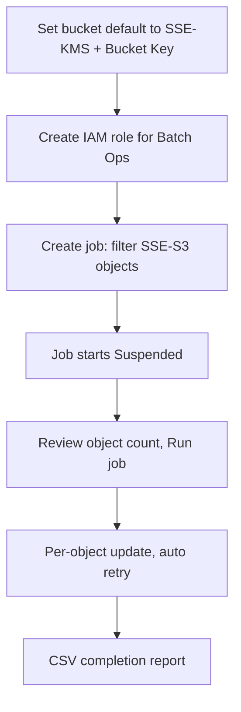

## What happened

AWS's storage blog published a walkthrough of using S3 Batch Operations with the new `UpdateObjectEncryption` API. The example standardizes a general purpose bucket from SSE-S3 to SSE-KMS, using a customer managed key with S3 Bucket Keys enabled.

You don't need a manifest for this. Batch Operations can generate the object list itself from a filter such as "encryption type = SSE-S3". The job then updates each object's encryption and writes a CSV completion report with a Succeeded, Failed or Skipped result per object.

## Why it matters

Compliance regimes such as FedRAMP and PCI-DSS, or internal audits, often require data to be encrypted with a customer managed key. Large organizations accumulate buckets holding hundreds of millions or billions of objects under mixed encryption settings. Changing the bucket's default encryption only affects new writes, so the existing data stays as it was.

Until now the standard fix was a Batch Copy job that rewrote every object onto itself. That approach is expensive, and it also changes object state: new timestamps, new versions, tiering resets and restore requirements. For many teams these side effects mattered more than the copy cost. The new API turns encryption into a metadata-level operation. This fits a wider trend of cloud providers making governance changes, such as key rotation and encryption posture, operations that don't move data.

## How it works

**Old path vs. new path**

| Aspect | Batch Copy (old) | UpdateObjectEncryption (new) |
|---|---|---|
| Data movement | Rewrites the object | None, in place |
| Max object size | 5 GB | Any size |
| Timestamps / Lifecycle clock | Reset | Lifecycle eligibility preserved |
| Versioned buckets | Creates new versions | Acts on the current version, or on a version ID you specify in the manifest |
| Archive tiers | Restore first | Works regardless of storage class |

**Workflow**



**Step 1: Default encryption.** Set the bucket's default encryption to SSE-KMS with your key and Bucket Key enabled. This only covers new objects. The article also recommends a bucket policy that denies `PutObject` requests that don't specify the intended KMS key.

**Step 2: IAM role.** Create a role that trusts `batchoperations.s3.amazonaws.com`. Its inline policy needs these permissions:
- `s3:UpdateObjectEncryption`, `s3:GetObject` and `s3:GetObjectVersion` on the source objects
- `kms:Decrypt`, `kms:GenerateDataKey`, `kms:Encrypt` and `kms:ReEncrypt*` on the key
- `s3:PutObject` on the report bucket
- `s3:PutInventoryConfiguration` on the source bucket

**Step 3: Job.** The CLI form from the article:

```bash
aws s3control create-job \
  --account-id 111122223333 \
  --operation '{"S3UpdateObjectEncryption": {"ObjectEncryption": {"SSEKMS": {"KMSKeyArn": "arn:aws:kms:us-east-1:111122223333:key/your-kms-key-id", "BucketKeyEnabled": true}}}}' \
  --manifest-generator '{"S3JobManifestGenerator": {"SourceBucket": "arn:aws:s3:::amzn-s3-encryption-demo-bucket", "EnableManifestOutput": false, "Filter": {"MatchAnyObjectEncryption": [{"SSES3": {}}]}}}' \
  --report '{"Bucket": "arn:aws:s3:::amzn-s3-encryption-demo-report-bucket", "Format": "Report_CSV_20180820", "Enabled": true, "Prefix": "completion-report", "ReportScope": "AllTasks"}' \
  --priority 10 \
  --role-arn arn:aws:iam::111122223333:role/S3BatchOpsUpdateEncryptionRole \
  --region us-east-1
```

The job starts **Suspended**. You check the estimated object count and then run it. Batch Operations retries transient failures on its own. You can follow progress with `describe-job`.

The report bucket must be separate. Reports are written with SSE-S3, so a bucket that enforces SSE-KMS would reject them.

## Trade-offs and open questions

- **Reader breakage.** After the switch, any principal that reads the objects needs `kms:Decrypt`. Without it, reads fail with access denied. The article recommends IAM Access Analyzer to find affected identities before a large run.
- **Object Lock.** Objects under retention or legal hold fail. For governance mode or legal holds you can remove the hold and rerun. Compliance-mode retention cannot be removed until it expires.
- **Replication.** Changing encryption this way doesn't trigger replication, so you must run jobs on both source and destination buckets. The replication role needs KMS permissions on the new key *before* you change default encryption, or replication and Batch Replication can fail. For Batch Replication of re-encrypted objects, grant `kms:Decrypt` on the source key and `kms:Decrypt` plus `kms:Encrypt` on the destination key.
- **Key ownership.** By default only keys owned by the bucket owner's account are allowed. Using a key from another organization member account requires contacting AWS Support.
- **Cost.** SSE-KMS adds KMS API charges per object operation. Bucket Keys cut these by up to 99 percent. The article gives no other pricing for the job itself, so check the Batch Operations pricing page.
- **Not covered.** The article doesn't address checksums, ETags or Last-Modified behavior, or custom-manifest details. It says only that the operation avoids the timestamp reset caused by Copy. Verify ETag and checksum behavior yourself if downstream systems depend on them.
- **Scope.** Only general purpose buckets are covered. The article doesn't cover unencrypted objects, DSSE-KMS or SSE-C.

## What you can apply

1. **Sequence matters.** Grant the KMS permissions for replication roles and readers first. Then set the bucket default and the deny-wrong-key `PutObject` policy. Re-encrypt existing objects last. That order keeps new writes from adding to the backlog.
2. **Audit readers beforehand.** Use IAM Access Analyzer or CloudTrail to list who reads the bucket. Add `kms:Decrypt` through key policies or IAM before running the job.
3. **Pilot first.** Filter on a prefix or a small bucket, run it, and inspect the completion report. Because jobs start Suspended, you can check the object count before committing.
4. **Turn on Bucket Keys** to control KMS request costs when you have many objects.
5. **Handle failures by category.** Read the report for Failed entries. Typical causes are Object Lock holds, which you fix and rerun, and missing permissions. The job's filter on SSE-S3 objects makes a rerun a natural way to pick up the leftovers.
6. **Versioned buckets.** Only the current version is updated unless you list version IDs in a manifest. If compliance requires old versions to be re-encrypted, plan for a custom manifest.
7. **Replicated setups.** Run the job on both source and destination, and don't assume replication will carry the change.
8. **Verify after the run.** Re-run the inventory or filter for SSE-S3 objects and expect zero. Spot-check reads using a representative application role.

## Glossary

- **SSE-S3:** Server-side encryption with keys that S3 manages.
- **SSE-KMS:** Server-side encryption with keys in AWS KMS, including customer managed keys.
- **S3 Bucket Key:** A short-lived bucket-level key that reduces calls to KMS and the associated cost.
- **S3 Batch Operations:** A managed service that runs one action across a large list of objects.
- **UpdateObjectEncryption:** The S3 API that changes an existing object's server-side encryption without copying it.
- **DSSE-KMS / SSE-C:** Dual-layer KMS encryption and customer-provided-key encryption. Neither is supported by this operation.
- **Object Lock:** An S3 feature that enforces retention or legal holds. Compliance mode cannot be overridden.
- **Completion report:** The per-object CSV that records Succeeded, Failed or Skipped.
