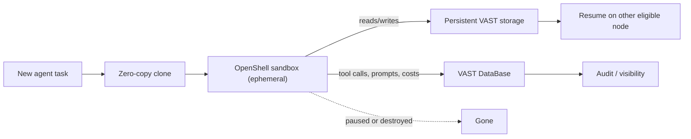

## What happened

At Nvidia GTC in Berlin, VAST Data announced FSGAS. It pairs VAST's storage and database platform with Nvidia's newly announced OpenShell runtime and the NemoClaw reference stack.

The pitch is a split between execution and state. Agents spawn, run tasks, spawn subagents and vanish. Fleets may create and destroy thousands of isolated workspaces per hour. Progress, working data and memory persist independently of any sandbox or compute node. A long-running agent can sleep, resume elsewhere, and delegate to short-lived subagents without starting over.

VAST says it will publish the automated deployment in a public GitHub repository. FSGAS builds on VAST DataEnclave, its cryptographically secured runtime for running commercial AI models next to sensitive data on customer-controlled infrastructure. It is the third such "foundation stack" from VAST, after ones for enterprise research (Nemotron) and video intelligence (Cosmos).

## Why it matters

Agents are moving from chat sessions to long-running, semi-autonomous workers. That exposes two problems:

1. **State is fragile.** If an agent's memory and working files live inside a container, killing the container loses the work. Scheduling, preemption and crash recovery all become harder.
2. **Accountability.** Alon Horev, VAST's CTO, put it this way: every enterprise that puts an agent into production will eventually need to answer what it did and why. That needs a durable, queryable record, not scattered logs.

Sandboxes are becoming the standard way to limit an agent's blast radius. Once the sandbox is ephemeral, state has to live somewhere else. Storage vendors are claiming that "somewhere" as a governed data layer. The broader trend is agent memory and audit becoming infrastructure features rather than application code.

## How it works

The source gives a high-level description, not implementation detail. The pieces:

- **OpenShell (Nvidia):** an open, secure runtime for agents. It governs execution, resource access, credential protection and where inference is routed. It offers sandboxed execution and formal policy verification. Enforcement sits outside the agent workload, so a misbehaving agent can't turn it off. It integrates with hardware security based on BlueField-4.
- **NemoClaw (Nvidia):** open-source blueprints and a reference stack for always-on agents with governance controls.
- **VAST storage:** persistent state, provisioned per task.
- **VAST DataBase:** the activity record.
- **VAST Management System:** real-time visibility into data flows and infrastructure activity across agent fleets.

**Zero-copy clones.** A clone is a new writable view of existing data that shares the underlying blocks and stores only changes. This is the usual copy-on-write idea. It makes it cheap to give each short-lived sandbox its own isolated workspace seeded from a shared baseline, which is what makes thousands of workspaces per hour plausible. The article doesn't say how clones are implemented or how fast they are.

**Activity record.** Every tool call, prompt, token count, cost and decision goes into VAST DataBase. That serves cost attribution, debugging and compliance with one store.

**Resume semantics.** Because state is separate from compute, an agent can move "across eligible infrastructure". The article doesn't define "eligible", or say how in-flight work, locks or half-finished tool calls are handled.

## Trade-offs and open questions

- **Vendor lock-in.** State and audit data in a proprietary platform make migration harder. The public GitHub deployment helps reproducibility, but it still targets VAST.
- **No numbers.** There are no clone latency, throughput, scale or cost figures. "Thousands of workspaces per hour" is a stated capability, not a measurement.
- **Consistency is unspecified.** The article doesn't say what happens if two sandboxes resume the same agent, how clones are reconciled back to the baseline, or whether the activity log is written atomically with the state change.
- **What counts as state.** Files and a log of actions are one thing. Model context, in-memory variables and external side effects (an email already sent) can't be restored by storage alone.
- **Security surface.** Persistent memory is a poisoning and exfiltration target. A malicious instruction saved in one session can affect later ones. The article covers credential protection and policy, but not memory integrity.
- **Alternatives.** You can build a similar design with object storage or a database for state, CoW volume snapshots, and an event or OpenTelemetry pipeline for audit. The VAST pitch is integration and governance in one place.

## What you can apply

- **Keep compute disposable.** Put checkpoints, scratch data and memory in external storage keyed by task or agent ID. Then preemption or a crash costs a resume, not a restart.
- **Use copy-on-write for workspaces.** Per-task clones or snapshots of a baseline dataset or repo give isolation without copy costs. Test this with ZFS, btrfs, or cloud volume snapshots.
- **Log structured agent events.** Record tool calls, prompts, token counts, cost and the decision rationale in a queryable store with task and session IDs. Write the log before executing side-effecting actions.
- **Design resume to be idempotent.** Make tool calls replay-safe, using idempotency keys and recorded results, and use fencing so only one sandbox owns an agent's state at a time.
- **Enforce policy outside the agent.** Keep credentials and egress rules in the runtime, not in the agent's prompt or process.
- **Ask vendors hard questions** about clone latency at scale, consistency of log versus state, retention, and export formats.

## Glossary

- **Agent sandbox:** an isolated runtime that limits what an agent can access and do.
- **OpenShell:** Nvidia's open secure agent runtime with policy enforcement outside the workload.
- **NemoClaw:** Nvidia's open-source blueprints and reference stack for governed, always-on agents.
- **FSGAS:** VAST's Foundation Stack for Governed Agent Sandboxes.
- **Zero-copy clone:** a writable copy that shares data blocks with its source and stores only changes.
- **VAST DataBase:** VAST's database component, used here for the agent activity record.
- **VAST DataEnclave:** VAST's secured runtime for running AI models beside sensitive data on customer infrastructure.
- **BlueField-4:** Nvidia's data-processing chip, whose hardware security OpenShell integrates with.
