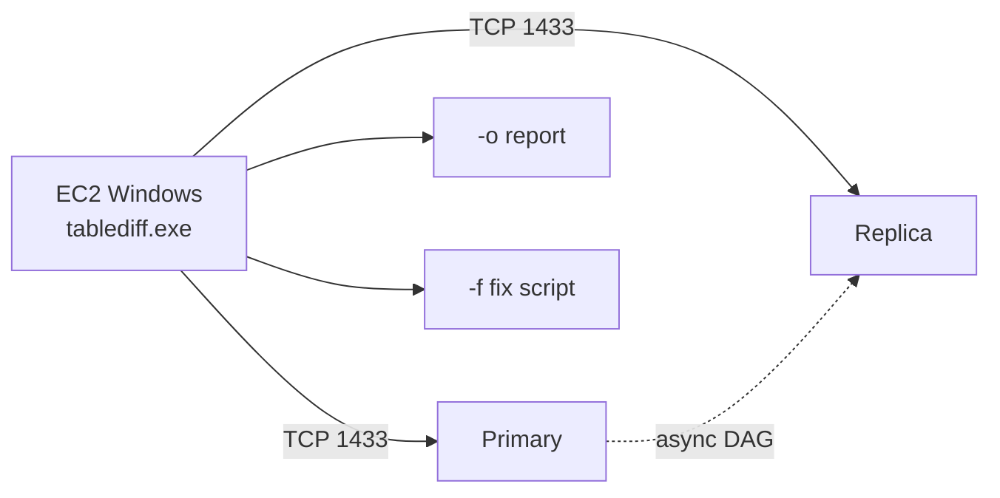

## What happened

AWS published a runbook for validating an Amazon RDS for SQL Server Enterprise Edition read replica against its primary. It applies after a replication lag event, a forced failover, a promotion or an infrastructure incident. The tool is `tablediff`, a SQL Server utility that ships with the Replication feature.

The worked example is a `PaymentsDB` database with a primary in us-east-1 and a DR replica in eu-west-1. The authors promote the replica and inject four kinds of divergence into a `dbo.Transactions` table:

- a stale value
- missing rows
- a wrong status
- an orphan row

tablediff classifies all five resulting differences correctly. It also emits a T-SQL fix script, which the post hardens and applies. The post says production scale for this approach was about 180M rows.

## Why it matters

RDS for SQL Server read replicas use **Distributed Availability Groups** in asynchronous-commit mode. Under heavy writes or cross-Region latency, the replica's redo queue grows. After a forced failover, async mode can lose data. Dashboards often go green before the replica has actually caught up, and that's the dangerous period.

This matters most for payments, finance and healthcare workloads. There, "probably consistent" isn't an acceptable answer to an auditor, and you need evidence. The same reasoning applies to any async-replicated system, whether Postgres, MySQL or a cross-Region DR copy. Lag metrics and LSN positions tell you about progress, not parity.

## How it works

### The check path

tablediff opens two connections. It scans both tables in clustered-index order with forward-only server-side cursors, then compares rows as they stream. Client memory use stays low. Cross-Region setups need VPC peering, Transit Gateway or equivalent routing.

### The seven-step pipeline

1. **Confirm catch-up.** Zero `ReplicaLag` in CloudWatch isn't enough, because it reflects the send queue, not redo.
2. **Query the primary** with `sys.dm_hadr_database_replica_states` where `is_local = 0`. Check `redo_queue_size`, `redo_rate`, `last_redone_time`, `log_send_queue_size` and the sync state and health. The post says this pattern is validated for RDS and may differ in non-RDS distributed AGs.
3. **Proceed only when** `ReplicaLag`, `redo_queue_size` and `log_send_queue_size` are all 0.
4. **Connect to the EC2 client** via RDP or Session Manager.
5. **Run tablediff per critical table.**
6. **Read the `-o` report.** Zero differences means you're done.
7. **If there's divergence**, promote the replica, apply the fix inside a transaction, validate, and re-run tablediff.

### Key flags

| Flag | Purpose |
|---|---|
| `-c` | Reports which columns differ per row. It takes no column list, so all columns are compared. |
| `-strict` | Requires matching data types and disables default type mapping. |
| `-f` | Writes a T-SQL fix script of bare INSERT, UPDATE and DELETE statements. |
| `-o` | Writes a human-readable report with counts and classifications. |
| `-et` / `-dt` | Log results to a table on the destination. They need write access, so don't use them against a read-only replica. |

Credentials in the example come from environment variables, not literals on the command line.

### Setup details that bite

- tablediff isn't in `MsSqlCmdLnUtils.msi`, which only has sqlcmd and bcp. Run SQL Server 2022 Setup, select only the Replication feature, and skip the Database Engine. The binary lands at `C:\Program Files\Microsoft SQL Server\160\COM\tablediff.exe`.
- Comparing needs `db_datareader` on both sides. Fixing needs `db_datawriter` on the promoted instance, plus `db_owner` or at least CREATE TABLE and ALTER on the schema. RDS gives you no sysadmin.
- Grant `VIEW SERVER STATE` to the service account on the primary before creating the replica, so it propagates through the seeding snapshot.
- RDS doesn't sync logins to replicas. You can't create a login on a read-only replica. Either promote first and then create it, or recreate the replica. Recreate logins with the original SID, read from `sys.server_principals`.
- If database owners differ after promotion, run `EXEC msdb.dbo.rds_changedbowner_to_rdsa 'PaymentsDB';`.

### Classifications

- **Source Only (Loss):** the row is on the primary but not the replica. The fix is an INSERT.
- **Dest Only (Orphan):** the row is on the replica only. The fix is a DELETE.
- **Column Mismatch (Update):** the keys match but values differ. The fix is an UPDATE to the source value.

In the demo, IDs 5 and 9 were updates, IDs 8 and 10 were losses, and ID 11 was an orphan. The report summarizes this as "Mismatch – Loss: 2, Orphan: 1, Updates: 2".

### Remediation

1. Promote with `aws rds promote-read-replica`. Wait until the instance is available. This severs replication permanently.
2. Apply the fix script in `BEGIN TRANSACTION` with `TRY/CATCH`. Commit on success. On error, roll back and `THROW`. Keep the `WHERE NOT EXISTS` and value-check guards, and the `SET IDENTITY_INSERT` toggles.
3. Compare `COUNT(*)` and `CHECKSUM_AGG(CHECKSUM(...))` on both sides. This reads every row and covers only the listed columns, so run it off-peak. It isn't collision-free.
4. Re-run tablediff without `-et` or `-dt`. You want "0 differences".
5. Cut over DNS or traffic only after that.

## Trade-offs and open questions

- **Not a consistent snapshot.** tablediff doesn't snapshot both endpoints together. In-flight source transactions can cause false positives unless you run in a low-write window or quiesce writes.
- **Active redo** makes committed rows look missing, which gives a false Source Only. That's why the redo-queue gate comes first.
- **Page splits during a scan** under dirty reads can skip or duplicate rows. Re-run in a quiet period to confirm any finding.
- **No column exclusion.** For columns like `ROWVERSION`, you can create a view on each instance, copy the needed columns into local staging tables (which requires a local SQL Server), or post-filter the results. ROWVERSION values replicate identically before promotion, so including them helps detect divergence then. After promotion, local writes generate different values, so exclude them.
- **Comparison follows collation and connection settings** such as ANSI_PADDING, not `-strict`. Equivalent DECIMAL magnitudes may compare equal. The post suggests `HASHBYTES` for byte-level validation.
- **Identity gaps after promotion.** Identity caching can shift seeds. `IDENTITY_CACHE = OFF` doesn't change existing rows, and inserts can collide if both instances stay active.
- **Irreversible promotion.** Don't promote just to apply fixes if the replica still serves production reads. A fix script generated before promotion can go stale, so regenerate it.
- **Scale.** The post gives no timing or throughput benchmarks. Scanning a 180M-row table twice is not free, and you should measure it.
- **Cause.** tablediff gives no root cause. For that you need SQL Server error logs, AG health events and CloudWatch metrics.

The post lists criteria for rebuilding instead of fixing:

- divergence across many tables or millions of rows
- schema drift
- a replica that can't absorb the fix's log, tempdb and autogrow load
- no non-production test of the script
- an unresolved root cause

The source text I could read was cut off at the start of its best-practices section, so I haven't covered that part.

## What you can apply

- **Gate on redo, not lag.** Script the DMV query and require `redo_queue_size` = 0 and `log_send_queue_size` = 0 before any comparison. Otherwise you'll chase false Source Only rows.
- **Prepare before you need it.** Pre-bake the EC2 image with the Replication feature installed. Pre-grant `VIEW SERVER STATE`. Keep a documented login/SID recreation procedure. All of these are painful to do mid-incident.
- **Prioritize tables.** Compare critical tables first, such as ledgers and transactions. Make sure each has a clustered key. Audit for heaps ahead of time.
- **Treat the fix script as a draft.** Generate it on the promoted instance. Review it, test it in non-production, add idempotent guards, wrap it in a transaction, and keep the report and script as audit artifacts.
- **Verify twice.** Run a cheap check first (count plus `CHECKSUM_AGG`), then confirm with tablediff. Don't use a checksum alone.
- **Decide on a rebuild threshold in advance.** For example, set a limit on the number of tables or rows beyond which you rebuild from a snapshot. Don't decide this under pressure.
- **DR drills.** The same runbook works as a post-failover or post-patching verification step. It's also a good regular DR test for regulated workloads.
- **The idea carries over.** Even on other engines, the pattern is to gate on apply-progress metrics, do an independent row-level or hash comparison, and repair only with a reviewed, transactional script.

## Glossary

- **tablediff:** a SQL Server command-line utility, shipped with the Replication feature, that compares two tables row by row and can generate a T-SQL fix script.
- **Distributed Availability Group:** an AG spanning two AGs. RDS uses it for Enterprise Edition read replicas, here in asynchronous-commit mode.
- **redo_queue_size:** log the replica has received but not yet applied to its data pages.
- **log_send_queue_size:** log on the primary not yet sent to the replica.
- **ReplicaLag:** the CloudWatch lag metric. It reflects the send queue, not redo.
- **Source Only (Loss):** a row present only on the source.
- **Dest Only (Orphan):** a row present only on the destination.
- **ROWVERSION:** an auto-generated binary column that changes on each row modification. Local writes after promotion make values differ.
- **CHECKSUM_AGG:** an aggregate over row checksums, used as a quick parity check. It can collide.
- **Promotion:** converting a read replica into a standalone writable instance. It is irreversible.
