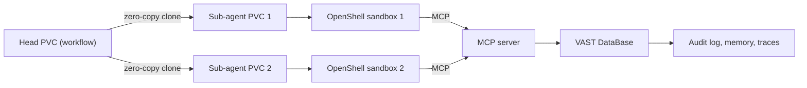

## What happened

At NVIDIA GTC Berlin on October 22, 2026, VAST Data announced the Agent Sandbox Foundation Stack, built with NVIDIA. It runs NVIDIA NemoClaw agents inside NVIDIA OpenShell sandboxes on the VAST AI Operating System. NemoClaw supports Hermes, LangChain, OpenClaw or a custom harness.

The division of labor is simple. OpenShell does isolated execution, identity-based access policies, and logging of agent interactions with anything outside the sandbox. VAST holds the state that has to outlive a sandbox: workspaces, memory and context, and an action record.

There is also an Apache 2.0 reference implementation on GitHub. It runs a supervised research job. A lead agent plans work on an NVIDIA NIM model, and a human can approve or edit the plan. Sub-agents then run in parallel in OpenShell sandboxes against an earnings-call corpus in VAST DataBase. VAST is demoing a governed multi-agent workflow at the show.

This is the third "Foundation Stack" from VAST. The earlier two were an enterprise research assistant and video intelligence.

## Why it matters

Agents are moving from chat to doing things: running code, calling tools and touching data. That creates two operational problems.

1. **Isolation without cost.** Each agent, and each sub-agent, wants its own writable workspace. Copying a data set per agent is slow and wasteful at fleet scale.
2. **Accountability.** If a sandbox is ephemeral, its logs and state die with it. The VAST CTO's framing is that every enterprise putting an agent into production will eventually need to answer what it did and why.

The wider trend is that agent infrastructure is converging on patterns from containers and databases. Compute is disposable, state is externalized, and every action is recorded. Storage vendors see an opening here because snapshot and clone primitives map well onto "fork this agent's world."

If you run multi-agent systems in a regulated setting, or you worry about runaway agents, this is the problem space to watch.

## How it works

**Components**

| Piece | Role |
|---|---|
| OpenShell | Isolated execution, identity-based policy, logging of external interactions |
| NemoClaw | Agent layer (Hermes, LangChain, OpenClaw, custom) |
| VAST DataStore Block CSI driver | Provisions a persistent volume per sandbox from a zero-copy clone |
| VAST DataBase | Vector store and knowledge base, per-department memory, trace spans and turns, reports, durable audit log |
| MCP server | The only path from sandbox to the database |
| VAST Management System | Real-time telemetry on data flows across the fleet |
| NVIDIA Sentry (BlueField-4 DPU) | Monitors traffic between agents on Vera CPUs and models on Rubin GPUs |
| VAST DataEnclave | Confidential computing runtime the stack builds on |

**Data flow**

**Zero-copy clones.** A clone shares the blocks of its source and only stores new writes. That is why provisioning is quick and does not need a full copy. In the reference implementation, each workflow gets a head persistent volume claim (PVC, Kubernetes' request for storage). Each sub-agent gets a clone of that head, mounted through the CSI driver (the standard Kubernetes storage plug-in interface).

**Suspend and resume.** Volume snapshots capture workspace state. An agent can pause, then resume or move to other eligible infrastructure without losing progress. Compute stays ephemeral while state stays durable.

**Mediated access.** The sandbox cannot reach the database directly. The MCP server (Model Context Protocol, a standard way for agents to call tools and data services) is the sole route. Hundreds of reasoning agents can, per VAST, query one dataset concurrently without a per-agent copy.

**Audit.** VAST DataBase records every tool call, prompt, token, cost and decision. Because it sits outside the sandbox, the record outlives it.

**Containment.** When Sentry flags or quarantines an agent, VAST says the AI OS isolates that agent's data access and freezes its sandbox state for forensic review. Freezing state rather than deleting it is the key idea. You can investigate afterward.

## Trade-offs and open questions

- **No measurements.** "Thousands of agents" is a design target. Seconds-to-clone and hundreds-of-concurrent-readers are VAST's claims. There is no published provisioning rate, latency under load or concurrency result.
- **Availability is vague.** There is no GA date, no required software versions and no hardware configuration. Parts of the stack name next-generation hardware (BlueField-4, Vera, Rubin), so a full deployment may not be practical for a while. The article doesn't say which parts work on current hardware.
- **Lock-in.** The state, audit and clone mechanics all lean on VAST's platform. The Apache 2.0 reference code helps, but the clone and DataBase behavior depends on VAST.
- **Audit trust.** The log is only as complete as the paths feeding it. Actions that bypass OpenShell or the MCP server wouldn't be captured. The article doesn't discuss tamper resistance or retention.
- **Clone semantics.** Clones isolate writes, but the article doesn't cover consistency of a snapshot taken while an agent is mid-write, or what happens to external side effects on resume. Restoring a volume does not undo an email already sent.
- **Alternatives.** You can approximate this with generic Kubernetes CSI snapshots and clones, gVisor or Firecracker sandboxes, and a Postgres or object-store audit log. VAST's pitch is integration, plus the Sentry-to-storage containment loop.

## What you can apply

- **Separate state from compute.** Keep agent workspaces on cloneable volumes, not on the sandbox's local disk. Then killing or moving a sandbox is cheap.
- **Use a head-and-clones pattern.** Prepare a base workspace once, with the repo, data and tools. Give each sub-agent a copy-on-write clone. Check whether your CSI driver supports `VolumeSnapshot` and clone-from-PVC before designing around it.
- **Force one chokepoint.** Route all sandbox access to data through one mediated service, such as an MCP gateway. Log at that point, outside the sandbox, with identity attached.
- **Log the full decision trail.** Capture prompt, tool call, tokens, cost and result per step, keyed by a workflow and agent ID. Write it to durable storage the agent can't modify.
- **Plan quarantine as freeze, not delete.** Build a path that revokes data access and snapshots the sandbox for forensics.
- **Add a human gate on plans.** The reference job lets a human approve or edit the plan before sub-agents fan out. It's a cheap control.
- **Benchmark before believing.** Measure clone time, concurrent-read throughput and snapshot consistency on your own workload. Treat resume as a restore of files, not of external side effects.

## Glossary

- **OpenShell:** NVIDIA's sandbox runtime for agents, with isolation, identity-based policy and logging.
- **NemoClaw:** NVIDIA's agent layer that can host Hermes, LangChain, OpenClaw or custom harnesses.
- **Zero-copy clone:** A copy-on-write volume that shares blocks with its source and stores only changes.
- **PVC:** Kubernetes PersistentVolumeClaim, a workload's request for storage.
- **CSI driver:** Container Storage Interface plug-in that lets Kubernetes provision and snapshot storage.
- **MCP:** Model Context Protocol, a standard interface for agents to reach tools and data.
- **VAST DataBase:** VAST's database service, used here for vectors, memory, traces and the audit log.
- **NVIDIA Sentry:** A BlueField-4 DPU layer that monitors traffic between agents and models.
- **DataEnclave:** VAST's confidential computing runtime that the stack builds on.
