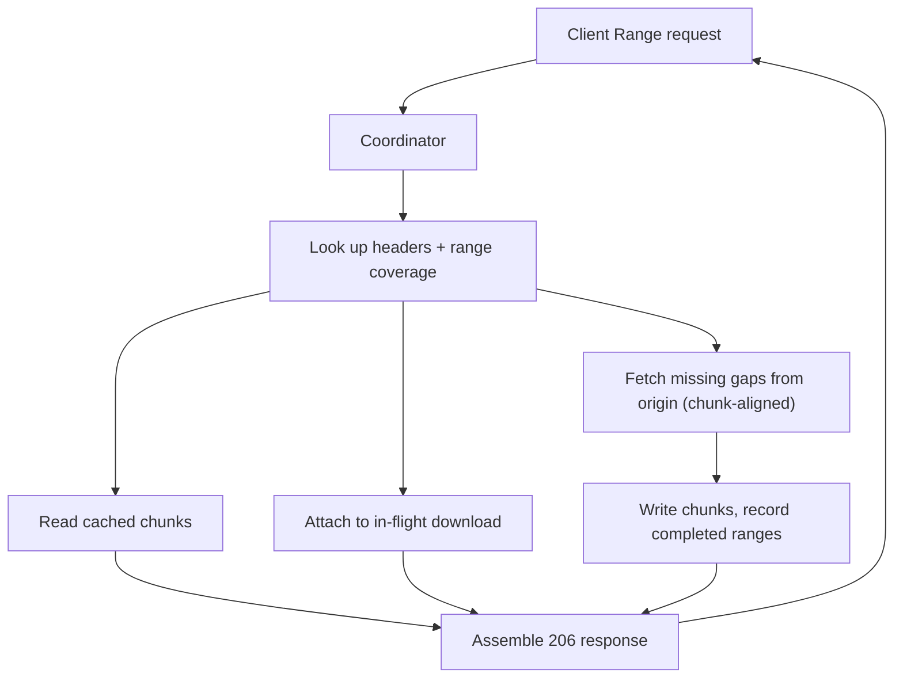

## What happened

Cloudflare released "Origin Range Requests", a cache feature that handles `Range` requests for large objects without a customer-tuned slice size. It is self-service on all plans. You enable it with a Cache Rule, or through the API with `origin_range_requests: { "mode": "on" }`.

The feature rebuilds how the cache, now on Pingora instead of nginx, fetches and stores partial content from origins such as R2. Cloudflare says p99 time to first byte on R2 roughly halved for both hits and misses. After it enabled combined cache and upstream responses for R2, tiered-cache traffic for R2 and similar workloads dropped about 6%. Cloudflare describes that as petabytes less data moved between data centers per day.

## Why it matters

Large objects are now routine: video, disk images, package repositories, AI model weights and archives. Clients often read only part of them, such as seeking in an MP4, resuming a download, or reading a header or shard.

Caching those objects exposes a bad trade-off. If the cache fetches more than was asked for, you pay in egress and latency. If it fetches exactly what was asked for, you lose cacheability and make many tiny origin requests. The waste also compounds. It happens from origin to data center, between cache tiers, and then to the client.

Anyone fronting object storage with a CDN or cache faces the same design question. Cloudflare's answer is to have the system pick a bounded, predictable granularity itself instead of exposing a knob.

## How it works

**The old design.** The cache split files into fixed-size ranges, configured per zone, like nginx cache slicing. Configured sizes ran from tens of KB to tens of GB. This caused several problems:

- Small ranges caused many origin requests, each holding memory while it waited.
- Large ranges over-fetched heavily.
- The range size was part of the cache key, so changing it invalidated entries.
- Concurrent requests in the same range could block each other even when their byte ranges were far apart.
- The nginx-based cache couldn't combine range caching with concurrent streaming, which means reading a file while it is still being written.

**The new design.** Pingora already stores cached files on disk in fixed-size chunks. Those chunks become the range unit.

1. The edge looks up the object's headers and its range-coverage metadata.
2. It reads the parts that are already cached.
3. For missing bytes, it requests origin ranges aligned to chunk boundaries and stores them as normal cache chunks.
4. It returns only the bytes the client asked for. A request for bytes 150–250 fetches the chunk containing them, but the response contains only 150–250.
5. It sets correct `Content-Range` and `Content-Length`.

**Request sharing.** If an in-progress download already covers another request's bytes, the new request attaches to it instead of starting another origin fetch. This helps with bursts on popular large files.

**Correctness checks.** Partial fetches stitched together are risky, so the cache validates several things:

- Each origin response must match the range requested.
- The total size must stay stable across subrequests.
- The entity tag (ETag) must stay consistent across subrequests.
- `If-Range` is honored. If the representation changed, the client gets the full representation instead of mixed bytes from two versions.
- Ranges are not composed for responses that will be decompressed or transformed, because byte offsets differ between compressed and decompressed content.

Outcomes follow the standard: `206 Partial Content` for satisfiable ranges, `416 Range Not Satisfiable` for invalid ones, and the full response when ranging isn't safe.

| | Old slicing | New chunk coordination |
|---|---|---|
| Granularity | Customer-set, tens of KB to tens of GB | Fixed Pingora chunk |
| Cache key | Includes range size | Range size is not a setting |
| Concurrency | Same-range requests can block | Requests share in-flight downloads |
| Streaming while writing | Not combinable with range caching | Supported |

## Trade-offs and open questions

- A request smaller than a chunk can still fetch a whole chunk. Non-aligned ranges also require more work. Cloudflare argues the overhead is bounded and predictable, unlike a customer-chosen slice size.
- The article does not give the chunk size in the part I could read. It also reports no hit-ratio breakdown, so I can't say how much waste remains for tiny random reads.
- The feature doesn't make uncacheable responses cacheable. The origin must support byte ranges, or partial fetches won't help.
- Compressed or transformed responses are excluded from range composition.
- The headline numbers are aggregates. The 6% drop is week over week and mixes in other workloads, so treat it as indicative, not a controlled benchmark.
- Cloudflare plans to make this the default for certain file types, and Cache Rules could override it. The article doesn't say which types.

## What you can apply

- **Don't expose a granularity knob if you can derive one.** If you already store objects in blocks, reuse that block size as the unit for range fetches.
- **Align origin fetches to block boundaries, but trim responses to the client's range.** This keeps the cache reusable and the client response exact.
- **Make range size independent of the cache key.** Otherwise a tuning change throws away the whole cache.
- **Coalesce in-flight fetches.** Let a second request attach to a download that already covers its bytes. This protects the origin during bursts on popular large files.
- **Validate on every stitched subrequest.** Check ETag, total length and the returned range, and honor `If-Range`. Fall back to a full response when you can't prove consistency.
- **Skip range composition when bodies are transformed**, for example compressed on the fly.
- **Check whether your origin supports ranges.** Verify that it returns `206` and stable ETags. Then consider enabling Origin Range Requests for MP4, ISO, package and model-file workloads.

## Glossary

- **Range request:** an HTTP `GET` with a `Range` header asking for part of a resource.
- **206 Partial Content:** the response status for a successful range, paired with `Content-Range`.
- **416 Range Not Satisfiable:** the status returned when the requested range is invalid.
- **If-Range:** a conditional header that returns the range only if the version still matches, and the full resource otherwise.
- **Cache slicing:** splitting a file into fixed-size ranges that are cached independently, as in nginx.
- **Chunk:** a fixed-size on-disk storage unit in Pingora's cache, now also the range unit.
- **Tiered cache:** layered caching between Cloudflare data centers before the origin.
- **Concurrent streaming:** serving a file to readers while it is still being written to the cache.
- **Pingora:** Cloudflare's Rust proxy framework, which replaced nginx for this cache layer.
