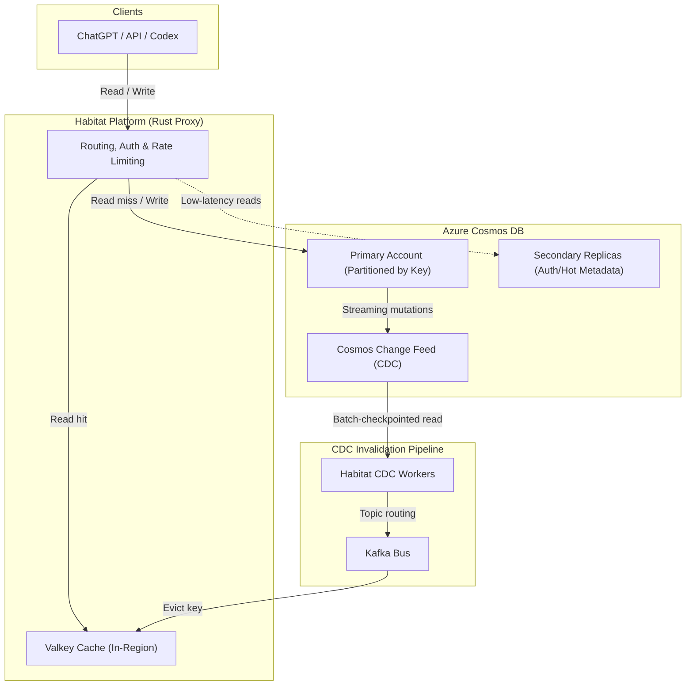

## What happened

OpenAI published the second part of its deep dive into Habitat, the unified online storage platform powering ChatGPT, Codex, and OpenAI's public APIs. While Part I focused on building the Python service abstraction, Part II details how the team scaled its underlying primary database, Azure Cosmos DB, to serve over 1 billion users and manage more than 500 petabytes of data across 40 Azure regions.

Operating at tens of petabytes and over 20 million queries per second (QPS) on a single Cosmos DB account revealed major failure modes in standard cloud multi-tenancy, partition management, and disaster recovery. To sustain growth, OpenAI collaborated directly with the Azure Cosmos DB engineering team to redesign serverless partitioning, implement hot-key throttling, overhaul CDC checkpointing, and establish a co-managed operational model. Combined with a local Valkey caching tier and a Rust proxy rewrite, OpenAI reduced median read latency from roughly 120 ms to 10 ms.

## Why it matters

Many engineering organizations follow an intuitive progression: start multi-tenant, isolate noisy workloads into dedicated databases as traffic grows, and eventually drown in operational fragmentation. OpenAI reached the limits of this pattern. With hundreds of features shipping concurrently, decentralized capacity planning broke down: product teams routinely forgot to pre-provision dedicated containers before launches, leading to severe launch-day throttling.

OpenAI's architectural trajectory demonstrates that at hyperscale, workload mixing in a centralized multi-tenant pool is vastly more resilient than single-tenant isolation—provided the underlying database engine can enforce granular throttling at the partition level. Furthermore, it highlights a stark reality for platform teams: beyond a certain threshold, managed cloud services are no longer black boxes. Infrastructure teams must either co-engineer the underlying control and data planes with the vendor or build custom storage engines in-house.

## How it works

Habitat sits between client applications (like the ChatGPT web app, mobile apps, and inference endpoints) and the persistence layer. It acts as a routing, authorization, rate-limiting, and caching proxy.

### The multi-tenancy cycle

OpenAI navigated three distinct architectural phases to balance tenant isolation with infrastructure efficiency:

| Metric / Dimension | Phase I: Default Shared Container | Phase II: Single-Tenant Containers | Phase III: Co-Managed Multi-Tenancy |
| :--- | :--- | :--- | :--- |
| **Isolation Model** | Single shared Cosmos DB container | Per-feature/service dedicated containers | Shared container with kernel-level request shaping |
| **Partition Key Limits** | Shared 10,000 RU/s limit per logical key caused collisions | Key spaces isolated per container | Hot keys isolated; client traffic throttled per-key |
| **Noisy Neighbor Impact** | High; physical partition contention hurt unrelated flows | Low; contained to service container | Low; prioritized QoS throttles background jobs first |
| **Headroom & Bursting** | High absorption of bursts from aggregate pool | Poor; launches risked 1,000× capacity spikes | High absorption; auto-splits on RU usage |
| **Operational Burden** | Centralized, but brittle | Decentralized; required every team to do capacity planning | Centralized platform team; zero manual pre-provisioning |

#### Overcoming "weak partitions"
In provisioned Cosmos DB containers, throughput capacity ($RU/s$) is divided evenly across all physical partitions. Each physical partition historically capped out at 10,000 RU/s. When a physical partition exceeds its storage threshold, Cosmos DB splits it into two children, dividing the allocated RU/s between them. 

For data-heavy, blob-like workloads, partitions split purely due to accumulated bytes. If a container was assigned 10,000 RU/s on one partition, a split reduced per-partition capacity to 5,000 RU/s, even though traffic remained flat. If the active workload required 6,000 RU/s, the partition began returning HTTP 429 (Too Many Requests) errors. 

To solve this, Azure engineered an enhanced serverless mode for OpenAI. This mode allows physical partitions to burst up to 10,000 RU/s independently and triggers partition splits based on *RU utilization* rather than storage capacity alone, eliminating partition weakening.

#### Request tiering and hot-key throttling
Within shared containers, two mechanisms prevent cross-tenant starvation:
1. **Hot-key throttling:** Identifies and rate-limits the specific logical partition keys consuming outsized throughput on a physical partition, shielding colocated keys from collateral degradation.
2. **Quality of Service (QoS):** Classifies requests into interactive and offline categories. Offline bulk migrations and analytical queries yield to latency-critical user requests during partition contention.

### A layered global read architecture

Because compute clusters and storage accounts are constrained by regional datacenter capacity, power, and cooling, OpenAI cannot place all storage adjacent to compute. They implemented a four-tier latency optimization strategy:

1. **Selective data residency:** Datasets with regulatory or residency requirements live in local regional accounts.
2. **Global replication for tiny, hot data:** Latency-critical metadata (e.g., authentication tokens, workspace permissions) is replicated across up to 40 Azure regions, guaranteeing local reads for every request.
3. **Integrated Valkey caches with CDC invalidation:** To avoid the staleness/hit-rate trade-off of standard TTLs, Habitat colocates distributed Valkey caches near compute. Write paths do not perform distributed synchronous cache invalidation. Instead, a CDC processing cluster tails the Cosmos DB Change Feed and fans out cache evictions via Kafka. Cached entries are invalidated globally within seconds of a primary write.
4. **Rust service proxy:** Habitat's proxy data plane was migrated from Python to Rust, stripping out serialization overhead and runtime latency.

### CDC scaling and SDK hardening

Habitat’s CDC infrastructure processes millions of changes per second across thousands of containers and millions of partitions. The CDC control plane dynamically assigns partition leases across a multi-region worker fleet. 

At this volume, the standard Azure Cosmos DB CDC SDK became a bottleneck: frequent checkpoint writes overwhelmed the underlying lease-coordination storage. OpenAI and Azure modified the SDK to batch partition checkpoints in memory and flush them to durable storage periodically, eliminating lease-store contention while maintaining safe resume points.

## Trade-offs and open questions

* **Eventual consistency in caching:** Invalidating caches via an asynchronous CDC pipeline introduces a window of several seconds where reads can return stale data. For conversation histories or collaborative state, applications must either tolerate read-after-write inconsistencies or force cache bypasses on critical paths.
* **Storage-compute colocation vs. cloud capacity:** Regional power and GPU constraints mean OpenAI frequently cannot colocate storage with inference clusters. Prioritizing flash storage in a datacenter directly cannibalizes rack space and cooling for GPUs, forcing the platform to rely on caching to mask cross-region network hops.
* **The limits of commercial NoSQL:** Despite deep optimization, Cosmos DB's document model and indexing overhead carry high storage magnification for large blobs and historical chats. This cost ceiling is driving OpenAI to develop an in-house RocksDB Cloud and Raft storage engine to decouple compute from physical storage.

## What you can apply

* **Monitor partition split triggers:** If you run provisioned distributed NoSQL databases (e.g., DynamoDB, Cosmos DB), track throughput capacity alongside storage volume. If partitions split on data size while provisioned throughput remains flat, your effective capacity per partition degrades over time.
* **Decouple cache invalidation from write transactions:** Avoid coordinating multi-region cache evictions inside the client request path. Offloading invalidations to a database Change Data Capture (CDC) stream bound to Kafka simplifies the write path and prevents cache inconsistencies caused by partial network failures.
* **Batch lease checkpoints in high-throughput CDC consumers:** When consuming partition feeds at scale, updating checkpoints synchronously on every record or small batch will saturate your metadata/lease coordinator. Buffer sequence tokens in memory and flush checkpoints at intervals bounded by your target Recovery Point Objective (RPO).
* **Protect against failback connection stampedes:** When failing back traffic to a recovered region, do not rely on standard DNS or load-balancer switches. Ensure client SDKs verify that data partitions have fully remounted before establishing connection pools; otherwise, clients will overwhelm gateways with requests destined for missing partitions.

## Glossary

* **RU/s (Request Units per second):** The rate-based currency in Azure Cosmos DB representing the compute, memory, and IOPS required to execute database operations.
* **Weak partition:** A failure mode where physical partition splits reduce the per-partition throughput allocation below the active workload's demand.
* **Change Data Capture (CDC):** A pattern that detects changes inserted, updated, or deleted in a database and emits them as an event stream.
* **Valkey:** An open-source, high-performance, in-memory key-value data store (a fork of Redis).
* **Lease store:** A secondary metadata store used by distributed CDC workers to coordinate ownership and checkpoint offsets across partition feeds.
