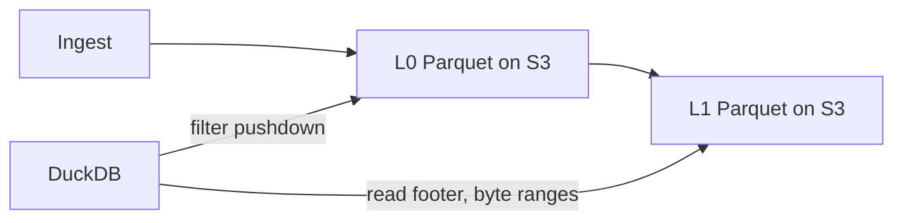

## What happened

Murat Demirbas posted his notes from days 2 and 3 of HPTS 2026, the High Performance Transaction Systems workshop. Day 1 was mostly about AI and specifications. This half covers hardware, query processing, object storage and open formats, failures, consensus and distributed systems, and lakehouses versus HTAP.

These are notes on talks, not a paper or a benchmark. Some talks have no notes, and several have only a line or two. I report only what the notes say.

## Why it matters

Three trends run through the sessions:

1. **Storage is moving to object stores.** Tesla's time-series database and the lakehouse talks all treat S3-style storage as the durable layer. The pain points are commit coordination and latency.
2. **Hardware limits have changed.** Power is the constraint on new datacenters. GPU memory is scarce while compute is abundant. Intra-datacenter bandwidth has grown enormously.
3. **Failures at scale are mostly about feedback loops.** Retries, queues and timeouts interact in ways local postmortems tend to misdiagnose.

If you run storage, data platforms or large services, these talks show where researchers and vendors think the next constraints are.

## How it works

### Hardware (Session 5)

- **GPU databases.** Bobbi Yogatama (NVIDIA) listed three obstacles: limited GPU memory, the interconnect bottleneck, and engineering complexity. Sirius is a GPU-native analytics engine that plugs into DuckDB without modifying it. On GPUs compute is abundant and memory is scarce, so the advice is to compress everywhere and operate on compressed data.
- **Power.** Devashish Purandare (Microsoft) said datacenter tax plus system tax consume 60–80% of execution. No single category dominates. His answer is many small accelerators, one per task category, such as the Fungible DPU (now Azure Boost DPU). It needs hardware/software codesign with a work-unit programming model.
- **DPUs.** Phil Bernstein described a DPU as a multicore CPU (low latency, weaker throughput) plus an ASIC for DMA, compression, encryption and regex (high throughput, higher latency). The open challenges are programmability and portability.
- **Resource brokering.** Natassa Ailamaki argued the database should broker between hardware and applications. The plan stays fixed, but data-movement strategy (pushdown, staging) is chosen at runtime based on what downstream operators consume.

### Object storage and open formats (Session 7)

Viktor Leis described S3 as a huge pool of HDDs with hash partitioning and erasure coding. Each request gives about 10 ms latency and 80 MB/s. High throughput needs many large parallel requests. His experiments reached about 100 Gbps from one node.

Tesla's design (Colin Breck) shows the pattern in practice:

There are no external indexes. Parquet's built-in statistics do that job. Tesla said this removed six operational problems of their clustered database:

- weeks of repartitioning
- catastrophic replication failures
- in-place upgrades
- the need for multiple databases for workload isolation
- costly recompaction for deletes
- custom migration tools

Two talks addressed the format layer:

- **Differential Change Discovery (Sergey Melnik, Databricks).** CDC emits every event, so a row updated forty times yields forty events to reconcile. DCD is a diff API that returns net changes since an LSN with replacement semantics. It is partitionable, and the unit of change is system-defined.
- **Shared log commits (Chris Douglas).** Tree-rewriting metadata is slow under concurrent writers, and centralized catalogs pull lakehouses back toward warehouses. His alternative is an append-only shared log of compact "intention records," with each engine validating transactions locally.

### Storage efficiency (Session 8)

Scott Andreas (Apple) started from a default Cassandra deployment: 3x replication, 50% compression, and 30% reserved for maintenance. That gives a 6.2x physical-to-logical ratio.

| Step | Ratio |
|---|---|
| Baseline | 6.2x |
| Witness replicas (journal-only, in quorum) | 4.2x |
| Smaller LSM buffers, splittable tablets | 3.6x |
| Compression advances | 2.4x |
| Satellite design (two durable replicas in two regions plus a satellite) | 1.6x |

Witness replicas replace repair with mutation tracking and background reconciliation.

### Failures and consensus (Sessions 8–9)

- Alvaro said retries can trigger metastable failures. Each local explanation (timeouts, queue bounds, token buckets, LIFO vs FIFO) may be partly true without resolving the problem. He argued for proving properties about real code.
- Charapko's MESSI simulator models nodes, processors and "qitems" (units of work). In a MongoDB Atlas case study, two queues separated short and long tasks to avoid the convoy effect.
- Alex Miller asked whether each of about 20 protocols could run a real database workload ("CashDB"). The criteria were surviving contention, consistent local snapshots, and incremental catch-up. His verdicts: EPaxos no; RIOT probably (Raft-equal slow-path latency but 10x network bandwidth); CEP-15 (Accord, Tempo) yes; escrow transactions yes.
- Joseph Hellerstein framed transactions as commitments. "Sealing" an input set turns non-monotone problems into monotone ones. He reviewed CALM (monotone Datalog is coordination-free) and a "complete CAP" (CAP holds iff the spec is monotone).
- Johann Schleier-Smith presented durable execution as readable control flow with recovery built into the runtime. The open question is that it moves recovery into the middle of the stack, which the end-to-end argument warns against.

### Lakehouses vs HTAP (Session 10)

Ippokratis Pandis cited intra-datacenter bandwidth growing from 10 Gbps (2015) to 3,200 Gbps (2023) to 6.4 Tbps now. He said this undermines keeping compute near data. His proposal, Lakehouse/RT (powered by Reyden), runs tens of thousands of concurrent sub-100ms queries on live Delta and Iceberg tables. It keeps Unity Catalog governance and autoscales to zero. He also discussed reading at an LSN directly from storage (Neon) so OLTP and OLAP stop competing for one machine. Stefano Stefani (Goldman Sachs) wants a fresh, fast join with zero-copy reads, transactional isolation and schema evolution, and said lakehouses don't deliver that yet.

## Trade-offs and open questions

- **S3 latency.** Leis cited Iceberg on S3 at about 1 TPS for OLTP (Ginter and Leis, VLDB'26). He dismissed S3 Express (3 ms latency) and argued for an SSD-based object store over an SSD cache in front of HDDs. The SSD-to-HDD cost ratio is about 5x now, up from 3x. This is a talk-level argument, not a shipped product.
- **Open-format governance.** Centralized catalogs fix concurrency but reintroduce proprietary control. The shared-log proposal is a design sketch. The notes give no results.
- **DPU portability.** Programmability and portability across vendors are unresolved.
- **Consensus protocols.** Miller's verdicts show real costs, such as RIOT's 10x bandwidth and QuePaxa's 7-RTT cost with open pipelining questions.
- **Metastability.** Simulation is useful, but calibrating it is hard, and Alvaro's code-level proofs are not yet routine.
- **HTAP.** Daniel Ritter's talk title, "No, HTAP in the Cloud Is Not Solved," was the argument. Databricks and Goldman have different framings of the gap.
- **AI.** The Tuesday panel got heated over code review. Murat's takeaway was that the community has not yet processed AI's impact.

## What you can apply

- **Object-store-backed analytics.** Consider Tesla's pattern for time-series or log data: Parquet in a log-structured layout, queried directly with DuckDB. Parquet footers and statistics can replace separate indexes. If you need on-prem, the S3 API gives portability.
- **Read S3 for throughput, not latency.** Issue many large parallel requests. Don't expect low-latency small writes. Per Leis's numbers, plan around about 10 ms per request.
- **Cut replication overhead.** Calculate your real physical-to-logical ratio, including compression and the maintenance headroom. Witness replicas and smaller compaction headroom were the big levers in Apple's Cassandra work. Witness replicas require replacing repair with mutation tracking.
- **Change feeds.** If consumers only need net state, a diff-since-LSN interface avoids replaying every event. With plain CDC, build reconciliation or compaction downstream.
- **Retries.** Don't trust a single-cause postmortem. Measure success rate, latency and amplification. Separate short and long work into different queues to avoid convoys.
- **Protocol choice.** Judge consensus protocols against a real workload. Ask whether they survive contention, give consistent local snapshots, and allow incremental catch-up.
- **GPU analytics.** Compress data and operate on compressed data, since GPU memory is the scarce resource.

## Glossary

- **HPTS:** High Performance Transaction Systems, a workshop on transaction and data systems.
- **DPU:** Data processing unit, a SmartNIC with a multicore CPU plus ASIC data-path engines.
- **CDC:** Change data capture, which emits every change event.
- **DCD:** Differential Change Discovery, a diff API returning net changes since an LSN.
- **LSN:** Log sequence number, a position in a write-ahead log.
- **Witness replica:** A journal-only replica that participates in quorum without a full copy of the data.
- **Metastable failure:** A failure state sustained by a feedback loop, such as retries, even after the trigger is gone.
- **CALM:** A result that monotone programs are coordination-free.
- **HTAP / LTAP:** Hybrid transactional-analytical processing, and the lakehouse-flavored variant proposed by Databricks.
- **Durable execution:** A runtime model where workflow state and recovery are handled by the platform.
