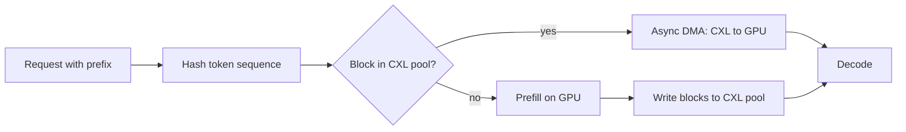

## What happened

A Micron team led by Dr. Skyler Windh built a CXL 2.0 shared-memory architecture for AI and HPC. They added cross-host KV cache sharing to Nvidia Dynamo and tested it on the Great Abaco cluster. Blocks & Files (Chris Mellor) summarized the work, which was presented in a webinar.

Abaco is Micron's design, with Liqid providing the fabric and orchestration. One rack presents up to 160 TB of DDR5 as a pool. Hosts can claim, share or release capacity without a reboot or re-cabling. Applications see a standard file system interface, so most code runs unmodified. The Great Abaco cluster uses H200 NVL GPUs in a Liqid PCIe Gen5 chassis. Four Liqid CXL memory chassis form one shared pool.

## Why it matters

The KV cache holds the attention keys and values already computed for a prompt. It grows with context length and concurrency. Each GPU normally keeps its own cache and spills to host DRAM when HBM (GPU memory) fills. Two GPUs given the same prompt prefix, such as a system prompt, shared document or agent scaffold, each redo the same prefill computation.

A shared pool removes that duplication. Prefill is compute-heavy, so avoiding it improves both throughput and TTFT. This fits the wider move toward tiered KV storage (HBM, host DRAM, SSD, network storage) and disaggregated inference. CXL fabric-attached memory (FAM) adds a tier that is byte-addressable and visible to many hosts. Liqid also pitches a cost angle: memory scales separately from compute, and you buy it once instead of overprovisioning every server.

## How it works

The article lists four integration components:

1. **Block-level cache manager.** It allocates KV blocks in CXL memory.
2. **Sequence-hash cache discovery.** Blocks are identified by a hash of the token sequence, so any GPU can find out whether another GPU already computed a prefix.
3. **Asynchronous transfer engine.** It moves blocks between CXL and GPU memory without stalling the inference scheduler.
4. **CUDA host-registration workflow.** It enables DMA between GPUs and CXL memory.

The flow is the same whichever host computed a block. A cache hit replaces recomputation with a memory transfer. The 99% figure says the CXL path was nearly as fast as local host DRAM for this purpose. Liqid says the serving stack is unchanged, with no vLLM patches and no changes to GPU servers.

| Result (Llama3-70B, 90% shared prefixes) | Figure |
|---|---|
| Throughput vs same-size host DRAM (32 GB/server) | 2.8× |
| TTFT improvement | 2.9× |
| Cross-host reuse | 3× throughput with half the memory |
| CXL vs host DRAM performance | within 99% |

The 2.8× gain compares same-size caches. It comes from cross-host sharing, not from CXL being faster than DRAM.

## Trade-offs and open questions

- **Narrow benchmark.** One model and one workload with 90% shared prefixes, which is very favorable to sharing. Low-overlap traffic would see much smaller gains. The article reports no such results.
- **Relative numbers only.** There are no absolute tokens/s or latency figures, and no baseline details beyond host DRAM. There is no comparison against SSD or network KV tiers, or against RDMA-based cache sharing.
- **Vendor-sourced.** The results come from Micron and Liqid.
- **Framework ambiguity.** The article says both Nvidia Dynamo and "an open-source multi-GPU inference framework", and doesn't clarify which ran the benchmarks.
- **Not covered:** coherence and consistency of shared blocks, eviction policy, fabric failure behavior, security isolation between tenants, and cost per GB against alternatives. CXL 2.0 pooling and its latency under load at scale are also unaddressed.
- **Hardware dependency.** It needs a specific PCIe Gen5 / CXL chassis setup.

## What you can apply

- **Measure your prefix overlap first.** Shared-prefix hit rate predicts the benefit of any shared KV tier. Log hashes of prompt prefixes and compute the potential reuse.
- **Think of KV blocks as content-addressed cache objects.** Hash-keyed, immutable blocks make sharing simple. No invalidation is needed, because a changed prefix gives a new hash.
- **Keep transfers off the scheduler's critical path.** Asynchronous movement is the key design point. Any tier you add (CXL, NVMe, network) needs prefetch and overlap.
- **Compare tiers by hit rate times transfer cost versus recompute cost.** Ask for absolute numbers and your own workload tests before buying hardware.
- **Plan failure handling.** The pool is a cache, so a lost block should mean recomputation, not an error. Verify that your design degrades that way.

## Glossary

- **KV cache:** Stored attention keys and values for already-processed tokens, reused during generation.
- **Prefill:** The compute-heavy phase that processes the prompt and builds the KV cache.
- **TTFT:** Time to first token.
- **CXL:** Compute Express Link, a cache-coherent interconnect running over PCIe for memory expansion and sharing.
- **FAM:** Fabric-attached memory, a CXL memory pool reachable by multiple hosts.
- **GFAM:** Global Fabric Memory, the term used in the slides.
- **Nvidia Dynamo:** Nvidia's distributed inference serving framework.
- **Abaco:** Micron's shared-memory architecture, with Liqid as fabric partner.
