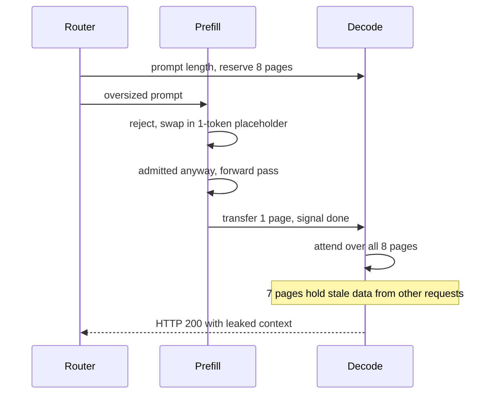

## What happened

On Sep 8, 2026, researcher Gadi Evron (Knostic) reported through Cloudflare's HackerOne program that `@cf/zai-org/glm-5.3` could return data from other users' requests. Cloudflare began verification the next morning and declared an incident at 13:22 UTC. It reproduced the leak within 25 minutes and set the model to private by 14:00, so it returned HTTP 400. All prefill nodes were on a corrected config by 14:52. A full rebuild with an engine patch was validated by 19:04, and the model was restored at 19:40.

Cloudflare says 155 responses contained other customers' recent request data. Every affected prompt was over 681,280 tokens. Once testing and the researcher's own activity were excluded, it found no evidence of deliberate exploitation. The remaining affected traffic looked like ordinary long-context use. No other Workers AI model was affected.

## Why it matters

LLM serving stacks now have many moving parts, such as paged KV caches, disaggregated prefill and decode, and RDMA transfers between nodes. Tenant isolation in these systems rests on memory-management invariants. A page that is handed out without being overwritten is a cross-tenant data leak, and no sandbox boundary stops it.

This is a good example of a failure that cuts across layers. The config looked harmless, since the team knew about the mismatch and tested it. The engine bug had already been reported upstream (SGLang issue #30233, July 6, 2026). Neither was a problem alone, but together they produced a leak. Anyone running SGLang, vLLM or similar engines with long contexts, prefix caching or disaggregated serving should read it as a checklist.

## How it works

**Background.** The KV cache stores the attention keys and values for tokens already processed. It is allocated in fixed-size *pages*. In *disaggregated* serving, *prefill* GPUs process the prompt and then send its KV pages to *decode* GPUs, which generate tokens. Cloudflare uses Mooncake for the RDMA transfer.

**Issue 1: config mismatch.** SGLang sizes the KV pool at startup from leftover GPU memory. Nothing forces it to match the advertised context length. For GLM-5.3 the prefill pool held 681,280 tokens while the context window was 1,048,576. Cloudflare knew about this before launch. Pre-launch tests returned successful HTTP codes and streams, so the team assumed the engine would handle oversized prompts gracefully.

**Issue 2: admission bug.** On a single node, SGLang handles a prompt that doesn't fit by marking the request rejected and swapping its prompt for a one-token placeholder. In disaggregated mode, the admission queues checked whether a request was *finished*, not whether it was *rejected*. The rejected request therefore went through.

The decode side reserved pages based on the prompt length the router told it, and it trusted the "transfer complete" signal. Only one page was actually written, so the other seven kept whatever earlier requests had left there. The model attended over those and produced a plausible reply that included other users' data.

**Why the canary was safe.** A canary node with a larger pool wasn't susceptible. That confirmed the config mismatch as the trigger.

## Trade-offs and open questions

- **Performance vs. integrity.** Cloudflare prototyped tagging KV pages on reallocation and verifying the tags at read time. It cost under 1% in throughput and latency, but the prototype was disabled after reliability problems. A production version is being built with SGLang, so for now this protection is not fully in place.
- **Memory cost.** The fix raises the prefill KV pool to about 2.04 million tokens, roughly twice the context length. That is safe but uses a lot of GPU memory.
- **Remaining race conditions.** Related race conditions and lifetime bugs exist around KV transfers, such as timed-out calls leaving writes in flight and client disconnects aborting mid-transfer. Cloudflare is hardening these upstream, and some changes are still landing.
- **Detection.** Because the output looked plausible, nothing alerted. Cloudflare found no deliberate exploitation, but the source says this rests on traffic analysis and doesn't describe it as proof.
- **Upstream lag.** The bug was public for about two months before the incident. Fixes landed upstream between Sep 16 and Oct 12, and the SGLang releases that carry them are v0.5.21 (Oct 2) and v0.5.22 (Oct 19).

## What you can apply

1. **Assert the pool-vs-context invariant on the live engine.** Measure the KV pool size against the context length on every prefill and decode node after any relevant change. Don't rely on docs or config values.
2. **Test for correctness, not status codes.** Send oversized and boundary-length prompts and expect HTTP 400. Add canary markers to concurrent requests and check that none appear in other responses.
3. **Upgrade.** Run SGLang v0.5.22 or later, which includes the admission fix.
4. **Harden KV transfer.** Use deferred KV page release on both roles, so pages are held until the transfer is confirmed. Bound Mooncake transfer batches. Avoid proxy-generated aborts mid-transfer.
5. **Validate handoffs.** The decode side should check that the transferred token count matches its reservation instead of trusting a completion signal.
6. **Enable corruption detection** where the model architecture supports it, using the KV checksum option and KV canary.
7. **Keep a kill switch.** Cloudflare's quickest mitigation was making the model private, so requests returned a clean error. A fast way to fail closed made the response time short.
8. **Don't accept known-risk launch configs on the basis of passing tests.** If a mismatch is known, treat it as a blocking item until you've proven safe behavior at the boundary.

## Glossary

- **KV cache:** stored attention keys and values for already-processed tokens, so they aren't recomputed.
- **KV page:** a fixed-size block of KV cache memory allocated to requests.
- **Prefill / decode:** the two inference phases. Prefill processes the prompt, and decode generates tokens.
- **Disaggregated serving:** running prefill and decode on separate GPU pools and transferring KV between them.
- **Mooncake:** the KV transfer layer Cloudflare uses, over RDMA.
- **RDMA:** remote direct memory access, which lets one machine write straight into another's memory.
- **Admission queue:** the stage that decides whether a request may proceed to allocation and execution.
- **Context window:** the maximum number of tokens a model accepts per request.
- **Canary marker:** a unique string inserted into test requests to detect whether it leaks into other responses.
