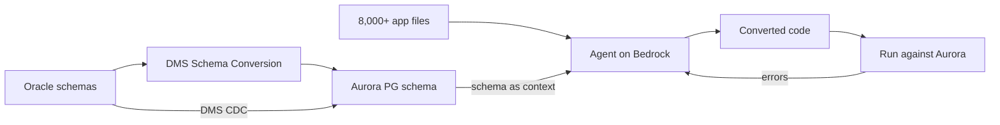

## What happened

The New York Times retired Oracle for PLATO, the system that processes payments for millions of digital subscribers. PLATO now runs on Amazon Aurora PostgreSQL-Compatible Edition. The AWS Database Blog post is written by AWS authors and describes the work done with AWS Partner Mactores.

The scale was large. An AWS Schema Conversion Tool scan found about 110,000 conversion items across three schemas. More than 8,000 application files held nearly 6 million lines of code with Oracle SQL embedded in them. The estimate for a conventional rules-based approach was up to 18 months. The team finished in about 5.

The post is a vendor blog. The figures come from AWS and NYT and have no independent verification. The page text I read was also truncated at the end.

## Why it matters

Database migrations rarely stall on moving data. They stall on application code. Oracle SQL ends up in Java, Gradle/Groovy build files, Python, Go and shell scripts. Each language needs its own parser or rule set, and rule-based converters usually cover only some of them.

Two business pressures made this urgent. Oracle licensing is per CPU, and the pre-migration assessment estimated about 200 CPUs. A renewal was also approaching. At the same time, PLATO is revenue-critical, so downtime or incorrect billing would show up immediately.

This fits a wider trend. LLM agents are being used for large, tedious, verifiable engineering work such as code migration. The work is a good fit when you can check each result mechanically, here by running the converted code against a real database.

## How it works

The post describes three layers.

1. **Layer 1: schema and object conversion.** AWS DMS Schema Conversion uses a built-in rules engine to convert database objects and DDL. It automates most of this and flags what needs manual fixes.
2. **Layers 2 and 3: application code.** The Mactores Aedeon agent runs on Amazon Bedrock with Claude Opus 4.6. It finds embedded Oracle SQL in any host language, including mixed-grammar files such as Gradle builds that combine Groovy and Java.
3. **Data movement.** DMS replicates continuously from Oracle to Aurora.

AWS Step Functions orchestrates the code-conversion pipeline. The post describes five stages, including schema analysis, embedded-SQL remediation, parity-test generation and validation. Amazon Bedrock AgentCore scales the processing horizontally so the 6 million lines can be handled in parallel.

The agent loop works in three steps:

- It locates the embedded Oracle SQL, whatever the host language.
- It gives the model the target PostgreSQL schema as context, so type mapping and function translation are grounded in the real schema.
- It iterates: convert, test against Aurora PostgreSQL, collect errors, and feed them back for self-correction.

The authors argue that a rules tool is tied to specific languages, while the model can reason about Oracle constructs inside whatever code surrounds them.

### Validation and rollback

- **Shadow traffic.** Apigee mirrored live PLATO traffic and sent shadow queries to PostgreSQL behind feature flags. Oracle stayed the system of record. This exposed query-plan problems and edge cases early, and fixes shipped with no client impact.
- **Rollback.** After cutover, a roll-forward clone of Oracle stayed current with every transaction from the Aurora primary. Rolling back to Oracle therefore carried no data-loss risk.
- **Readiness checklist.** The post condenses a longer list:
  - Failover tested on the writer and reader endpoints.
  - Parameter groups tuned from load tests.
  - Multi-AZ deployment, with a DR strategy that has RPO/RTO targets.
  - Encryption (KMS at rest, TLS in transit) and pgAudit logging.
  - Alarms including replication lag.
  - Row-level validation, with zero DMS lag and all tables in CDC (change data capture) state.
  - A rehearsed rollback runbook.

### Who did what

| Party | Role |
|---|---|
| NYT | Owned the application and environments, designed the approach, configured DMS, built the rollback plan, ran QA, gave final sign-off |
| AWS | Level-of-effort assessment, database specialists, staging rehearsals, performance tuning, replication troubleshooting |
| Mactores | Schema conversion and embedded-SQL remediation across about 6 million lines |

## Trade-offs and open questions

- **The numbers are self-reported.** The 18-month figure is an early rule-based estimate, not a measured baseline. The post does not break down how much of the saving came from the agent and how much from the DMS tooling, rehearsals or team size.
- **Missing detail on agent accuracy.** I saw no figures for the share of code converted without human edits, the review burden, or how many iterations the loop needed. The post is also thin on cost.
- **Test coverage limits correctness.** The loop is only as good as the tests and runtime checks. Semantic differences between Oracle and PostgreSQL, such as NULL and empty-string handling, date semantics, locking and isolation behavior, and query plans, can pass a test and still fail in production. Shadow traffic is the main safeguard here.
- **Vendor-stack coupling.** The architecture leans on Bedrock, Step Functions, AgentCore, DMS and a specific partner agent. The ideas carry over, but the implementation does not.
- **Rollback depth.** Rollback is only as safe as the reverse replication has been tested. The post says it was tested, but gives no detail on lag or on how Oracle-specific features replicate in reverse.
- **Alternatives.** Rules-based converters are deterministic and auditable but weak across languages. Manual rewriting is slow. The agent approach gains speed and breadth and loses some determinism.

## What you can apply

- **Split the problem.** Use deterministic tooling for the schema and DDL, where rules work well. Use an LLM only where context and many languages defeat rules.
- **Ground the model.** Give it the target schema and run its output against a real target database. Feed the errors back. A compile or execute loop beats one-shot translation.
- **Generate parity tests.** Have the pipeline produce tests that compare old and new behavior. Review them, because they define what "correct" means.
- **Parallelize by file.** Embedded-SQL remediation is mostly independent per file, so an orchestrator (Step Functions here) with fan-out workers cuts wall-clock time.
- **Keep the old system authoritative until proven.**
  - Mirror production traffic to the new database behind feature flags.
  - Compare results and query plans.
  - Cut over only after replication lag is zero and every table is in the CDC state.
- **Plan rollback as replication.** After cutover, replicate back to the old database so you can return without losing writes. Rehearse it, and keep a pre-provisioned target with production SQL baselines.
- **Check operations, not just data.** Failover tests, parameter tuning from load tests, alarms on replication lag, runbooks and on-call access all went into the readiness checklist.
- **Assign ownership.** NYT kept ownership of the app, QA and sign-off. A partner or agent should not hold the final call.

## Glossary

- **AWS DMS:** Database Migration Service. It moves data and supports continuous replication.
- **DMS Schema Conversion:** A rules-based tool that converts schema objects and DDL between database engines.
- **CDC (change data capture):** Streaming ongoing source changes to the target after the initial load.
- **Aurora PostgreSQL:** AWS's managed, PostgreSQL-compatible relational database.
- **Amazon Bedrock / AgentCore:** AWS's managed LLM service and its runtime for scaling agents.
- **Shadow traffic:** Copies of live requests sent to a new system whose responses are not served to users.
- **Roll-forward clone:** A copy of the old database kept current from the new primary, so rollback loses no data.
- **Embedded SQL:** SQL strings or fragments inside application code or build scripts.
- **System of record:** The database treated as the authoritative source of truth.
