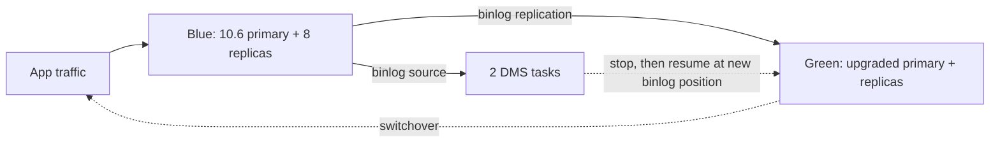

## What happened

Vestiaire Collective is a pre-owned luxury fashion marketplace. It operates in 50 countries and has 7.5 million members. Its core monolith runs on RDS for MariaDB, and the database backs every listing, purchase and transaction.

The fleet was on MariaDB 10.6, which was nearing end of support. Minor version 10.6.19 was due to be deprecated as early as March 2026. The upgrade also had to happen during the fall 2025 peak sales season.

The topology was one `db.r7g.12xlarge` primary, eight read replicas, and two DMS tasks using the primary as their source.

| Phase | When | Change | Switchover |
|---|---|---|---|
| Upgrade 1 | Oct 2025 | 10.6.19 → 10.11.14, plus r7g.12xlarge → r8g.12xlarge | ~94 s |
| Upgrade 2 | Dec 2025 | 10.11.14 → 11.4.9, engine only | ~7 s |

After Upgrade 2, the database accepted reads and writes immediately, although DNS propagation took longer. Internal monitoring raised no alarms. The team called it the lowest-downtime database maintenance event in its five-year history with AWS.

Post-upgrade results reported in the article:
- Up to 40% faster execution for the most-used queries, benchmarked. The article credits the instance class change and query optimization.
- Maximum CPU of 4.6%.
- No significant latency change, with spikes well below 10 ms.

One oddity: the post is dated October 2026 but describes events from October to December 2025. The article doesn't explain the gap.

## Why it matters

Major-version database upgrades are a recurring source of risk. Engine support windows end on a fixed schedule, and business calendars such as peak sales seasons don't move to fit them. Teams often end up choosing between an upgrade that takes hours and running on unsupported software.

The article shows a third route. Build the new version beside production, keep it in sync, test it against real write traffic, and cut over in seconds. This matches the wider shift from "maintenance window" thinking to "replicate, validate, switch" thinking.

It is most relevant if you run a monolith on a single relational primary with read replicas and side consumers such as CDC or DMS. That topology is common, and it is where upgrades hurt most.

The article is also partly a case study for AWS Countdown Premium, a paid support engagement. Read it with that in mind.

## How it works

### The options they rejected

- **In-place upgrade:** several hours of downtime, so it was rejected.
- **Upgrade via DMS:** keeping replication consistent across the upgrade was judged too complex.
- **Blue/Green Deployments:** chosen after testing in staging and QA. Non-production environments were upgraded first.

### Blue/Green in outline

RDS Blue/Green creates a staging copy of the production topology (green) that stays in sync with production (blue) through binlog replication. You upgrade the green side while blue keeps serving traffic. At switchover, RDS promotes green and redirects the endpoints. Blue remains available as a fallback until the switchover.

The team gave three reasons for choosing it:
1. Disruption is minimal compared with hours of in-place downtime.
2. Storage hydration and buffer pool warming happen on green before it takes traffic, so performance is stable at switchover.
3. Rollback stays possible until switchover. Green ran alongside live production writes for over a week, which validated compatibility, query performance, replication accuracy and DMS continuity.

### The Upgrade 1 runbook

- **Friday:** scale green storage to 5,500 GiB and check storage optimization across the fleet.
- **Monday:** warm the InnoDB buffer pool on green. The buffer pool is MariaDB's in-memory page cache, and a cold one causes latency spikes right after cutover. Also take manual backups of the blue primary.
- **Tuesday:** run final health checks (process list and InnoDB status). Start the switchover at 04:00 UTC with a 5-minute timeout. Stop the DMS tasks before the switchover and resume them from a new binlog position afterward.
- **Result:** about 94 seconds, inside the expected 1–5 minute range.

### Countdown Premium's role

- An Operational Readiness Review covering the primary and all eight replicas.
- Runbook refinement: pre-staged backups, replication health validation, and handling active writes before switchover.
- 24-hour standby with RDS and DMS engineers for each upgrade, plus a war room bridge.
- 12-hour standby during the November 2025 peak sales event.
- A post-event report comparing metrics from the week before and the week after.
- Weekly preparation calls.
- A Slack Connect channel. It was used to resolve a Performance Insights query-truncation issue quickly.

## Trade-offs and open questions

- **Not literally zero downtime.** The 94-second switchover is a real write outage. Seven seconds is excellent but still not zero. DNS propagation added more time for clients after Upgrade 2. The article doesn't quantify how many client errors or retries occurred.
- **Two cutovers, two risk windows.** Splitting the changes lowers the risk of each step. It also doubles the number of events, plus the preparation and standby around them.
- **Why 94 s and then 7 s?** The article doesn't explain the difference. Possible factors include instance changes, write load at the time, and runbook maturity, but that would be speculation.
- **Running two environments costs money.** The green environment runs alongside production for more than a week. The article gives no cost figure.
- **DMS is a manual seam.** The tasks had to be stopped and resumed from a new binlog position. That is a correctness-sensitive step, and the article doesn't say how they verified there were no gaps or duplicates.
- **Heavy support.** Much of the confidence came from paid, engineer-staffed standby coverage. Smaller teams may not have that, and the article doesn't show how Blue/Green performs without it.
- **Thin evidence on the performance numbers.** "Up to 40% faster" is a benchmark of the most-used queries. The gain is attributed to the instance change and query optimization, so it can't be credited to the engine versions.
- **Not yet proven:** the planned 11.4 → 11.8 LTS upgrade using the same method.

## What you can apply

1. **Separate variables.** Do the engine upgrade and the hardware or instance change as different events when you can. If something regresses, you will know which change caused it.
2. **Soak the green side.** Replicate real writes to green for days before cutover. Compare query performance, replication lag and application behavior. This is also your rollback test.
3. **Warm before you switch.** Pre-hydrate storage and warm the buffer pool, for example by replaying read traffic. Plan storage sizing ahead of time, as they did with the Friday scale-up.
4. **Inventory replication consumers.** List every CDC pipeline, DMS task, analytics replica and other process that reads binlogs from the primary. For each one, write down the stop, resume and verification steps. Resume from a recorded binlog position, then check row counts or checksums downstream.
5. **Pick a quiet time and set a timeout.** They started at 04:00 UTC with a 5-minute timeout. Take a manual backup immediately before. That gives you a recovery point if something unexpected happens.
6. **Make clients tolerate the cutover.** Use retry logic, short DNS TTLs and connection pool recycling. The switchover is only short if the application reconnects quickly.
7. **Rehearse in non-production first.** The team upgraded staging and QA before production and refined the runbook from those runs.
8. **Compare metrics before and after.** Look at the weeks either side of each upgrade (CPU, latency, errors) to catch slow regressions.

## Glossary

- **Blue/Green Deployment (RDS):** a managed feature that keeps a synchronized staging copy (green) of a production database (blue) and swaps them with a switchover.
- **Switchover:** the step that promotes green to production and redirects endpoints. It is the only period of write unavailability.
- **Binlog:** MariaDB's binary log of data changes, used for replication and CDC.
- **AWS DMS:** Database Migration Service, here used as a replication and CDC consumer reading from the RDS primary.
- **InnoDB buffer pool:** the in-memory cache of table and index pages. Warming it avoids a cold-cache latency penalty.
- **Storage hydration:** loading data from backing storage on a newly created volume so reads run at normal speed.
- **AWS Countdown Premium:** an AWS paid support offering for critical events, including readiness reviews, standby engineers and war rooms.
- **Graviton (r7g/r8g):** AWS Arm-based instance families. The team moved from r7g to r8g.
