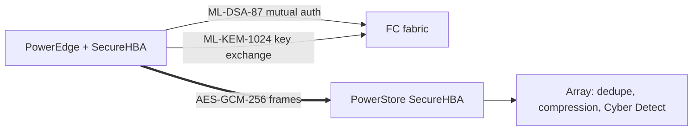

## What happened

On 27 October 2026 Dell expanded its cyber resilience portfolio. The article says the part that matters most to storage buyers is a date. PowerStore's next software release in November adds quantum-safe encryption of data in flight over Fibre Channel, when paired with supported PowerEdge servers.

Dell positions this as protection against "harvest-now, decrypt-later" attacks. In that kind of attack, an adversary records encrypted traffic today and decrypts it once quantum computers can break the key exchange.

The other announcements:

- **Post-Quantum Readiness Assessment (November):** it inventories cryptographic exposure across IT infrastructure and devices, ranks the risks by criticality and prioritizes migration actions.
- **PowerProtect with PowerScale (December):** this automates retention-locked local snapshots on PowerScale. SmartSync then copies them to Dell ObjectScale as a second recovery copy for long-term retention, with no separate backup job.
- **Identity recovery (available now):** PowerProtect identity resilience restores a clean copy of Active Directory, Microsoft Entra ID and Okta. A Managed Detection and Response for Identity service offers 24×7 monitoring, and Dell's team can start automated containment when defined attack patterns appear.
- **AI Factory services:** Security Hardening (October) and Resilience Operations for AI (available now). Both are expert-led assessments.
- **PowerProtect AI Assistant (available now):** a conversational interface with daily risk briefs and human approval before actions run.

## Why it matters

Storage networks are an awkward place for post-quantum work. Fibre Channel traffic is often unencrypted inside the data center. Where it is encrypted, it is usually protected at the application or array layer, which means key management and CPU cost.

The harvest-now, decrypt-later threat applies to data with a long confidentiality life, such as health records, financial data, government data and IP. Anyone who can tap the data path gets that data.

The wider trend is that post-quantum cryptography (PQC) is moving from TLS and VPNs down into infrastructure. The CNSA 2.0 algorithm set drives much of this, and procurement requirements follow it. A shipping date and named algorithms let storage teams plan, which is more useful than a roadmap promise.

The identity-recovery pieces reflect another trend. Attackers target Active Directory and cloud identity providers because that compromises everything else. Backup vendors are now treating identity as a tier-0 workload to protect and restore.

## How it works

**Fabric-level encryption in the HBA.** The Emulex SecureHBA is a Fibre Channel host bus adapter (the card connecting a server or array to the SAN) that can encrypt in hardware. The article says these adapters run at 64G and 32G in the array. The same adapters have shipped in PowerEdge since March 2025, with more than 80,000 ports in the field by May, per Broadcom. Gen 3 PowerStore arrays can be ordered with EDIF-capable FC OCP cards. Dell said at the PowerStoreOS 5.0 launch that these would be enabled through a non-disruptive update this fall. EDIF is Encryption of Data in Flight.

**Session negotiation.** The adapters negotiate the encryption themselves, session by session:

1. The host and array adapters authenticate each other with ML-DSA-87 signed certificates (a post-quantum signature scheme).
2. They establish a shared secret with ML-KEM-1024 (a post-quantum key encapsulation mechanism).
3. Frames are then encrypted with AES-GCM-256, which is authenticated symmetric encryption.

**Where plaintext exists.** The array's adapter decrypts, so PowerStore's data services still see plaintext. That avoids breaking data reduction, which ciphertext from application-layer encryption would defeat. The cost is that data in flight is protected, but data is plaintext inside the endpoints. This is not a substitute for encryption at rest.

**Recovery features.** The PowerScale integration has PowerProtect create and manage retention-locked snapshots (immutable until the retention period expires). SmartSync replicates them to ObjectScale. Identity resilience keeps a clean copy of directory and IdP state, so you restore it instead of rebuilding access controls by hand.

## Trade-offs and open questions

- **Hardware dependence.** Both ends need compatible SecureHBAs. The article specifically says Gen 3 PowerStore and supported PowerEdge servers. Mixed estates, other server vendors and older arrays are not covered.
- **Data in flight only.** Nothing here addresses data at rest, or an attacker with access at the endpoints.
- **No published performance data.** The article gives no latency or throughput figures for PQC sessions, no handshake cost, and no data on failure modes such as fallback to unencrypted sessions.
- **Standards claim.** The article says FC-SP-3 standardized the CNSA 2.0 set this year. I could not verify that independently, and interoperability with non-Dell gear is unstated.
- **Vendor sourcing.** This is Dell's announcement as reported. The services (hardening, resilience operations, MDR) are consulting-style offerings with no measured outcomes given. The AI Assistant's value depends on its approval workflow in practice.
- **Alternative:** Application-layer or host-based encryption (TLS, IPsec) works on any hardware but costs CPU and hurts data reduction. Fabric-level hardware encryption is simpler, but ties you to the vendor.

## What you can apply

- **Inventory first.** Identify which SAN links carry long-lived sensitive data. Those are the harvest-now exposure. Dell's assessment tool is one way to do it, but a spreadsheet of links, data classes and retention periods works too.
- **Check hardware.** Look at whether your HBAs, array cards and switch firmware support EDIF and the PQC suites. Ask vendors about interoperability and what happens when negotiation fails (hard fail or silent fallback).
- **Benchmark before rollout.** Measure latency and IOPS with encryption on, using your own workloads. Verify with a trace that frames are actually encrypted.
- **Keep detection working.** Confirm that inspection tools behind the HBA, such as Cyber Detect, still see data. Also confirm that taps and fabric monitoring tools aren't blinded.
- **Protect identity like data.** Back up AD, Entra and Okta, test a restore, and define an RTO for identity. Everything else restores slowly if identity is down.
- **Use immutable copies in two places.** The PowerScale design (local retention-locked snapshots plus an asynchronous copy to object storage) gives fast local RPO/RTO and an off-box copy. Verify retention locks can't be shortened by a compromised admin, and test restores from both tiers. The article doesn't state replication intervals, so ask for them.

## Glossary

- **Harvest-now, decrypt-later:** recording encrypted traffic today to break it with future quantum computers.
- **PQC:** post-quantum cryptography, algorithms intended to resist quantum attacks.
- **ML-KEM-1024:** a post-quantum key-encapsulation scheme used for key exchange.
- **ML-DSA-87:** a post-quantum digital signature scheme, used here for certificates.
- **AES-GCM-256:** authenticated symmetric encryption used for the data frames.
- **CNSA 2.0:** the US NSA's suite of quantum-resistant algorithms for national security systems.
- **FC-SP-3:** Fibre Channel security protocol standard, said to cover this algorithm set.
- **EDIF:** Encryption of Data in Flight on Fibre Channel.
- **HBA:** host bus adapter, the card connecting a server or array to the SAN.
- **SmartSync:** PowerScale replication feature that copies snapshots to ObjectScale.
- **Retention-locked snapshot:** a snapshot that cannot be deleted until its retention period ends.
