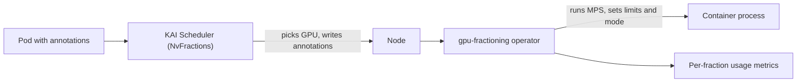

## What happened

NVIDIA published a guide to memory-enforced GPU sharing in Kubernetes, built on CUDA 13.4. Many AI workloads need only a fraction of a GPU, and giving each one a whole device leaves capacity idle.

The post describes the existing options. MIG gives hardware-isolated instances. Time-slicing lets processes take turns but doesn't enforce memory. MPS runs processes concurrently in separate address spaces, which the article calls sm-sharing.

CUDA 13.4 adds a memory boundary that is transparent to the application, plus a time-sharing mode. NVIDIA pairs this with the `gpu-fractioning` operator, hosted under the KAI Scheduler GitHub organization, and a new `NvFractions` sharing mode in KAI Scheduler.

## Why it matters

Platform teams often have a pool of GPUs and many small jobs: notebooks, small fine-tuning runs, and inference servers that don't fill the memory of an H-class card. Before this release, the choices were limited:

- Whole-GPU allocation is simple but wasteful.
- MIG is isolated but comes in fixed partition shapes.
- Time-slicing and plain MPS pack workloads together but don't enforce memory. One tenant can take the whole GPU and cause out-of-memory errors for the others.

Enforced memory with flexible sizes (an exact amount, a fraction, or a request/limit range) is how CPU and RAM already work in Kubernetes. It fits the request/limit model engineers already know. It also fits the broader trend of GPUs being treated as a sliceable, schedulable resource, not an opaque device.

## How it works

The work is split between three layers.



**1. CUDA 13.4 (the driver-level capability).** It provides four things:
- An exact memory amount per workload.
- A range, with a guaranteed minimum and a maximum to grow into when memory is free.
- A per-workload choice of compute mode.
- A transparent memory limit, so each workload sees only its share of GPU memory.

**2. The node operator (`gpu-fractioning`).** It runs alongside the NVIDIA GPU Operator, which still handles the driver and container runtime setup. It does three jobs:
- Sets up and supervises MPS on every GPU node.
- Applies each container's memory limits and compute mode before its process starts.
- Measures memory and compute use per fraction, not per GPU.

**3. The scheduler.** The scheduler writes per-container annotations, and the operator reads them:

| Annotation | Meaning |
|---|---|
| `nvidia.com/container.<name>.gpu-memory.request` | Guaranteed GPU memory |
| `nvidia.com/container.<name>.gpu-memory.limit` | Maximum the container may grow into |
| `nvidia.com/container.<name>.gpu-compute.mode` | `time-slicing` (default) or `sm-sharing` |
| `nvidia.com/container.<name>.gpus.devices` | GPUs assigned |

**Compute modes.**
- **Time-slicing:** workloads take turns on the whole GPU. Each gets roughly 1/n of the time when all are busy, and idle time goes to the others. A crash in one workload doesn't affect the others.
- **SM-sharing:** streaming multiprocessors (SMs, the GPU's compute units) are divided among workloads that run at the same time. Each gets roughly 1/n when all are busy, and idle SMs go to active workloads. All workloads share one error domain, so a fault in one can affect the rest.

KAI tracks the compute mode per GPU. One GPU runs one mode at a time, but a node can have both modes on different GPUs.

**Specifying workloads.** A workload answers four questions:
- **How much memory:** an absolute size (`nvidia.com/container.<c>.gpu-memory.request: "40Gi"`) or a portion (KAI's `gpu-fraction: "0.5"`).
- **How far it may grow:** `...gpu-memory.limit` for absolute sizes, or `kai.scheduler/container.<c>.gpu-memory.portion.limit` for portions. If the limit is omitted, it equals the request.
- **Compute mode:** `nvidia.com/container.<c>.gpu-compute.mode`.
- **How many GPUs:** `gpu-fraction-num-devices`. The request applies to each device, so 40Gi across four devices means 40Gi on each of four GPUs.

An example from the article:

```yaml
metadata:
  labels:
    kai.scheduler/queue: default-queue
  annotations:
    nvidia.com/container.app.gpu-memory.request: "40Gi"
    nvidia.com/container.app.gpu-memory.limit: "60Gi"
    nvidia.com/container.app.gpu-compute.mode: "sm-sharing"
    gpu-fraction-num-devices: "4"
spec:
  schedulerName: kai-scheduler
```

This guarantees 40Gi on each of four GPUs, allows growth to 60Gi when neighbors are idle, and runs concurrently with other workloads. Inside a fractional container, `nvidia-smi` shows the fractional memory share.

**Install.** Enable the mode when installing KAI. This also installs `gpu-fractioning` as a dependency:

```bash
helm upgrade -i kai-scheduler oci://ghcr.io/kai-scheduler/kai-scheduler/kai-scheduler \
  -n kai-scheduler --create-namespace \
  --set global.nvFractions.set=true
```

## Trade-offs and open questions

- **Error domains.** SM-sharing puts all co-located workloads in one error domain. The article recommends it only for workloads you trust to run together. Multi-tenant clusters will likely default to time-slicing.
- **Time-slicing isn't a performance guarantee.** The article says each workload gets roughly 1/n of GPU time when all are busy. It gives no latency or throughput numbers, and it publishes no benchmarks. That matters for latency-sensitive inference.
- **One mode per GPU.** This constrains packing. The scheduler must avoid mixing modes, and mixed demand can fragment capacity.
- **Burst limits.** A workload that grows beyond its request into free memory depends on neighbors staying idle. The post doesn't explain what happens when a neighbor later needs its guaranteed memory back, so test this before relying on it.
- **Documentation inconsistency.** The article's second example uses `gpu-fraction.limit`, while its table lists `kai.scheduler/container.<c>.gpu-memory.portion.limit`. Check the KAI docs for the correct name. A portion limit must be greater than `gpu-fraction` and less than 1.
- **Versus MIG.** MIG provides hardware isolation but has fixed partition shapes. This approach is more flexible but, by the article's own account, isolation is weaker, especially in SM-sharing mode.
- **Moving parts.** You now need CUDA 13.4, the GPU Operator, the fractioning operator, MPS on every node, and KAI v0.18.0 or later. Tying the setup to KAI is a lock-in risk, though other schedulers can write the annotations.

## What you can apply

- **Match mode to trust.** Use time-slicing for mixed or untrusted tenants, and SM-sharing only for workloads from the same team that you'd accept failing together.
- **Use request/limit like CPU and RAM.** Set the request to steady-state need and the limit to the peak you can tolerate. Leave the limit unset when you want a hard cap.
- **Right-size first.** Check peak GPU memory per workload (for example via `nvidia-smi`) before choosing a request. Allocations over the limit fail, so a request that is too tight causes out-of-memory errors in production.
- **Pilot on a few nodes.** Enable `NvFractions` on a subset. KAI's other sharing modes stay available, and administrators choose one per cluster, so you can't mix them freely.
- **Keep scheduling responsibilities explicit.** If you build your own scheduler integration, it must pick GPUs with enough free memory and keep each GPU in one compute mode.
- **Watch per-fraction metrics.** The operator reports usage per fraction, which gives you data to tune requests and show chargeback.
- **Mind the KubeCon timing.** The article points to KubeCon NA 2026 (Nov. 9–12) and the KAI community channels for follow-up.

## Glossary

- **MIG (Multi-Instance GPU):** hardware partitioning of a GPU into isolated instances.
- **MPS (Multi-Process Service):** an NVIDIA service that lets processes share a GPU concurrently with separate address spaces.
- **Time-slicing:** workloads take turns on the GPU. Each is its own error domain.
- **SM-sharing:** SMs are split among workloads running at the same time, in a single error domain.
- **SM (streaming multiprocessor):** the GPU's basic compute unit.
- **Error domain:** the set of workloads that a fault can affect together.
- **KAI Scheduler:** an NVIDIA-associated Kubernetes scheduler. Version 0.18.0 or later adds `NvFractions`.
- **`gpu-fractioning`:** the node operator that enforces memory limits and compute modes and reports per-fraction usage.
- **NvFractions:** the KAI sharing mode that writes the annotations for `gpu-fractioning`.
