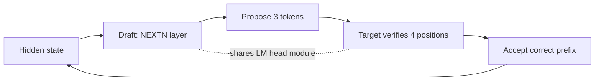

## What happened

Yang Liu, an NVIDIA solutions architect, wrote up an optimization pass on Ling-3.0-flash (Inclusion AI) running on an NVIDIA DGX Spark at batch size 1. The baseline was the official cookbook's W4A8 configuration. It uses FlashInfer MXFP4 MoE kernels, CUTLASS dense GEMM and an FP32 LM head.

Profiling showed decode was memory-bound, so the author applied three changes. Each is covered in the sections below, and together they improved real-task decode throughput by 42.5% and mean latency by 24.5%.

## Why it matters

Local and edge inference boxes like DGX Spark run a single user or agent at batch size 1. In that regime the GPU's compute sits mostly idle, and every token requires streaming the active weights from memory. Memory bandwidth, not FLOPs, sets your speed.

Large sparse MoE models are a good fit for this class of hardware because they have many parameters but few active ones. Ling-3.0-flash has 124B total parameters and 5.1B active per token. Sparse models still pay a memory cost for routing, though, and that is where these optimizations come in.

The article shows a general method: profile, find what you read from memory, shrink or avoid those reads, then verify that the optimizations are actually active.

## How it works

**Model setup.** Ling-3.0-flash has 42 layers: 35 Kimi Delta Attention (linear-attention) layers and 7 multi-head latent attention (MLA) layers. Each MoE layer routes a token to 8 of 512 routed experts plus one shared expert. The LM head maps a 2,560-dimensional hidden state to a 157,184-token vocabulary.

**1. Humming MXFP4 MoE backend.** Humming is a kernel library (`humming-kernels` on pip). It uses NVRTC (CUDA runtime compilation) to build kernels at runtime for the exact shapes, data types and GPU architecture, and caches the binaries in `~/.humming/cache`. This suits the model's narrow MoE intermediate size of 768. Compilation is also far cheaper: seconds per kernel, versus the FlashInfer CUTLASS path, which builds 97 targets with ninja over tens of minutes.

**2. Online FP8 LM head.** The checkpoint stores the LM head in BF16 and excludes it from quantization. Every token reads the full 157,184 × 2,560 matrix. The change applies a dynamic FP8 config only when the LM head is constructed, which halves the bytes read. It is enabled with `SGLANG_ENABLE_FP8_LM_HEAD=1`, which is mutually exclusive with the baseline `--enable-fp32-lm-head`.

**3. MTP speculative decoding.** The model ships a NEXTN prediction layer (`num_nextn_predict_layers: 1`) that acts as a free draft model. With three draft steps, the draft proposes 3 tokens and the target verifies 4 positions in a single pass, keeping the correct prefix.

The benefit depends on two numbers:

- **Accept length**: average tokens accepted per round.
- **Verification-cost ratio**: cost of a verify step relative to a normal step, measured at about 2.26.

Verification costs more than a normal step mainly because of expert activation. A single token activates 8 experts, but four tokens can activate up to 32, so more expert weights have to be read.

### Results

| Config (synthetic, cumulative) | TPOT | Throughput |
|---|---|---|
| Baseline | 27.71 ms | 36.09 tok/s |
| + Humming | 25.35 ms | 39.45 tok/s (+9.3%) |
| + FP8 LM head | 22.76 ms | 43.94 tok/s (+21.7%) |
| + MTP3 | 9.72 ms | 102.88 tok/s (+185.1%) |

TPOT is time per output token. Synthetic MTP accept length was 3.90.

On all 1,319 GSM8K test questions (five-shot, temperature 0.6, chain-of-thought on, no errors or truncations):

| Metric | Baseline | Optimized |
|---|---|---|
| TPOT | 26.45 ms | 18.56 ms |
| Decode throughput | 37.81 tok/s | 53.89 tok/s |
| Accuracy | 96.89% | 96.82% |
| MTP accept length | n/a | 2.68 |
| Mean latency | 15.21 s | 11.49 s |
| P50 / P95 latency | 8.36 / 50.20 s | 6.11 / 38.60 s |
| Mean TTFT | 0.207 s | 0.214 s |

### The integration trap

With FP8 LM head and MTP both on, the draft must share the entire LM-head module with the target, not only its weight tensor. The original Ling NEXTN implementation didn't expose that interface. The framework silently fell back, and the draft read FP8 weights as BF16. Accept length dropped to 1.00, which means no speculative gain while still paying verification cost, so throughput landed below baseline. The cookbook documents the working combination.

## Trade-offs and open questions

- **Synthetic vs. real.** Synthetic gave +185% and GSM8K gave +42.5%. The article attributes the gap to repetitive synthetic output (higher accept length, 3.90 vs 2.68), greedy vs sampled decoding, and a fixed 2K output vs a GSM8K median of about 310 tokens. A shorter output spreads fixed savings over fewer tokens.
- **Batch size 1 only.** Everything here is for a single stream. The article doesn't say how the gains hold with batching. Larger batches shift toward compute-bound, and speculative verification costs more there.
- **Accuracy evidence is one benchmark.** GSM8K shows −0.08 pt. That is reassuring for FP8 on the LM head, but it is a single math benchmark. Outputs were also about 7% longer on average (567 vs 607 tokens), which the article doesn't explain.
- **TTFT** is essentially unchanged (0.207 vs 0.214 s). These changes target decode, not prefill.
- **Toolchain coupling.** The setup relies on SGLang flags, Humming, and a model-specific NEXTN layer. It was tested on one model and one device, so the article doesn't establish portability.
- The article gives no per-optimization GSM8K breakdown, only the combined result.

## What you can apply

- **Profile first.** Identify whether decode is memory- or compute-bound before choosing a technique. At batch size 1 the answer is nearly always memory, so count bytes read per token.
- **Check the large, unquantized tensors.** An LM head with a big vocabulary is a large per-token read that checkpoints often leave in BF16. Quantizing it online is cheap, but validate quality on your own tasks.
- **Reason about speculative decoding with both numbers.** Estimate gain from accept length against verification-cost ratio. With MoE models, verification costs more because more experts are activated. Don't assume a dense-model intuition.
- **Benchmark on real distributions.** Use sampling settings and output lengths that match production. Repetitive synthetic prompts inflate accept length.
- **Assert that each optimization is active at startup.** Log accept length, the quantization dtype in use and the backend selected. A silent fallback here made the system slower than baseline. Treat accept length near 1.0 as an alarm.
- **Compose optimizations deliberately.** Test each alone and in combination, because interactions (like shared modules between draft and target) can break gains.

## Glossary

- **MoE (mixture of experts):** a model where each token is routed to a small subset of expert sub-networks.
- **Memory-bound:** performance limited by how fast weights can be read from memory, not by arithmetic.
- **MXFP4:** a 4-bit microscaling floating-point format for weights.
- **NVRTC:** NVIDIA's runtime compilation library, used to build CUDA kernels at run time.
- **LM head:** the final layer projecting hidden states to vocabulary logits.
- **TPOT:** time per output token.
- **MTP / NEXTN:** multi-token prediction, using a built-in layer to draft future tokens.
- **Speculative decoding:** a small draft proposes tokens that the target model verifies in one pass.
- **Accept length:** average number of draft tokens accepted per verification round.
- **TTFT:** time to first token.
