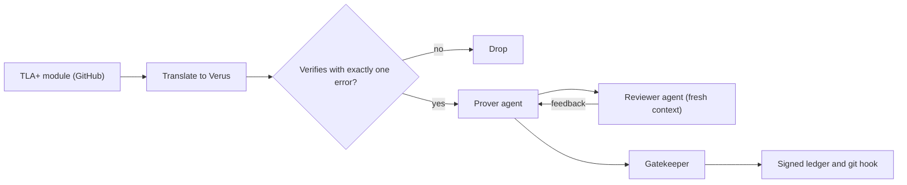

## What happened

A NeurIPS'26 workshop paper, TLA-Verus, reuses the TLA+ specs that engineers have published on GitHub. It converts them into Verus, a verifier for Rust. It then sets LLM agents to prove each spec's stated properties inside Verus.

The proofs rest on Anvil's temporal-logic library for Verus. That library provides `always`, `eventually`, `leads_to`, weak fairness and the WF1 rule.

This summary comes from Demirbas's blog review, not the paper itself. Details are limited to what he reports.

## Why it matters

Distributed protocols such as Raft, Paxos variants and replication schemes are usually specified in TLA+. Two practical limits apply:

- **TLC** (the TLA+ model checker) only explores small configurations, such as 3 nodes and bounded logs. A passing run is not a proof for all sizes.
- **Proofs are expensive.** Writing them by hand is slow, so few teams do it.

The paper's pitch is that LLM agents can make proofs cheap enough to attempt at scale. The industry trend is verification with an AI proof-search loop, where a trusted checker catches the model's mistakes. Verus plays that role here.

Demirbas disputes one of the paper's framing claims. The paper says TLAPS (the TLA+ proof system) is weak on liveness. He says it has temporal proof rules, including WF1, and handles liveness reasonably well with LS4 and coalescing. In his view, its main weakness is reasoning about `ENABLED`.

The paper also lists spec-to-code drift as a motivation. It then leaves that problem for future work, which would prove that Rust code refines the Verus spec.

## How it works

The unit of work is a **(spec, property) pair**. Each pair becomes one self-contained Verus file with exactly one open proof obligation.

**Translation.** There are two routes:

- **TranSpec** is a deterministic Rust transpiler.
- An **LLM translator** is checked by an LLM judge. No proof backs that check.

A task is kept only if the translation verifies with exactly one error, namely the missing property proof. Verus does this filtering automatically, which Demirbas likes.

**Proof search.** The prover agent writes proof code. Verus reports only which assertion failed, which is thin feedback. A reviewer agent with fresh context therefore supplies semantic guidance.

**Anti-cheat.** The obvious shortcut for a model is to add `assume`, `admit` or `external_body`, which make Verus accept a claim without proof. The gatekeeper rejects any such addition. The prover cannot merge its own work. A signed append-only ledger and a git hook enforce this.

**Results.**

| Item | Number |
|---|---|
| Pairs | 16,459 from 2,734 modules, 838 repos |
| TranSpec translated | 6,070 (5,160 well-posed) |
| Prover closed | 3,094 |
| Liveness closed | 304 of 809 (~38%) |
| Cost | ~$2 per proof |
| Dropped as unprovable by an LLM | 2,851 (unchecked) |

Corpus composition was 83% invariance and TypeOK, 16% liveness (809 tasks) and 1% safety (50 tasks). Demirbas attributes the safety shortfall to TranSpec handling safety forms poorly. He does not think safety properties are actually rare on GitHub. Of 630 safety properties that the agentic pipeline translated, 578 had no usable algorithmic bundle.

**Benchmark.** There are 40 tasks, 10 per property type, in two encodings. Eleven models were run at pass@3 with up to 10 attempts and no reviewer or gatekeeper. Opus-5 and GPT-5.6-sol-pro solved everything. gpt-oss-120b solved nothing. Liveness was the hardest type, with 58 of 110 attempts solved, against 73 to 78 for each other type.

The 53% benchmark liveness figure cannot be compared with the 38% corpus figure. The benchmark tasks were drawn from the 3,094 pairs already proven, so top scores are partly saturated by selection.

## Trade-offs and open questions

- **Translation fidelity.** Demirbas quotes the gap directly: "Nothing establishes that the translated Verus spec means what the original meant." Nothing links the TLA+ and Verus specs formally.
- **Vacuity.** If the translation breaks the state machine instead of the property, the property holds trivially. The vacuity filter only catches tasks that verify with an empty proof, so it misses this.
- **Impossible versus hard.** Exactly-one-error does not mean the property is provable. The paper admits that an impossible proof looks the same as one that is merely hard. The 2,851 pairs dropped as unprovable by an LLM were never checked.
- **Ground truth.** Specs were usually model-checked by their authors, so the properties are probably mostly true. That is still an assumption.
- **No comparison with TLAPS.** Demirbas has seen Opus write TLAPS proofs well. The paper does not compare against them.
- **The main contribution is missing from the model table.** The benchmark drops the reviewer and gatekeeper.
- **Inefficiency.** Each property re-translates and re-proves the same spec.
- **No `exec` code.** Verus's strength of compiling to binaries goes unused. Demirbas doubts that code for distributed systems can be generated from `spec` alone.

## What you can apply

- **Treat LLM proof agents as untrusted.** Have the checker ban escape hatches (`assume`, `admit`, `external_body`) in CI. Use a separate reviewer context. Make merges happen outside the agent's control. This applies to Lean, Coq, Dafny and similar tools too.
- **Check for vacuity yourself.** Before trusting a proved property, show that the spec can take real steps. For example, prove or check reachability of non-trivial states, or confirm that a deliberately false property fails.
- **Audit your filters.** If an LLM labels things "unprovable" and you discard them, sample the discards.
- **Be wary of benchmark transfer.** A model's score on sequential-code verification does not predict its score on temporal proofs. Liveness needs fairness and leads-to reasoning, and models do worst there.
- **Ask whether TLAPS or Verus suits you.** If you already have TLA+ specs, try an agent on TLAPS before adopting a translation layer. This is Demirbas's implied suggestion, not a tested result.
- **Budget.** Roughly $2 per proof on a pre-filtered corpus is a rough guide, not a guarantee for your own specs.

## Glossary

- **TLA+**: a specification language for concurrent and distributed systems.
- **TLC**: the TLA+ explicit-state model checker. It checks bounded configurations.
- **TLAPS**: the TLA+ Proof System, a machine-checked prover for TLA+ proofs.
- **Verus**: a verifier for Rust that checks specs and proofs with an SMT solver.
- **Safety / invariance**: properties stating that something bad never happens.
- **Liveness**: properties stating that something good eventually happens.
- **WF1**: a proof rule for deriving leads-to properties from weak fairness.
- **Weak fairness**: an action that stays continuously enabled eventually runs.
- **Vacuous truth**: a property that holds only because the model has no relevant behaviors.
- **`ENABLED`**: the TLA+ operator for "this action can currently fire", which is awkward to reason about in proofs.
- **pass@k**: the fraction of tasks solved within k sampled attempts.
