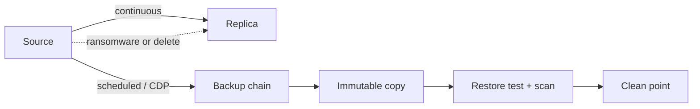

## What happened

Veeam published a refresher on backup, recovery, replication and disaster recovery (DR), and on how to match each to a workload. It is a vendor blog post, and the last part maps the advice onto Veeam products. The generic framework in the first part stands on its own.

The headline artifact is a four-tier table. It runs from payments and core banking systems (Tier 1) down to dev/test and archives (Tier 4). Each tier gets an RPO, an RTO and a recommended mechanism. The article suggests running your own estate against this table to find where protection and business tolerance have diverged.

## Why it matters

Backup configurations tend to be set once and inherited. Meanwhile the estate has grown to include several hypervisors, SaaS, public cloud, NAS and containers. The threat model has also shifted: ransomware targets backup infrastructure, and attackers may dwell for a long time. That means the newest restore point may already be compromised.

The first questions in an incident are "how fast can we be back?" and "back to what?". Those are RTO and RPO questions. A dashboard of completed jobs answers neither.

The article also looks ahead. AI agents with access to production data can make mistaken bulk changes at machine speed. Rolling back a whole environment can cost more than the error did. It calls the answer "precision recovery", meaning recovery scoped to what changed. The post only gestures at this, so treat it as direction rather than established practice.

## How it works

### Four distinct concepts

| Concept | What it is | Key property |
|---|---|---|
| Backup | Point-in-time copy under a retention policy | Keeps history; stored separately from the source |
| Recovery | Returning data or systems to a usable state | Measured by RTO and RPO |
| Replication | Standby copy kept in sync at a second site | You fail over to it, but it inherits whatever happens to the source |
| Disaster recovery | Plan and orchestration: recovery order, failover authorization, dependencies | Backup is a component of DR, not a substitute |

RPO (recovery point objective) is how much data loss you can tolerate. RTO (recovery time objective) is how long you can be down.

A backup-only estate recovers slowly. A replication-only estate resumes quickly but has nothing to fall back on after a logical event such as deletion or encryption.

### Backup types

| Type | What it copies | Restore requires | Window | Storage cost |
|---|---|---|---|---|
| Full | Everything in scope | One full backup | Longest | Highest |
| Incremental | Changes since last backup of any type | Full plus every increment | Shortest | Lowest |
| Differential | Changes since last full | Full plus one differential | Middle, grows over the cycle | Middle |
| Synthetic full | Builds a full from existing backup data, with no production reads | The synthetic full alone | Middle, no production impact | Middle |

Retention is a separate decision from backup type. The article mentions grandfather-father-son schemes for compliance and the 3-2-1-1-0 rule against attacks on the primary copy. Storage tier also matters for restore speed: performance disk, object storage or offline. It suggests checking whether NAS backups can use archive-tier storage as the primary repository, to avoid performance-tier pricing on long retention.

### The tiering table

| Tier | Examples | RPO | RTO | Mechanism |
|---|---|---|---|---|
| 1 | Payments, order entry, core clinical or banking | Seconds | Minutes | Continuous replication with rehearsed failover, plus backup for a clean historical point |
| 2 | ERP modules, line-of-business apps, primary file services | 15 min to 1 h | 1 to 4 h | Frequent backup with instant recovery; replication only for the most critical |
| 3 | Microsoft 365, collaboration, departmental shares | 4 to 24 h | Same business day | Scheduled backup, item-level restore, legal-hold-length retention |
| 4 | Dev/test, reproducible builds, archives | 24 h+ | Best effort | Periodic backup to cheap object storage, or a documented rebuild |

Near-zero RPO costs bandwidth, capacity and licensing, so tiering is how you justify that spend. Continuous data protection (CDP) is the mechanism for near-zero RPO. It journals changes continuously instead of taking periodic snapshots. Support varies by vendor, workload and OS.

### Proving recovery

The article lists four capabilities:

1. **Automated restore testing** in an isolated network. It should include application-level checks, such as whether the database opens or the web tier serves, and not just a ping.
2. **Malware and IoC scanning**, so a restore doesn't reintroduce the payload.
3. **Clean point identification**, rather than defaulting to the latest point. Long dwell time means recent points may be compromised.
4. **Immutability**, so restore points can't be altered after they're written.

A real test boots the restore point in isolation, runs the checks, records results against RPO/RTO targets and remediates failures. The output is a dated report that boards, auditors and cyber insurers can use. For Tier 1 and 2, tests should be scheduled and orchestrated.

### Recovery granularity and coverage

The article lists the recovery options to map onto tiers:

- file or item-level recovery
- instant recovery from backup
- volume-level recovery
- bare-metal recovery to dissimilar hardware
- orchestrated multi-application recovery in the correct order

Coverage should include multiple hypervisors, physical servers, databases, NAS, SaaS, public cloud and containers. For SaaS, provider shared-responsibility models don't cover point-in-time recovery of your content. For containers, persistent volumes and cluster configuration are separate recovery problems.

### Databases

A running database holds state in memory and in transaction logs, which file-level copies miss, so a crash-consistent copy may not open. Application-aware processing with log handling gives transactionally consistent recovery. The article names SQL Server, Oracle, PostgreSQL, SAP HANA, MongoDB and Db2. Generic tools can report success when point-in-time recovery isn't possible.

## Trade-offs and open questions

- **Vendor framing.** The latter part maps requirements to Veeam features: CDP, SureBackup, Threat Hunter, Recovery Orchestrator and others. The consolidation argument ("one console, one policy") is made on operational cost, and the post offers no data on that. The single cited result is Quest Global reporting a 100% success rate across its recovery tests, with no detail on the method.
- **Cost of tight RPO.** Replication and CDP consume bandwidth, capacity and licences, and the article offers no figures.
- **Clean-point detection.** The post says to find a clean point but doesn't say how reliable scanning is against a patient attacker. Scan coverage and false negatives are left open.
- **Precision recovery** is stated as a direction, not a described capability.
- **Alternatives.** The post doesn't compare native database replication, storage snapshots or cloud-native tooling. Those are real alternatives, and this is a vendor-centred view.

## What you can apply

1. **Run the tiering exercise.** List workloads, assign a tier by business tolerance, and compare it to the actual mechanism and schedule. The mismatches (replicated file shares, nightly-only critical databases) are your findings.
2. **Pair replication with backup for Tier 1.** Replication gives fast resumption. Backup history gives you a point to return to after a logical corruption. Be explicit that failover is fast but inherits the damage.
3. **Measure RPO and RTO, don't assume them.** Record achieved restore times from tests against the targets. Alert on jobs that protect zero workloads or have shrunk in scope.
4. **Test restores in isolation.** Include application-level checks, keep dated reports, and schedule them for Tier 1 and 2.
5. **Choose the restore point deliberately.** Keep enough retention to reach back before the attacker's dwell time, and scan candidate points before restoring.
6. **Harden the backup plane.** The FAQ calls for production-level security: immutability, encryption, separate credentials, and a copy outside the trust boundary.
7. **Check onboarding.** Can you name the last workload added and who confirmed it entered a backup policy? If not, coverage has drifted.
8. **Use application-aware backups for databases.** Verify that point-in-time recovery works, not just that the job succeeded.

## Glossary

- **RPO:** Recovery point objective. The maximum tolerable data loss, measured in time.
- **RTO:** Recovery time objective. The maximum tolerable downtime.
- **Replication:** Keeping a standby copy in sync, usually at a second site, for failover.
- **CDP:** Continuous data protection. It captures changes continuously for near-zero RPO.
- **Immutability:** A property that stops restore points being altered or deleted after they're written.
- **Synthetic full:** A full backup assembled from existing backup data without reading production.
- **3-2-1-1-0:** A rule of thumb for copy count, media, offsite and offline/immutable copies, and zero errors after verification.
- **IoC:** Indicator of compromise. Evidence of malicious activity used in scanning.
- **Dwell time:** How long an attacker stays undetected, which can contaminate recent restore points.
- **Bare-metal recovery:** Restoring a whole system onto new hardware, possibly dissimilar to the original.
