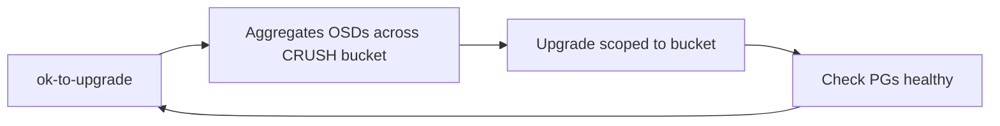

## What happened

The Ceph project released v21.2.0, "Umbrella", on October 28, 2026. It is the first stable release of Umbrella, and the project recommends all users update. The release notes open with two warnings. The first is about CPU: container images now use `rockylinux:10`, so hosts without x86-64-v3 can't run the containerized daemons. The second is about Python: cephadm needs Python 3.9 or newer on every host.

The rest of the notes cover changes across RADOS, RGW, CephFS, the dashboard, cephadm and ceph-volume. I read only the first part of a very long page (about 100k of roughly 436k characters). The RBD section and the detailed changelog were not in what I read, so this post doesn't cover them.

## Why it matters

Ceph is the storage layer under many OpenStack, Kubernetes (Rook) and on-prem S3 deployments. Its upgrades are rolling and long-lived, so the problem is usually not "does the new feature work". The problem is whether the fleet can legally and safely get there.

- **Hardware floor.** x86-64-v3 roughly means AVX2, BMI and FMA-era CPUs, which is Intel Haswell and AMD Excavator/Zen or later. Storage nodes are often kept for 7+ years, so older Xeons that were fine for Ceph last year may be unable to run the containers. The release notes don't offer a workaround for older CPUs.
- **Default drift.** Autoscaler and mClock changes alter data placement and I/O behavior without any configuration change by you. PG splits cause backfill traffic.
- **Industry direction.** The release carries several broader trends. EC is becoming viable for more workloads, including OMAP and direct reads. Object storage is adding cloud-tiering and IAM parity with AWS. Block storage is gaining NVMe/TCP management. Stronger security defaults are arriving.

## How it works

**Upgrade-sensitive defaults**

| Setting | Old | New |
|---|---|---|
| `mon_target_pg_per_osd` | 100 | 200 |
| `mon_max_pg_per_osd` | 250 | 500 |
| `osd_op_num_shards_hdd` | 5 | 1 |
| `osd_op_num_threads_per_shard_hdd` | 1 | 5 |
| CephX default cipher | legacy key types | AES256KRB5 |
| BlueStore mkfs | n/a | full-device discard by default |

A **PG** (placement group) is the unit Ceph uses to map objects to OSDs. The **autoscaler** adjusts a pool's PG count toward a target number of PGs per OSD. Doubling the target means pools can be split roughly twice as finely, and each split moves data. The notes say `pg_autoscale_during_upgrade` paces the splitting. They also advise clusters with an effective `bluestore_osd_memory_target` below 4 GiB, or SSDs divided into more than two OSDs, to pin the old values first. More PGs per OSD mean more per-PG memory and CPU.

The mClock change keeps one shard per HDD OSD but uses five threads on it. mClock is Ceph's QoS scheduler. A single queue per HDD makes its scheduling more coherent, and the threads keep concurrency up.

**Optimized EC.** The new I/O path adds EC direct reads, support for object classes (CLS) on EC reads, EC OMAP (per-object key-value data) and CRC checks. Chunk sizes that aren't 4k-aligned are rejected, so check existing profiles. Deprecated EC plugins and techniques, and Blaum-Roth profiles where w+1 is not prime, now raise health warnings.

**Upgrade orchestration.**

`ok-to-upgrade` now aggregates across CRUSH buckets (the failure-domain hierarchy, such as rack or host), so you can upgrade a whole bucket at once when the data is still safe. Monitor RocksDB backup/restore adds `mon_backup_interval`, `ceph tell mon.* backup` and `ceph-mon --restore-backup`.

**Security.** AES256KRB5 replaces weaker legacy key types as the CephX default, with online key rotation for mon, OSD and MDS.

**Other notable areas**
- RGW: tech-preview dedup, bucket logging with journal mode, cloud transition and Glacier/tape restore, AES-256-GCM SSE, `GetCallerIdentity`, JWT/JWKS validation, and account-wide PublicAccessBlock.
- CephFS: FSCrypt, multi-threaded mirroring with blockdiff sync, and new pybind `*at` APIs.
- cephadm: certmgr-managed certificates, SMB, NFS QoS and TLS, NVMe-oF TLS and KMIP.
- Build: C++23, CMake 3.22.1 minimum, Ubuntu 24.04 and Rocky 10 supported.
- Crimson/Seastore: EC support and PG splitting, tracked in the notes as ongoing work.

## Trade-offs and open questions

- **Cost of the CPU floor.** Mixed-age clusters may need hardware refresh or a delayed upgrade. The notes don't describe a non-container path for old CPUs, so verify before assuming one exists.
- **Python 3.9+** may be an issue on older enterprise distros' base images.
- **First release of a major version.** Treat it cautiously. The notes cover breaking items, but real-world performance of Fast EC isn't quantified in what I read, and I won't invent numbers.
- **Doubled PG targets** may help balance and parallelism, but they cost memory and cause backfill. The notes themselves caution low-memory OSDs.
- **Removed or changed behavior:** the legacy Keystone admin-token requirement, the global RGW tenant "Roles" tab, and root-directory fragmentation in CephFS. The `cephfs_mirror peer_add` command is deprecated. Check your automation.
- **Tech-preview** dedup and the off-by-default availability score aren't production-ready by definition.

## What you can apply

1. **Pre-flight CPU audit.** Run `grep -o 'avx2\|bmi2\|fma' /proc/cpuinfo` on every host, or check `ld.so --help | grep x86-64-v3`. Do this before planning, and treat it as a go/no-go gate.
2. **Check Python** version on every host for cephadm.
3. **Freeze PG behavior first.** Before upgrading, record current `mon_target_pg_per_osd` and `mon_max_pg_per_osd`. Pin the old values if your OSDs have under 4 GiB memory target or you split SSDs into more than two OSDs. Raise them later, deliberately, during a quiet window. Watch backfill and recovery rate.
4. **Audit EC profiles** for non-4k-aligned chunk sizes, deprecated plugins and Blaum-Roth with a non-prime w+1, since they now fail or warn.
5. **Take a mon backup** (`ceph tell mon.* backup`) before the upgrade. Also confirm the restore procedure on a test cluster, since an untested backup isn't a recovery plan.
6. **Plan for auth.** The new CephX cipher affects clients as well as daemons. Verify client library versions, and test on staging first. Use online rotation rather than a big-bang cutover.
7. **Upgrade in stages.** Use `ok-to-upgrade` scoped to a CRUSH bucket, and verify with `ceph -s` and PG states before moving to the next bucket. RPO isn't directly affected by a rolling upgrade, but RTO depends on how quickly you can detect and halt a bad step.
8. **Review RGW clients**, including presigned PUT uploads. A SigV4 regression from 19.2.6 and 20.2.4 is fixed here.

## Glossary

- **x86-64-v3:** CPU microarchitecture level (AVX2 and related instructions) required by Rocky Linux 10.
- **cephadm:** Ceph's container-based deployment and orchestration tool.
- **PG (placement group):** Unit mapping objects to OSDs.
- **PG autoscaler:** Adjusts pool PG counts toward a per-OSD target.
- **mClock:** QoS-based operation scheduler in OSDs.
- **Fast / optimized EC:** New erasure-coding I/O path with direct reads and OMAP support.
- **CRUSH:** Ceph's placement algorithm and failure-domain hierarchy.
- **CephX:** Ceph's authentication protocol.
- **OMAP:** Per-object key-value metadata.
- **Crimson/Seastore:** Next-generation OSD and its storage backend.
- **RGW:** RADOS Gateway, the S3/Swift-compatible object interface.
