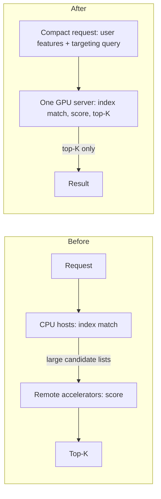

## What happened

Meta published a follow-up on Andromeda, its personalized ads retrieval engine. Retrieval is the first stage of the ads pipeline. It narrows a huge pool of eligible ads to a small candidate set, and a later ranking stage scores that set in more detail.

The 2024 version ran on NVIDIA GH200 Grace Hopper Superchips and scored tens of millions of ads per second per GPU. Generative AI creative tools have since enlarged the candidate pool a lot. Meta's new target is billions of ads per second per card.

The new system combines three things:
- an MoE retrieval model
- a single-GPU fused pipeline
- GPU-optimized kernels developed with NVIDIA

Production now processes over one billion ads per second per GPU server while scoring every eligible ad.

## Why it matters

Retrieval has a built-in tension. Cheap models can score a huge pool but are less accurate. Accurate ranking-grade models are too expensive to run on everything. Whatever retrieval drops is never seen by ranking, so retrieval quality caps the whole funnel.

Generative creative tools make this worse because they grow the candidate pool faster than hardware budgets grow. Meta's answer is not to prune earlier. It makes full scoring cheap enough that no pruning is needed.

The wider lesson for recommender and search engineers is that at high throughput, a model with few FLOPs becomes memory-bound and network-bound. Model design and systems design then have to be done together. This applies to anyone running two-tower retrieval or large-scale candidate scoring.

## How it works

### The model: retrieval MoE

The architecture borrows MoE from LLMs. Each input activates only a few specialized sub-networks (experts), so capacity can grow without compute growing in step. It changes three parts of a classic two-tower retriever:

1. **User modeling.** One user tower becomes an ensemble of specialized user towers (experts). They draw on sequences of ad engagement events, user-cohort representations, LLM-derived semantic features and cross-surface co-engagement signals.
2. **Candidate ads tower.** A joint encoding strategy folds real-time serving context into the ad representations.
3. **Interaction overarch.** Dense networks are replaced by an MoE attention-based gating network. It routes each candidate to the most relevant user experts (top-K activation).

The result is about 300x fewer inference FLOPs than the 2024 retrieval model. Meta says capacity can grow through more experts, richer feature interactions and deeper architectures without a proportional rise in GPU cost.

### The system: fusion and co-location

**Fused kernel.** The 2024 launch fused only the model operations. Now embedding gathering, interaction modeling and scoring run in one GPU kernel per user-ad interaction. Intermediates stay in registers and shared memory and never go to high-bandwidth memory (HBM), the GPU's main memory. This matters because memory traffic, not math, is the main bottleneck.

**Co-location.** Index matching enforces advertiser targeting rules. Previously, index matching, scoring and top-K were split across CPU hosts and remote accelerators, and shipping candidate lists saturated the network. Now all three run on the same GPU server.

Meta reports roughly 100x less network traffic, which puts the system back in a GPU-compute-bound regime. Moving index matching to the GPU meant redesigning the index for GPU-parallel execution. It still had to keep production targeting semantics, including real-time updates as ads change during the day.

### The NVIDIA collaboration

| Component | Result |
|---|---|
| Interaction (gating) network | 5.3x: 2.4B to over 10B ads/s, about 85% of peak HBM bandwidth |
| INT8 quantization | Up to 2x over optimized FP16, accuracy on par with 16-bit |
| Index matching | Over 2x, to over 100B ads/s |
| End-to-end pipeline | Co-designed data layouts removed indirection; multiple times current production throughput on one GPU server |

At 85% of peak HBM bandwidth the gating kernel is close to the memory ceiling. Meta says it now runs as fast as a simple dot-product kernel on the same hardware. Index matching is an order of magnitude faster than scoring. That leaves headroom to re-run it across multiple retrieval pathways. Profiling also showed that data movement between components, not computation, accounted for much of the latency.

## Trade-offs and open questions

- **Unverified numbers.** The 300x FLOP reduction and the throughput figures come from Meta without a detailed methodology. The baselines, batch sizes and latency percentiles are not given.
- **"Near ranking-level" is unquantified.** There is no offline metric comparison.
- **Thin business evidence.** The only business number is a 2.4% conversion increase on Facebook since 2025. It has no breakdown by surface or advertiser type, and it can't be attributed to this specific generation.
- **Operational costs of co-location.** The article doesn't discuss capacity planning per GPU server or failure isolation. Putting index, scoring and selection on one box concentrates blast radius and ties index memory to GPU memory.
- **Fusion is rigid.** A hand-fused kernel is fast but harder to change. Model experiments have to fit the kernel's structure.
- **Hardware-specific.** The tuning targets GH200. The move to Grace Blackwell, and its sensitivity to CPU-to-GPU ratios, is still under evaluation.
- Meta says the pipeline hasn't hit its ceiling and more gains are coming.

## What you can apply

- **Profile for bytes, not FLOPs.** Once you cut compute, check roofline position. If a kernel is near peak HBM bandwidth, as the gating network is at about 85%, only less data movement will help.
- **Fuse across the model/non-model boundary.** Embedding lookups and scoring are often separate services or ops. Keeping intermediates in registers and shared memory is where the gain comes from.
- **Move compute to the data.** Send a small query in and a top-K out, rather than shipping candidate lists between tiers. Measure your own inter-tier bytes per request.
- **Use sparse activation to buy capacity.** MoE with top-K routing lets you add experts while holding per-request cost roughly flat.
- **Try INT8 on the heaviest kernel.** Meta reports up to 2x over FP16 with matching accuracy. Validate on your own data.
- **Plan for the GPU index.** If you move filtering or targeting onto the GPU, define how real-time updates and the exact rule semantics are preserved before cutover. Verify against the old path by comparing result sets on shadow traffic.
- **Weigh failure domains.** If you co-locate, decide how a single server failure affects index availability and recovery.

## Glossary

- **Retrieval:** the first pipeline stage, which narrows a large candidate pool before ranking.
- **MoE (Mixture of Experts):** a model with many specialized sub-networks, of which only a few top-K are activated per input.
- **Two-tower model:** separate user and item encoders whose outputs are compared by a scoring function.
- **Index matching:** filtering ads by advertiser targeting rules.
- **HBM:** high-bandwidth memory, the GPU's main memory.
- **Kernel fusion:** merging several GPU operations into one kernel to avoid writing intermediates to memory.
- **GH200:** NVIDIA's Grace Hopper Superchip, pairing a Grace CPU with a Hopper GPU.
- **INT8 quantization:** running with 8-bit integers instead of 16-bit floats to raise throughput.
