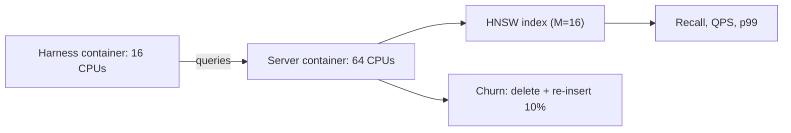

## What happened

Percona benchmarked HNSW (a graph-based approximate nearest-neighbour index) in six engines that index vectors themselves. The engines were MariaDB 11.8, MariaDB 12.3, AliSQL (8.0.44-2, with its VIDX index), PostgreSQL with pgvector 0.8.6, Valkey 9.1.1 with valkey-search, and Percona Search for MongoDB. Percona Search is a Technical Preview that uses scalar-quantized HNSW.

All engines ran on the same host: a Xeon Gold 6230 with 80 logical CPUs and 187.5 GB RAM. The server container had 64 CPUs, and a separate container held the benchmark harness. The test measured five things: time to a queryable index, storage and memory, recall against throughput, concurrency, and filtered search. It also measured behaviour after rewriting 10% of the corpus.

There was no single winner. pgvector led on concurrency, Valkey on filtered accuracy and single-client throughput, MariaDB 12.3 on recall at 0.99, and Percona Search on build speed and tight filters.

## Why it matters

Many teams are deciding whether to put vectors in a database they already run (Postgres, MySQL-family, Valkey/Redis-style, MongoDB) or adopt a dedicated vector store. Headline "recall vs QPS" charts hide the questions that decide the outcome in production:

- How long does re-embedding take after a model change?
- What happens to a filtered query with a selective predicate?
- Does throughput survive concurrent clients?
- Does the index degrade after updates?

This benchmark covers those questions, which is why it is useful beyond the ranking itself.

## How it works

**Setup.** The corpus is dbpedia-openai-1000k-angular, with M=16 and k=10 everywhere. `ef_search` (the number of candidates explored at query time, where higher means better recall and slower queries) was swept from 10 to 800 for recall tests and pinned at 100 for throughput tests. Recall follows the ann-benchmarks definition. For filtered tests, ground truth was recomputed by brute force over qualifying rows only. Concurrency ran 1–32 clients, 60 seconds per point, 3 repeats.

**Build and footprint.**

| Engine | Time to queryable | Index size | Peak RSS |
|---|---|---|---|
| Percona Search | 1.9 min | 15.1 GiB | 48.8 GiB |
| Valkey | 4.3 min | 11.3 GiB | 14.3 GiB |
| PostgreSQL | 40.9 min | 7.6 GiB | 43.5 GiB |
| MariaDB 11.8 | 3.6 h | 3.9 GiB | 28.6 GiB |
| MariaDB 12.3 | 5.4 h | 3.9 GiB | 27.0 GiB |
| AliSQL | 6.7 h | 3.9 GiB | 21.9 GiB |

MHNSW (MariaDB) and VIDX (AliSQL) update the graph on every INSERT. That makes loading slow but gives the smallest indexes. The raw vectors alone are 5.7 GiB. pgvector and Valkey load the data first and then build the index in bulk.

**Recall and throughput (single client).** At recall ≥0.90, Valkey managed 1,191 QPS and pgvector 679. At ≥0.99, MariaDB 12.3 led with 277 QPS, ahead of Valkey (264) and pgvector (210). Percona Search was slowest at 138, 124 and 88 QPS across the three floors. MHNSW and VIDX expose no `ef_search`-style knob at a fixed graph degree, so their speed does not fall off as recall rises. That is why their numbers repeat across columns.

**Concurrency.** pgvector scaled 21.7× from 1 to 32 clients, and Valkey about 12×. The InnoDB-based engines stayed flat while median latency rose about 20×, which suggests a server-side queue. The authors caution that their Python threads shared one interpreter lock, so these engines saw only about 7–17 queries in flight instead of 32. They withdrew the scaling-efficiency figures for those engines. A fix using one OS process per client exists, but its results are not published.

**Filtered search.** The engines use different strategies:

| Engine | Strategy | 10% selective: recall / QPS | 1% selective: recall / QPS |
|---|---|---|---|
| Valkey | Planned per query | 0.995 / 53.5 | 0.9996 / 8.2 |
| MariaDB 12.3 | Post-filter, keeps searching | 0.990 / 16.4 | 0.980 / 0.5 |
| Percona Search | Pre-filter | 0.858 / 71.9 | 0.867 / 117.5 |
| PostgreSQL | Post-filter, stops | 0.859 / 227.5 | 0.103 / 237.1 |

A *post-filter* runs the ANN search first and then discards non-matching rows. If it stops after one pass, tight filters leave fewer than k results. That is what pgvector did at default settings. Percona's recall is limited by quantization; unquantized it reached 0.997.

**Churn.** After deleting and re-inserting 10% of the rows, pgvector's QPS was unchanged, but only after it ran `VACUUM (ANALYZE)`. Valkey dropped 4%. Percona Search re-inserted at 20,223 rows/s, far faster than the others, but its QPS fell from 186 to 113.

## Trade-offs and open questions

- **Run quality.** There was one run on one corpus, with no repeat observations. The authors rate build time, index size and recall as the most stable measurements. Throughput is less trustworthy.
- **Concurrency is partly compromised.** The shared-interpreter harness issue means the MariaDB and AliSQL concurrency numbers are lower bounds on contention, not clean measurements. Six data points were withdrawn.
- **Churn is incomplete.** A 30-minute timeout cut off the three MySQL-family results. The engines were still inserting correctly, at 16–28 rows/s. The timeout is now two hours, and a rerun will take about 24 hours.
- **pgvector filtering used defaults.** Iterative scan, added in pgvector 0.8, was not tested, so the 0.10 recall is a worst-case default. It is not an inherent limit.
- **Unexplained anomalies.** AliSQL's QPS rises between `ef_search` 400 and 800, and its p50 latency jumps from 6.6 ms to 50.8 ms to 384 ms.
- **Tuning.** M=6 was tried only for MHNSW and VIDX, and it was worse than M=16 above recall 0.88. The other engines were tested at M=16 only. Four engines were built from source and two came from packages, so compile flags were not uniform.
- **Percona Search** is a Technical Preview, so its results may change.
- **Memory trade-off.** Valkey's lowest RSS (14.3 GiB) comes with the requirement that the data fit in memory. The article lists its write path into indexed prefixes as something to test first.

## What you can apply

- **Plan for re-embedding.** An embedding-model change means a full rebuild. From this data, that is minutes (Valkey, Percona Search), about 40 minutes (pgvector), or hours to a weekend (MariaDB, AliSQL). Build a new index alongside the old one and cut over, rather than rewriting in place.
- **Test your actual filters.** Run queries at your real selectivity and check the number of rows returned, not just latency. Fast and empty is a silent failure. For pgvector, enable iterative scan before shipping filtered queries and rerun this test.
- **Run VACUUM after bulk rewrites in Postgres.** The flat churn result for pgvector depended on `VACUUM (ANALYZE)`.
- **Measure under churn, not just on a static index.** A 39% throughput drop after rewriting 10% of rows (Percona Search) would not show up in a static benchmark. Include a delete-and-reinsert phase in your own tests.
- **Check your load generator.** Python threads sharing one interpreter lock made some engines look worse than they may be. Use one OS process per client and verify in-flight query counts.
- **Choose by workload.** High concurrency points to pgvector or Valkey. Tight accurate filters point to Valkey. A small, accurate index with few clients points to MariaDB 12.3. Frequent tight filters where some recall loss is acceptable point to Percona Search, with the Technical Preview caveat. For MariaDB, 12.3 beat 11.8 on every measure the article reports.
- **Reproduce before you decide.** The framework and raw records are at github.com/Percona-Lab/vector-bench. Run it with your own embeddings and dimensionality.

## Glossary

- **HNSW:** Hierarchical Navigable Small World, a layered proximity-graph index for approximate nearest-neighbour search.
- **M:** The graph degree, meaning the number of neighbours kept per node. Higher values give a bigger index and usually better recall.
- **ef_search:** The query-time candidate list size. Higher values give better recall and lower speed.
- **Recall:** The fraction of the true top-k neighbours that the ANN search returns.
- **MHNSW / VIDX:** The vector indexes in MariaDB and AliSQL respectively. Both update the graph on each INSERT.
- **Post-filter / pre-filter:** Applying the predicate after or before the vector search.
- **Selectivity:** The fraction of rows that pass a filter, such as 10% or 1%.
- **Scalar quantization:** Storing vector components at lower precision to save space, at some cost in recall.
- **Churn:** Deleting and re-inserting existing rows, used here to test index degradation.
- **RSS:** Resident set size, the physical memory a process uses.
