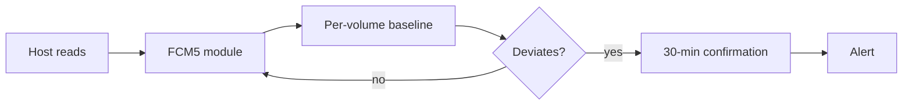

## What happened

IBM's October 2026 update for the FlashSystem 5600, 7600 and 9600 arrays adds in-drive detection of data exfiltration. It runs on the fifth-generation FlashCore Module (FCM5), IBM's own flash module. These modules already detected ransomware encryption in hardware.

The module builds a baseline of normal read activity for each volume. Reads that break from the baseline are flagged. A suspected event is confirmed after a 30-minute window. IBM says routine backup passes and analytics scans are recognized, so scheduled full reads shouldn't raise alerts. Availability starts in October 2026 on eligible configurations.

The update also includes:

- **Post-quantum cryptography (PQC) in FCM5.**
- **FlashSystem.ai governance features.** These are advisory: contextual recommendations, task context that persists across sessions, and suggested next-best actions. IBM claims up to 90% less effort for routine provisioning. That figure comes from lab-controlled evaluations of multi-volume provisioning with Safeguarded Copy and disaster recovery policies.

## Why it matters

Most cyber-recovery designs focus on getting data back: immutable snapshots, isolated copies, and clean-room restores. That answers "can we restore?" It doesn't answer "what did the attacker take?" For breach notification, regulatory exposure and extortion negotiations, the second question often costs more.

IBM cites two figures for the timing problem. Google Cloud's M-Trends 2026 reportedly says attackers often sit in a network for 11–14 days before deploying ransomware. IBM's Cost of a Data Breach 2026 puts average breach identification at 247 days. Encryption is the loud final step. Exfiltration happens earlier and quietly, and double-extortion attacks make it the main lever.

The wider trend is detection moving down the stack, to places an attacker who owns the host can't easily tamper with. Endpoint agents, host logs and SIEM feeds can be disabled or falsified once an attacker has admin rights. The storage device sees every read regardless. If you design cyber-recovery, this adds a signal from a different trust domain.

## How it works

The article is thin on the internals. IBM describes the behavior, not the model, features or thresholds. What it does say:

1. **Baseline per volume.** The module learns what normal read activity looks like for each volume. The article doesn't say which features it uses, such as volume, rate or access pattern.
2. **Deviation flagging.** Reads that break from the learned pattern are flagged as possible exfiltration.
3. **Confirmation window.** A suspected event is confirmed over 30 minutes. This trades speed for fewer false alarms.
4. **Scheduled-read recognition.** Full backup passes and analytics scans are read-heavy, so they look like exfiltration. IBM says the module recognizes them.
5. **In-module placement.** Analysis doesn't need host agents or host logs. It needs no application changes, and IBM says it has no measurable performance impact.

### Post-quantum changes

The concern is "harvest-now, decrypt-later". An attacker steals encrypted data or traffic today and keeps it until quantum hardware can break the keys.

| Element | Mechanism | Purpose |
|---|---|---|
| Data at rest | AES-256 (unchanged) | Bulk encryption |
| Unlock PIN transport | ML-KEM (FIPS 203), hybrid | Key encapsulation for delivering the PIN to the module |
| Firmware authenticity | ML-DSA (FIPS 204), hybrid | Signature verification of firmware |
| Fibre Channel data path | Secure HBAs, planned, no date | Extend protection to the fabric |
| Fabric session encryption | Quantum-safe, future | Not yet available |

"Hybrid" means a classical algorithm and a post-quantum one are combined. An attacker would need to break both. The article doesn't specify which classical algorithms are paired.

## Trade-offs and open questions

- **All figures are vendor claims.** The sub-1% false-positive rate, the zero measurable performance impact and the 90% effort reduction come from IBM's telemetry or lab tests. The article includes no independent validation.
- **Detection versus prevention.** The article describes flagging and alerting. Whether the array can automatically act, for example by snapshotting, blocking or throttling, isn't covered.
- **False positives versus false negatives.** Only the false-positive rate is reported. The detection rate, and the volume of data that can leave before an alert, are not stated. A 30-minute confirmation window leaves room for meaningful data to leave.
- **Slow, low-volume exfiltration.** A baseline approach can in principle be evaded by an attacker who reads slowly and in a pattern that resembles normal use. The article doesn't address this.
- **Blind spots.** The module sees reads at the volume level. It can't tell a legitimate privileged read from a stolen-credential read by the same host, and it can't see data taken from other systems. It also depends on firmware 9.1.2 or later and eligible configurations.
- **Baseline poisoning.** If an attacker is present while the baseline is learned, malicious patterns could become "normal". The article doesn't say how this is handled.
- **PQC scope is partial.** The PQC protects PIN transport and firmware signing. It doesn't change data-at-rest encryption, which remains AES-256, and fabric protection is future work with no date.
- **Vendor lock-in.** This is a feature of IBM's own flash modules. It doesn't help arrays from other vendors or other tiers.

## What you can apply

- **Treat exfiltration as its own recovery question.** In a cyber-recovery plan, add "what was read, and when?" next to RPO and RTO. Decide which data sets would trigger notification obligations, and whether your tooling can answer for them.
- **Prefer signals from an independent trust domain.** If your host-based monitoring depends on the same credentials an attacker would take, add at least one signal that doesn't. Storage, network flow logs or an out-of-band appliance all qualify.
- **Plan for scheduled-job noise.** Whatever you deploy, register or tag backups, scans and analytics jobs. Test them before you rely on alerts, because large legitimate sequential reads are the main false-positive source for any read-anomaly detector.
- **Validate vendor numbers in your own environment.** Before you rely on "under 1%", run it in alert-only mode on your own workloads. Measure alert volume, and run a simulated exfiltration to measure time to detection.
- **Wire alerts into response.** A 30-minute confirmation and an alert only matter if someone can act: isolate the host, revoke credentials, and preserve an immutable snapshot at that moment as forensic evidence.
- **Start a PQC inventory.** Long-lived confidential data is the "harvest-now" risk. Find where key exchange and firmware signing are still classical-only, and ask vendors for hybrid ML-KEM and ML-DSA roadmaps with dates.

## Glossary

- **FlashCore Module (FCM)**: IBM's custom flash module in FlashSystem arrays. FCM5 is the fifth generation and does hardware-level analysis.
- **Data exfiltration**: Unauthorized copying of data out of an environment, often before ransomware is deployed.
- **Double extortion**: Ransomware that both encrypts data and threatens to leak stolen copies.
- **Dwell time**: The time an attacker spends in a network before acting visibly.
- **Harvest-now, decrypt-later**: Storing stolen encrypted data to decrypt it once quantum computers can break the keys.
- **ML-KEM (FIPS 203)**: A NIST-standardized post-quantum key encapsulation mechanism.
- **ML-DSA (FIPS 204)**: A NIST-standardized post-quantum digital signature algorithm.
- **Hybrid mode**: Combining a classical and a post-quantum algorithm, so an attacker must break both.
- **Safeguarded Copy**: IBM's feature for protected snapshot copies, mentioned here in the provisioning claim.
- **HBA**: Host bus adapter, the card connecting a server to a storage fabric such as Fibre Channel.
