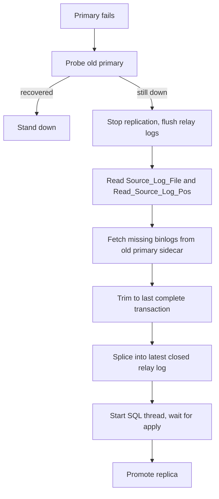

## What happened

Percona released Operator for MySQL 1.3.0. It runs Percona Server for MySQL on Kubernetes. The release moves three things forward:

1. Automatic configuration tuning.
2. Failover for async-replication clusters that salvages in-flight transactions.
3. Point-in-time recovery (PITR) for clusters whose binary logs are encrypted at rest.

It also adds smaller items. These include a declarative `spec.users` list, a custom CA for S3-compatible backup storage, cert-manager ClusterIssuer support, TLS rotation without restarts, backup deadlines, DigitalOcean Kubernetes (DOKS) support, and MySQL 9.7 in the support matrix.

## Why it matters

Async replication acknowledges a commit to the client before any replica has it. If the primary dies with unshipped binlog events, those transactions are gone. This is true even when the HA controller works perfectly. Teams that chose async for latency or simplicity have had to accept that window. Others moved to Group Replication.

The tuning feature addresses a common Kubernetes problem. Someone resizes a pod, but `innodb_buffer_pool_size` stays at the value from the old size. The result is wasted memory or OOM kills.

Encrypted PITR matters for compliance. Many teams must encrypt backups and binlogs at rest, and recovery that only works on unencrypted logs is not usable for them. The wider trend is that operators are taking over what a DBA would do by hand: sizing, failover forensics and key handling.

## How it works

### Zero-data-loss async failover

Each MySQL pod's xtrabackup sidecar gets a `POST /failover/stream` endpoint on port 6450. It serves binlogs as a tar stream. The failed primary's `mysqld` may be down, but its sidecar and storage must still respond.



The key idea is to treat the old primary's binlog as a source of relay log content. The replica's coordinates show where it stopped reading. The operator fetches everything after that point and cuts it at the last complete transaction, so no half-written event is applied. It splices the result into the relay log and lets the SQL thread apply it. Only then does promotion happen.

The failover tool waits up to one hour by default for the source pod to become reachable and for the missing transactions to apply. That budget counts from the first attempt, not per retry. When it expires, the `on-timeout` policy decides:

| Policy | Behavior |
|---|---|
| `Abort` | Holds the cluster for a human to decide |
| `ForceWithPossibleDataLoss` | Promotes anyway |

### Autopilot tuning

```yaml
spec:
  mysql:
    resources:
      limits: { cpu: "4", memory: 8Gi }
    autoConfig:
      enabled: true
      loadType: someWrites   # mostlyReads | someWrites | equalReadsWrites | heavyWrites
      version: 8.4.0
```

The CRD requires both CPU and memory limits when `autoConfig` is enabled. The operator computes settings such as the buffer pool from those limits and recalculates when limits or `loadType` change. Dynamic variables are applied with `SET GLOBAL`. Static variables need a restart, which the operator rolls through the pods one at a time.

### Encrypted binlogs for PITR

The binlog server ships binlogs to object storage. With encryption on, each file gets its own data encryption key (DEK). A key encryption key (KEK) from a keyring Secret wraps each DEK. This is envelope encryption.

- `...binlogServer.storage.encryption.cipher`: default `AES-256-CTR`.
- `...binlogServer.storage.encryption.kekId`: the KEK entry name in the keyring, for example `alpha`.
- `...binlogServer.keyringSecret`: the Secret `name` and `key`, with `keyring.json` as the default key.

On restore, the PITR tool reads the keyring and finds the KEK named in the file's metadata. It unwraps the DEK and streams decrypted events through `mysqlbinlog` into the restored MySQL. Backups and PITR must be enabled, along with S3 settings (bucket, credentials Secret, endpoint, region).

## Trade-offs and open questions

- **Backups are now a hard requirement for async.** The failover logic is tied to the backup setup. The escape hatch brings back the old behavior, which is faster but can lose data.
- **It depends on the old primary's storage.** If the node and its volume are gone, there is nothing to stream, and you wait out the timeout. The article does not say how this case is handled beyond the timeout policy. Treat this as an assumption to test.
- **Failover time can grow.** Waiting for a pod to come back, up to an hour by default, trades availability for durability. Pick the `on-timeout` policy deliberately.
- **Gaps in the article.** It does not say whether binlog encryption is on by default. It does not list ciphers beyond `AES-256-CTR`, and it does not describe how KEK rotation behaves. It also does not give benchmarks or tuning formulas, so you cannot see what `autoConfig` actually sets for a given `loadType`.
- **Alternatives.** Semi-sync replication or Group Replication avoid this class of loss at the protocol level, at the cost of commit latency or complexity. This feature recovers the loss after the fact and does not prevent it.

## What you can apply

- **Before upgrading async clusters:** Confirm backups are enabled. Then decide whether you accept `asyncFailoverWithPossibleDataLoss`. Make that choice explicit and write it down.
- **Rehearse failover.** Kill a primary pod under write load and check that the replica ends up with every acknowledged transaction. Also try a case where the volume is unavailable, so you know what `Abort` leaves you with.
- **Pick your RPO deliberately.** With this feature the RPO for a primary-pod failure approaches zero if the sidecar and volume survive. For a lost volume it is still the replication lag.
- **Turn on `autoConfig` in a staging cluster first.** Diff the resulting `my.cnf`/variables against your hand-tuned ones. Remember that static variable changes cause a rolling restart.
- **Test a PITR restore with encryption.** Verify you can restore with the keyring present. Also verify the failure when it is missing. Back up the keyring Secret separately from the cluster, since losing the KEK makes the binlogs unreadable.
- **Check the leader election default** if you run several operator replicas or a local dev setup.

## Glossary

- **Async replication:** The primary commits and acknowledges without waiting for replicas to receive the transaction.
- **Binlog:** MySQL's binary log of changes, used for replication and PITR.
- **Relay log:** The replica's local copy of events received from the source, applied by the SQL thread.
- **PITR:** Point-in-time recovery. Restore a base backup, then replay binlogs up to a chosen moment.
- **Envelope encryption:** Encrypting data with a DEK, then encrypting the DEK with a KEK.
- **DEK / KEK:** Data encryption key and key encryption key.
- **Sidecar:** A helper container in the same pod, here xtrabackup, which serves binlogs.
- **Group Replication:** MySQL's built-in multi-member replication, unaffected by the new async requirements.
