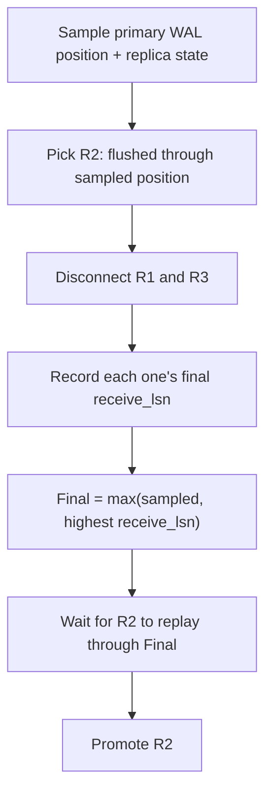

## What happened

PlanetScale described how Neki, its Postgres sharding system, performs a planned switchover. A Neki shard has one Postgres primary and several replicas. Sometimes a replica has to become the primary, for example to replace a Kubernetes pod, upgrade a kernel, or move the primary to another cell.

The post splits the operation into three parts:

1. **Preflight validation.** Admin, the control plane, checks the shard and finds a viable replica. The primary serves normally during this.
2. **Convergence and promotion.** One replica is brought fully up to date and promoted.
3. **Client recovery.** Queries meant for the old primary reach the new one.

Only parts 2 and 3 disrupt anything. The post is about shrinking those windows. It gives no timing numbers, so there are no benchmarks to quote.

## Why it matters

Managed Postgres at scale means constant lifecycle work: node replacement, kernel patches, cell moves, version upgrades and shard resizes. Each of these ends in a primary change. If every switchover produces errors, routine maintenance becomes a customer-visible incident. The post says this mechanism is the foundation for shard resizes, version upgrades and other lifecycle operations.

The post also shows a general idea: separate planned from unplanned events. Many HA tools use the same code path for both and inherit the conservatism of the failure case. A planned path can use information and cooperation that a failover path doesn't have. If you run Postgres with Patroni, a custom operator, or any leader-based datastore, this applies directly.

## How it works

### Why planned is easier

An unplanned failover must first confirm that the primary has really failed. Promoting while the old primary can still take writes risks two primaries. In a planned switchover the primary is stepping aside on purpose, so Admin can validate everything beforehand. A failed check rejects the switchover and leaves the primary as it was.

### Fixing the final WAL position

The goal is to find the **final WAL position**, the last write-ahead log byte any commit could reach, so the target can replay exactly to it.

Patroni stops Postgres on the primary to get a clean final position. That is simple and proven. But going back to the old primary then means restarting it, and possibly rewinding it, before it takes writes.

Neki keeps the old primary running instead:

- Routers buffer primary-bound queries.
- The primary's default for new transactions is set to read-only.

This doesn't stop all writes. Existing transactions can still commit, sessions can override the default, and background processes can generate WAL. So Admin does more:

Once R1 and R3 are disconnected, they can't receive more WAL. Whatever they had is recorded, and the final position is fixed.

### Keeping synchronous replication honest

Neki uses `ANY 1` synchronous replication over all eligible replicas. One slow replica can't block commits while another can acknowledge. The catch is that the latest commit may have been acknowledged by any one of them.

- R2 must have flushed through the sampled position.
- The disconnected replicas' final positions become part of what R2 must replay.
- After the disconnects, R2 is the only streaming synchronous standby, so no new commit can be acknowledged without it.

Before promotion, Admin prepares R2's replication slots and synchronous configuration, then attaches the other replicas on a best-effort basis. At least one of them must show up in the configuration R2 applied. If none does, R2 would wait for acknowledgements it can never get, so Admin rolls back. After promotion, the old primary is rebuilt as a replica of R2 through the standard replica-creation flow and takes part in synchronous acknowledgements once it restarts.

### What the application sees

Routers hold primary-bound queries instead of sending them to Postgres, and replica reads are unaffected. When the switchover completes, Admin removes the signal and Routers replan each buffered query against the new topology. The result is extra latency, not failures.

This buffering is proactive. In an unplanned failure, buffering can only start after a query discovers the outage. Admin also doesn't wait for every Router to acknowledge the signal. Buffering reduces disruption but isn't needed for correctness.

### Validation

Before changing anything, Admin checks:

| Check | What it enforces |
|---|---|
| Shard state | Only explicitly accepted states proceed. Replication lag and divergent timelines block it. |
| Target | Even an operator-named target must be viable. |
| Logical failover slots | They must be copied to the candidate. |
| Postgres capacity | The candidate's settings must be compatible with all replicas. A replica can't follow a primary with larger `max_connections` or `max_worker_processes`. |

Some checks can only run after initiation. The target must have flushed and replayed through the required positions. It must hold all needed replication slots, including failover slots created since preflight. It must have at least one attached replica in its synchronous configuration. Any failure triggers rollback, and promotion happens only after all checks pass.

### Timeouts and rollback

The primary is read-only during convergence, so Admin can't wait forever. The switchover has a deadline. On timeout, Admin reloads configuration to make the primary writable again and reconnects R1 and R3. Service is restored immediately. This is the payoff of not stopping Postgres.

## Trade-offs and open questions

- **Bounded buffering.** The buffer is finite and each query has a deadline. If the switchover runs long or the buffer fills, queries fail. The post gives no sizing or timing figures.
- **Read-only default isn't a fence.** Existing transactions, session overrides and background WAL are why the position-sampling dance is needed. The design is more intricate than "stop Postgres", and that complexity is the price of fast rollback.
- **Synchronous-only guarantee.** The no-lost-commits claim depends on Neki's synchronous durability policy and `synchronous_commit = on`. Workloads that relax it don't get the same promise.
- **Best-effort router signaling.** Routers that miss the signal aren't a correctness problem, but they won't buffer, so their clients may see errors instead of delay.
- **Old primary rebuild.** The old primary is rebuilt as a replica through the standard flow rather than rewound. That keeps things uniform, but the cost of the rebuild is not discussed.
- **Comparison with Patroni.** Patroni's approach is simpler and well proven. Neki's is more complex but keeps the primary available for rollback. The post doesn't give a head-to-head measurement.

## What you can apply

- **Split your paths.** Don't reuse failover logic for planned moves. Validate first, and only then touch the primary.
- **Prefer reversible steps.** Making a primary read-only by default and un-doing it with a config reload is cheaper to roll back than a shutdown and restart.
- **Compute the final position explicitly.** Don't trust a single sample. Take the max of the sampled primary position and the final `receive_lsn` of every replica you disconnect. Then wait for the target to replay through it.
- **Check sync-standby topology before promotion.** With quorum sync replication, confirm the new primary has at least one attached standby in its synchronous configuration. Otherwise commits will hang.
- **Re-check after initiation.** Slots and positions change during the operation, so some validation must be repeated inside it.
- **Set a hard deadline with a defined rollback.** Because writes are blocked, decide how long you'll wait and what restores service when time runs out.
- **Buffer at the proxy.** If you have a routing tier, holding queries during the switch turns errors into latency. Size the buffer and per-query deadline to your expected switchover window.
- **Check config compatibility ahead of time.** Settings like `max_connections` and `max_worker_processes` can stop a replica from following a primary.

## Glossary

- **Planned switchover:** A deliberate, routine promotion of a replica to primary, with the old primary cooperating.
- **Unplanned failover:** Promotion after unexpected primary failure, which requires failure detection.
- **WAL (write-ahead log):** Postgres's ordered log of changes, used for durability and replication.
- **LSN:** Log sequence number, a position in the WAL. `receive_lsn` is how far a replica has received.
- **`ANY 1` synchronous replication:** A commit waits for acknowledgement from any one of the listed standbys.
- **Router:** Neki's query-routing tier, which buffers primary-bound queries during a switchover.
- **Admin:** Neki's control plane, which validates and orchestrates the switchover.
- **Logical failover slot:** A logical replication slot that must be present on the new primary so consumers continue after promotion.
- **Cell:** A placement or failure domain to which a primary can be moved.
