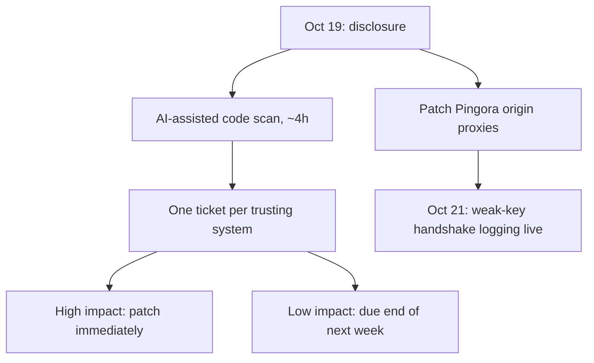

## What happened

On October 19, 2026, Cloudflare learned that eMudhra had eight weak intermediate signing keys. The key-generation process produced keys from very small values: 4, 56, 66, 115, 155, 156, 230 and 237. A real key should come from a vast number. Because of this, the private keys can be derived from the public certificates, so anyone can issue certificates under those intermediates.

eMudhra said it is leaving the public CA business. It blamed a mistake in a key generation script but hasn't published the script. The post also says eMudhra signed a certificate revocation list (CRL) with what may have been a correct key, then reissued it signed with the weak key. Open questions remain about why auditors and cross-signers didn't catch the problem.

This post is Cloudflare's follow-up. It covers how Cloudflare patched, what attempted exploitation it saw, and how many clients still trust the weak chain.

## Why it matters

The Web PKI (public key infrastructure) rests on one assumption: only the CA can sign with its key. Here that assumption failed completely. Earlier CA incidents (DigiNotar, TÜRKTRUST, Trustwave) involved keys that were stolen or misused. In those cases key access was more contained. In this one, anyone can derive the keys, so anyone can mint a certificate for any domain.

Any client that doesn't enforce CT can accept such forgeries. CT is a public log requirement that makes mis-issued certificates visible. One forged certificate was dated October 20 at 18:19 UTC, less than an hour after Mozilla's bug report became public. That shows how quickly people act on a disclosure.

It also fits a wider trend. The post says vulnerabilities are being found faster than ever, while trust stores and clients update slowly. Anyone who runs clients, SDKs, IoT fleets, proxies or private trust configurations should care.

## How it works

**The flaw.** An RSA key pair is built from large secret primes. The security rests on the secret values being unpredictable. If they come from tiny, guessable values, an attacker can recompute the private key from the public certificate. The post doesn't detail the exact math or the script, and eMudhra hasn't released the script, so the precise failure mode is unconfirmed. The post says only that small values such as 4 were used where a ~115-digit number was expected.

**Attack path.** With a derived intermediate key, an attacker signs a leaf certificate for any domain. The chain then leads to a root that clients already trust. The client accepts it unless it has been patched to distrust the intermediates, or it requires CT proof (signed certificate timestamps, SCTs).

**Cloudflare's patch and discovery flow:**

**Measuring attacks on Cloudflare.** Pingora logged handshakes where the peer presented a weak-key certificate. Once all verified connections were patched, they were refused.

| Observation (~1 week) | Result |
|---|---|
| Attempted handshakes | ~22,000 |
| Test-site fetches | ~two-thirds |
| Mostly self-issued origin certificates | most of the rest |
| Unusual (other orgs' SANs, some IoT, validity over 2 years) | ~160 |

The odd ~160 looked like servers' default certificates, not interception. Several appeared from many Cloudflare locations, which fits the servers themselves presenting them.

**Measuring client exposure.** Cloudflare can't test visitors directly without breaking connections. So a fraction of challenge pages ran two probes: one to a test host with a weak-key chain, and one to a control host with a normal chain. If the weak probe succeeds, the client trusts the compromised chain. About 50 million probes were recorded. The post says the setup changed several times (control endpoint tweaks, SCT removal, adding a G3 cross-sign, a rollback, and a ramp from 1% to 10% on non-paying zones), so readers should treat the figures as approximate.

Findings:
- Modern up-to-date browsers are mostly patched.
- Bots, old browsers and embedded browsers like Android WebView lag.
- Patching was visible over the first weekend, then acceptance stalled.
- A new bot-detection change on October 29 reclassified a wave of fake "Chrome 150–154 on macOS" traffic. That made acceptance appear to drop when it hadn't.
- Chrome 150–154 on Linux is the exception, with acceptance still declining, though Cloudflare calls that only suggestive.

## Trade-offs and open questions

- **Measurement bias.** Traffic is skewed by unconfirmed bots. Only clients running JavaScript send probes. Probe settings changed mid-experiment. So the numbers show direction, not precise prevalence.
- **No evidence is not evidence of absence.** Cloudflare saw no interception on its own connections and no indirect signs of compromise. A targeted attack against specific victims could still have gone unseen.
- **Unanswered CA questions.** Why audits and cross-signers missed it, what the script did, and what the odd CRL signing means are all unexplained.
- **Scope of the AI-assisted analysis.** The post reports speed (about four hours, one ticket per system) but gives no accuracy or false-negative data.
- **Revocation is weak here.** The incident exposes how slow it is to distrust an intermediate across a heterogeneous client population. Browser updates help, but long-tail clients stay exposed.

## What you can apply

- **Know where you trust things.** Cloudflare's first step was finding every system that trusts the affected CA. Keep an inventory of trust stores, pinned roots and custom verification code, so you can run this search in hours.
- **Patch by blast radius.** Cloudflare fixed the proxies that handle most outbound connections first, then ticketed the rest with deadlines. Triage by exposure the same way.
- **Add telemetry before you need it.** Logging handshakes that present a known-bad chain gave real data on attempts and showed whether the patches held. Build "log and reject" hooks for distrusted issuers.
- **Enforce CT where you can.** The post says clients without CT enforcement accept forgeries. Clients you control should require SCTs.
- **Check old clients.** Look at embedded browsers, WebViews, IoT devices and bots. These are the stragglers. Plan for out-of-band updates of trust data.
- **Consider dynamic trust stores.** The post points to projects like upki that treat trust stores as updatable, with fast revocation and CT-key updates.
- **Act now if you're affected.** The post points to Dennis Jackson's crowdsourced site (emudhra.we-have-a-problem.com) for patch instructions, including a macOS developer guide. Cloudflare customers using WARP or Tunnel should follow the earlier Cloudflare post on customer actions.

## Glossary

- **CA (certificate authority):** an organization trusted to sign certificates that vouch for domain ownership.
- **Intermediate certificate:** a CA certificate signed by a root, used to issue leaf certificates. If its private key leaks, anyone holding it can mint certificates.
- **Certificate Transparency (CT):** public append-only logs of issued certificates. They make mis-issuance detectable.
- **SCT (signed certificate timestamp):** proof that a certificate was submitted to a CT log. Clients enforcing CT require it.
- **CRL (certificate revocation list):** a signed list of revoked certificates.
- **Pingora:** Cloudflare's proxy framework, used for origin-facing connections.
- **SAN (Subject Alternative Name):** the field listing the domains a certificate covers.
- **Trust store:** the set of root and intermediate certificates a client trusts.
- **Cross-sign:** a CA certificate signed by a different root, creating an alternate path to trust.
