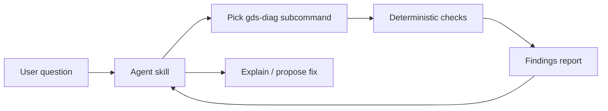

## What happened

NVIDIA's GDS team published `gds-diag`, a command-line assessment tool in the Magnum IO repository. You clone the repository and run the script, and there is nothing else to install. It needs Linux and Python 3.8 or newer. GDS itself needs a datacenter-class NVIDIA GPU and CUDA Toolkit 12.2 or newer. `gds-diag` doesn't depend on either of those to run.

GDS is NVIDIA's direct data path between GPUs and storage. Its aim is more bandwidth, lower latency, and less CPU and memory use. In practice a GDS setup has many moving parts: the GPU, the CUDA version, the driver, the filesystem, the mount, the config files, and for containers the runtime. `gds-diag` checks these in an organized way.

## Why it matters

Feeding GPUs from storage is a common bottleneck in training, data loading, checkpointing and inference. GDS is meant to help, but it can fail quietly. A misconfigured system may still work through a slower fallback path, and the source lists a "compat-only" category of storage routes. A system can appear to work while not delivering the speed-up you expected.

The usual debugging process is to read the docs, compare config files by eye, and guess why a container behaves differently from the host. A tool that audits each layer and points to the relevant doc section shortens that loop. This matters most to platform and infrastructure engineers who run mixed fleets of bare metal, VMs, containers and Kubernetes.

It also fits a wider trend: diagnostic tooling paired with an AI agent front end. In this design the checks are deterministic and the agent only picks and explains them. That keeps the reliability of a script and adds a friendlier interface.

## How it works

You can use the tool in two ways: run the CLI directly (`gds-diag.py --help`, then `<subcommand> --help`), or open the directory in a coding assistant and ask questions in plain language.

### Subcommands

| Stage | Subcommand | Purpose |
|---|---|---|
| End-to-end | `all` | Picks and runs suitable checks for a path on bare metal, VM or container |
| Before install | `pre-install` | Checks GPU support and the CUDA Toolkit |
| Before install | `support-matrix` | Shows supported storage targets |
| After install | `post-install` | Checks GDS is installed correctly |
| After install | `config-audit` | Reviews config files and environment variables |
| Deep dive | `container-check` | Covers containerd, Docker, Enroot and Kubernetes |
| Deep dive | `mount-check` | Examines a specific mount point or directory |

### Options

- `--verbose` shows PASS findings, which are hidden by default.
- `--json` emits structured reports for automation.
- `--static` or `--live` (for `support-matrix`) chooses general data or data from the current system.
- `--config` (for `config-audit`) points at a candidate configuration file.

### Findings

Output is grouped into sections with status badges:

- **FAIL:** a hard blocker.
- **WARN:** a potential blocker.
- **INFO:** notable information.
- **PASS:** nominal.

Each finding has an explanation, a mitigation plan and a documentation reference.

The support matrix is a color-coded table with footnotes. Green means fully supported, yellow means supported with caveats, and red means unsupported. Routes are grouped into local file systems, remote file systems, storage paths, and compat-only. Most distributed storage vendors appear to the OS as `nfs` or `nfs4`, so one row covers many products.

### Agent flow

The source gives two demos:

- **Config audit:** `config-audit --config` flagged a misspelled entry in a candidate `cufile.json`. After the fix, it confirmed the file was valid and added some hints.
- **Container diagnosis:** An agent (Claude Code CLI) read the container launch script, picked a suitable tool, found why GDS wasn't available in the container, and proposed a fix. It applied the fix after confirmation.

The skill activates automatically inside the repository, or you can call it with `/gds-diag`. Example questions are whether a system is eligible for GDS, whether GDS is available for a given path, and which NVMe device has the best locality to a given GPU.

## Trade-offs and open questions

- **It diagnoses and doesn't remediate.** That is safe, but you still have to carry out the fixes. The agent can do this on request, so review what it proposes before approving.
- **Coverage is early.** The source says the modular design is meant to allow future checks for network transports, object storage and application frameworks. Today's coverage of those areas is not described, so don't assume it exists.
- **It doesn't measure performance.** A clean report says the setup is eligible and configured correctly. It doesn't say you will get a given throughput. The article gives no benchmarks, so you still need to run your own workload tests.
- **Agent mode is non-deterministic.** The CLI is described as deterministic. The agent layer routes and interprets, so for CI or audits use the CLI with `--json`.
- **The source is thin on the details.** It doesn't cover P2P versus compat modes, specific `cufile.json` options, filesystem or driver specifics, or cloud notes. Read the GDS docs for those.

## What you can apply

1. **Make it a pre-flight gate.** Run `gds-diag.py all` on a new node image or storage path, and use `--json` to fail a pipeline on FAIL findings. Treat WARN as something to review.
2. **Audit config changes before rollout.** Use `config-audit --config <candidate>` to catch typos in `cufile.json` before you deploy it. The source's demo caught exactly this kind of mistake.
3. **Debug containers separately from hosts.** If GDS works on the host but not in a pod, run `container-check` for your runtime (containerd, Docker, Enroot or Kubernetes).
4. **Check the mount you actually use.** `mount-check` on the real dataset or checkpoint directory is more informative than a host-wide check. Use `support-matrix --live` to compare your filesystem against the supported list.
5. **Be careful with NFS.** Because many distributed storage products show up as `nfs` or `nfs4`, don't assume your vendor is covered. Check the caveats in the matrix row and the vendor docs.
6. **Verify with a real workload.** After the checks pass, measure throughput and CPU use with and without GDS on your own data to confirm the benefit.
7. **Use the agent for exploration, the CLI for records.** Ask the agent things like which NVMe device is closest to a GPU. Save the CLI output as the evidence you keep.

The code is Apache 2.0 and the agent skill is CC BY 4.0, so you can adapt both.

## Glossary

- **GPUDirect Storage (GDS):** NVIDIA's direct data path between GPUs and storage, intended to cut latency and CPU and memory overhead.
- **`gds-diag`:** Open-source CLI that assesses GDS readiness and configuration.
- **Agent skill:** An add-on that lets a coding assistant pick and run `gds-diag` subcommands and interpret the results.
- **`cufile.json`:** The GDS configuration file that `config-audit` checks.
- **Compat-only:** Storage routes that work only through a compatibility path rather than the direct one. The source uses the label in the support matrix without defining it.
- **Support matrix:** A color-coded table of storage targets and their GDS support level.
- **FAIL / WARN / INFO / PASS:** The finding severities, from hard blocker to nominal.
- **Enroot:** A container runtime that `container-check` covers.
