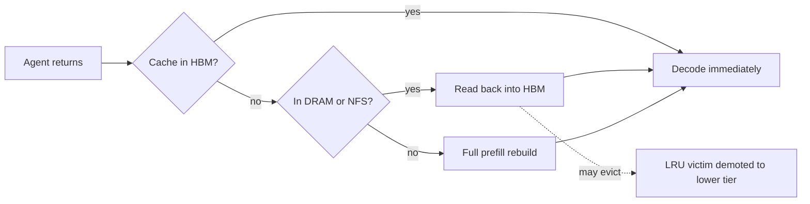
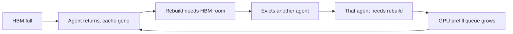

## What happened

Pure Storage, branded Everpure on its blog, published a post on Pure KVA. KVA is a KV cache backend for LLM inference engines. The authors are Jean-Baptiste Chenailler and Robert Alvarez.

The post argues that long-running agents expose a weakness in GPU-only KV caching. When a returning agent's cache has been evicted, the engine must redo the prefill. Pure KVA stores evicted caches in lower tiers so they can be restored.

The headline test used Gemma-4 26B on one endpoint. With KVA, returning-turn latency stayed near a few tenths of a second for 40 agents. Without it, latency degraded to tens of seconds.

## Why it matters

Agent workloads differ from chat. A human pauses for minutes between messages. An agent calls a tool, gets a result and comes back in seconds. It also carries a large context of documents, tool output and history. Many such sessions compete for the same limited GPU memory.

The result is a capacity cliff. The article warns that a pilot with 15 agents can look fine while 40 agents are far slower. Capacity planning from small tests is therefore risky.

The latency compounds over a task. By the article's arithmetic, an agent at 0.1 s TTFT completes about 4 turns a minute. At 45 s it completes about 1. A 60-turn task takes about 15 minutes in the first case and about an hour in the second.

This fits a wider trend. KV cache is becoming a tiered data-management problem, much like a database buffer pool, with HBM, DRAM and shared storage. That is why a storage vendor is writing about inference throughput.

## How it works

**Cache size.** KV cache size is 2 × layers × kv_heads × head_dim × tokens × dtype_bytes. The article's example is a 32B model with 64 layers, 8 KV heads, head dim 128 and fp8 storage. That needs about 131 KB per token. A 28K-token conversation is about 3.7 GB, and 40 of them need about 150 GB. That is more than a typical HBM budget leaves after weights.

**Architecture.** Pure KVA has three parts:

- an inference-engine plugin (vLLM in the tests)
- a service running beside the engine
- enterprise storage underneath

It manages these tiers:

| Tier | Role |
|---|---|
| GPU HBM | Active conversations; smallest and most contended |
| Host DRAM | Closest tier for fast restores |
| NFS | Shared across the fleet, so a cache written on one node can be restored on another |
| S3 | Also supported |

**Eviction still happens.** HBM is the same size, and LRU eviction still runs. The difference is that an evicted cache is kept instead of discarded. A restore still needs HBM room, so it can evict another conversation. That conversation can also come back with a read.

**Why restore beats rebuild.** Prefill cost grows roughly O(n²) with context length because of attention. A restore is bandwidth-bound and roughly O(n). In a standalone test on an idle server (40 prompts, 5.5K–118K tokens), NFS restore was about 10× faster than rebuild at agent-scale contexts. It was 32× faster at 118K tokens.

**The cascade without a lower tier.**

**The load test.**

- 40 agents joined one every 15 s, and all were live by 10 minutes.
- Each loaded 10 documents on turn 1 (about 22K–33K tokens).
- Think time averaged about 15 s, with 64-token outputs, in a closed loop. Each agent planned 60 turns.
- Both runs used the same seed and lasted 750 s.

Results:

- Both setups answered in about 0.1 s until roughly 22 agents were live, at about 5.6 minutes.
- Without KVA, the median reached 17 s within about 30 s of that point. It was 31 s at 8 minutes and about 45 s at the end.
- With KVA, the median stayed between 0.11 and 0.30 s. The 0.30 s peak came as the last agents arrived, and it fell back to 0.12 s within a minute.
- The slowest KVA turn was 4.6 s, and it was a first turn.
- First-turn medians were similar: 2.1 s with KVA and 2.3 s without.
- Prompt sizes stayed between 21.8K and 34.1K tokens, so the slowdown came from HBM overflow and not from growing prompts.

**Setup.** The test used Pure KVA 1.2 over NFSv4.1 (with nconnect for the standalone sweep), vLLM, and a 32 GiB host-memory tier. Telemetry ran every 3 s. The harness used 50 client workers and 2,400 planned turns. Think time was normal-distributed (mean 15 s, spread 10 s, floored at 0).

## Trade-offs and open questions

- **Vendor benchmark.** It is one model (Gemma-4 26B), one endpoint, one synthetic closed-loop workload and one storage setup. The article doesn't say which NFS hardware was used. It also gives no numbers for restore bandwidth or storage load. Treat 2× as an illustration and not a guarantee.
- **Workload fit.** Gains depend on agents returning to contexts that were already cached. Short contexts, few agents or long think times reduce the benefit. At 15 agents the baseline was already fine.
- **Restores still cost HBM and bandwidth.** A restore needs HBM room and can evict another conversation. Heavy restore traffic could therefore still thrash if the working set is far larger than HBM. The article doesn't test that limit.
- **Latency of restores.** KVA's median stays near 0.1–0.3 s, but the cold first turn (about 2 s) is unchanged. NFS restores will be slower than DRAM restores. The tiers' separate contributions weren't broken out in the summary I could read.
- **Alternatives.** You can add GPUs (about 1.8× HBM, roughly twice the GPUs, per the article). You can cap concurrency below the overflow point. You can also use other KV offload options, such as the engine's own CPU offload or open-source cache layers. The article doesn't benchmark these.
- **Source limits.** I could only read a condensed version of the post. Some details, such as the exact pass/fail criteria for the 1.8× claim, may be missing here.

## What you can apply

- **Load-test past the cliff.** Ramp concurrency until HBM overflows, and watch returning-turn TTFT separately from first-turn TTFT. A pilot at low concurrency can hide this.
- **Measure the right signals.** Track prefix-cache hit rate, KV usage and the prefill queue depth. Hit rate falling as TTFT rises points to eviction-driven rebuilds, as opposed to growing prompts.
- **Do the sizing math.** Compute bytes per token (2 × layers × kv_heads × head_dim × dtype) and multiply by the expected concurrent contexts. Compare the result with the HBM left after weights.
- **Use realistic think times.** Agent pauses of seconds, not minutes, change eviction behavior. Replay your own tool-call timing.
- **If you adopt a tiered cache:**
  - Size host DRAM for the hot set.
  - Use shared NFS if requests may land on different nodes. A cache written on one node can then be restored on another.
  - Check NFS throughput, for example with multiple connections.
  - Treat the cache as disposable. A miss should fall back to a rebuild and not a failure.
- **Prefer cache-aware routing and stable prompt prefixes.** Without them, even a tiered cache can't be reused.

## Glossary

- **KV cache:** stored attention keys and values for prior tokens, which let a model avoid recomputing context.
- **Prefill:** the pass that processes the prompt and builds the KV cache. Its cost grows roughly quadratically with length.
- **TTFT:** time to first token, the latency before a response begins streaming.
- **HBM:** high-bandwidth memory on the GPU; fast, small and contended.
- **Eviction (LRU):** dropping the least recently used cache entries to free space.
- **Tiered cache:** layered storage of KV data across HBM, host DRAM and NFS or S3.
- **Closed-loop load:** each simulated agent sends its next request only after the previous reply and a think time.
- **nconnect:** an NFS mount option that opens multiple TCP connections to raise throughput.
